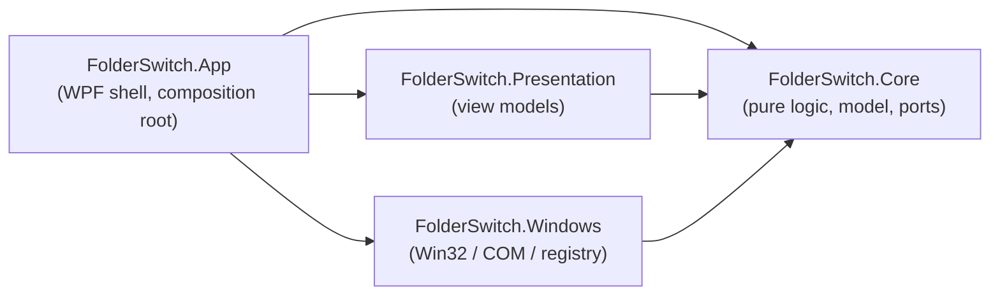
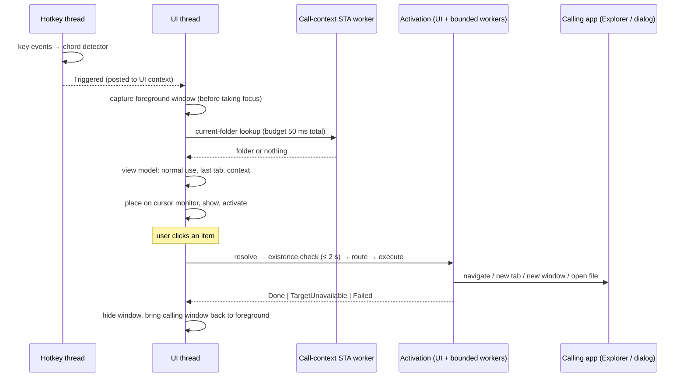

# Project software architecture
**Software architecture only** — everything there is to know about the project's technical and software architecture. Features do not belong here, nor does `CODEMAP.md`. This file is **self-contained, with no outgoing links**.

---

## 1. Shape of the system

FolderSwitch is a **resident Windows desktop process** (C# on .NET 10, WPF). It starts with the user's session, builds its only window once, hides it, and then waits. A global shortcut, a click on the notification-area icon or a second launch shows the window that already exists; closing it only hides it. Nothing of the UI is created or destroyed at call time, which is what keeps the time between the shortcut and the first frame short.

Four principles drive the design:

1. **Decisions are pure code, effects sit at the edges.** What a click does for a given calling window, how a shortcut is validated, how a theme is resolved, how a configuration is repaired: all of it is plain functions over plain data, testable on any machine. Everything that touches Win32, COM, the registry or WPF is behind an interface and kept thin.
2. **The UI thread never waits for something unbounded.** Every call into another process (Explorer, a file dialog, a network path) has a time budget, runs off the UI thread or in a bounded way, and degrades to "unknown" or "failed" instead of hanging.
3. **Services do not throw to their callers.** Expected failures are values (`false`, `null`, an outcome enum, an issue list). The few exceptions that cross a boundary (a failed launch, a keyboard hook that could not be installed, a file or registry write that was refused) are documented there and caught by name.
4. **The process must stay alive and consistent.** An ordinary exception on the UI thread is logged and survived; only an exception after which the process cannot be trusted ends it, and everything that holds a system-wide resource (keyboard hook, mutex, notification icon) is released on every exit path.

## 2. Solution structure

| Project | Target | Role |
|---|---|---|
| `FolderSwitch.Core` | `net10.0` | The domain: configuration model, board editing rules, activation routing, window classification, shortcut rules, layout and placement maths, theme catalog and colour maths, localization, configuration persistence, update-announcement rules. **No reference to Windows, WPF or any package.** Also defines the *ports*: the interfaces for everything that needs the operating system. |
| `FolderSwitch.Presentation` | `net10.0` | MVVM view models (main board, appearance, settings, shortcut editor, first-run wizard) and the three UI-facing ports (`IConfigPersistence`, `IUserPrompts`, `IWindowHost`). Depends on Core and `CommunityToolkit.Mvvm` only: no WPF types. |
| `FolderSwitch.Windows` | `net10.0-windows` | Implements the Core ports against the operating system: global shortcut, call-context capture, Explorer control, file-dialog inspection and navigation, shell launch, path resolution, foreground activation, single instance, autostart, system information, monitors, window frame. Depends on Core only. Win32 flat APIs are generated by CsWin32 (the list is `NativeMethods.txt`); shell COM interfaces are hand-declared. |
| `FolderSwitch.App` | `net10.0-windows`, WPF, `WinExe` named `FolderSwitch` | The shell: entry point, startup and composition, the main window and every view, theme resources, notification-area icon, prompts, update checker, diagnostics (log, self-test, snapshots), translation files. The only project that references the other three. |
| `tools/FolderSwitch.IconBuilder` | `net10.0-windows`, WPF | Development tool that renders the application icon into `assets/icon` (an `.ico` and PNG files). It compiles the App's single icon-drawing source file as is, so that the icon file and the icon drawn in the title bars cannot drift apart. |
| `tests/*` | see section 15 | Four test projects and `DialogHost`, a helper executable. |

**Why this split.**

- Dependencies point one way, toward Core. Presentation and Windows know nothing of each other; only the composition root in App connects them. A view model never sees a Win32 type, and a Win32 service never sees a view model.
- The *ports live where they are consumed*. Core owns the interfaces its logic needs (`IExplorerController`, `IFileDialogNavigator`, `IShellLauncher`, `IPathResolver`, `IItemActivator`, `ICallContextProvider`, `IHotkeyService`, `IForegroundActivator`, `ISystemInfo`, `IAutostart`, `IKeyNames`); Presentation owns the three it needs from the UI shell. Windows implements the operating-system ones (Core's own activation service implements `IItemActivator`), and App implements the UI-facing ones. Tests, the snapshot mode and the first-run wizard substitute their own implementations without a mock framework.
- Pure logic is kept out of the platform project on purpose. Windows *gathers facts* (the class name, process and child windows of a window as a `WindowInfo`; where a file dialog stands after an OK) and Core *decides* (is it Explorer, a file dialog, or something else? may the dialog's file name box get its text back?). The behaviour table of a click (calling context × Windows generation × item kind → action) is one pure function. The App keeps a few decisions of its own (what a press of the shortcut does, the error breaker) as pure functions too, tested without a window.
- Presentation is separate from App so that all view-model behaviour (every edit, every refusal, save-once rules, rename, activation outcome handling) is tested at unit-test speed without a dispatcher.

**Cross-cutting build settings.** Nullable reference types and implicit usings are on everywhere; warnings are errors. Package versions are managed centrally. The SDK is pinned by `global.json`. The Windows project exposes its internals to its integration tests only; those internals are the test seams (injectable time budgets, a fake keyboard, a replaceable existence probe).

**Interop strategy.** Flat Win32 APIs go through CsWin32 source generation. Shell COM interfaces (`IShellWindows`, `IWebBrowser2`, `IShellBrowser`, `IFolderView`, `IShellFolder` and friends) are declared by hand with `[ComImport]` and `[PreserveSig]`, early-bound, declaring only the vtable slots used: the generated projection throws on failure HRESULTs where these lookups expect failures (a window closed meanwhile, a virtual folder with no view), is architecture-specific for `IShellBrowser`, and a dynamic binder would cost more on first use than the whole call-context budget.

## 3. Process lifecycle

### 3.1 Entry and startup order

`Program.Main` (STA) does, in order:

1. **Velopack hooks** (`VelopackApp.Build()...Run()`), before anything else: on install, update and uninstall events the matching hook runs and the process ends. The before-uninstall hook removes the autostart registry value.
2. Option parsing: `--self-test`, `--snapshot <dir>`. A self-test gets a throwaway configuration folder; a snapshot run touches no user data.
3. Opens the debug log, installs the last-resort handlers (`AppDomain.UnhandledException`, `TaskScheduler.UnobservedTaskException`, both only log).
4. Creates the UI thread's `SynchronizationContext` before anything that posts to it.
5. **Single instance**: acquires a per-session named mutex. A later launch signals a named auto-reset event and exits with code 0; the running instance raises an event on the UI context and shows its window.
6. Creates the WPF `App` (explicit shutdown only, no startup URI, no generated `Main`) and runs the dispatcher.

`App.OnStartup` runs `Composition.Build()`, which constructs, in this order:

1. System information (starts watching the Windows application-theme registry value).
2. The localizer, from the translation files next to the executable, started in the Windows display language.
3. The configuration: load (with repair, see section 8), startup backup, then the configured language.
4. The prompt service, the persistence adapter, autostart, foreground activator.
5. The Windows services: hotkey service (its own thread starts and installs nothing yet), call-context provider (its STA worker is pre-warmed), Explorer controller, file-dialog navigator.
6. The activation service, given the Windows generation reported by the system-information service (one source of truth).
7. **First-run wizard**, modal, shown once the services above exist but *before the shortcut is registered and the view models and the window are built*, only if the configuration says the first run is not complete. Closing it without finishing saves nothing and makes the application quit; the next start shows it again. While its shortcut step is shown it registers the candidate shortcut temporarily for its test zone and releases it afterwards. It has its own theme resources, merged into the application resources and removed when it closes.
8. Registration of the configured shortcut. A refusal does not stop startup: it becomes a startup notice.
9. The window controller, the view models (main, appearance), then the **theme applier**, which puts the theme's resources into the application resources *before the window exists*.
10. The update checker (absent without a feed address, in a self-test, and in a copy that is not installed by Velopack), the shortcut-editor and settings view models.
11. **The main window, built once for the life of the process**, handed to the window controller.
12. The notification-area icon.
13. Wiring of the user triggers: shortcut, second launch, icon menu, update events. Starts the update timer.

Then `WindowController.Prerender` shows the window **once, off-screen, without activating it** (far outside every monitor), waits for `ContentRendered`, hides it and signals ready. First layout, template expansion, font and resource loading therefore happen at startup, not at the first call. After the ready signal, a start that just completed the first run shows one notification of the icon naming the shortcut (only if it was registered), and startup notices (a configuration restored from backup or reset, a shortcut that could not be registered, a configuration that could not be read) are shown one after another at background priority.

### 3.2 Steady state

The process is idle: the UI dispatcher, the hotkey thread blocked in its message loop, the single-instance thread blocked on its handles, an update timer, a registry-change wait. A call before the pre-render has finished is accepted: the window is already up off-screen and is simply placed.

### 3.3 Shutdown

`Quit` (notification menu, an update ready to apply, the error breaker, a fatal startup error) disposes the composition once: first the *sources of input* (trigger wiring, update checker, shortcut service and its hook, single instance, notification icon) so nothing fires during teardown, then the window, view models and theme applier, then the system-information watch, call-context provider, Explorer controller and file-dialog navigator. Each step is independent: a failing step is logged and the rest still run. Disposal is also reached from `OnExit` (session end) and, best effort, after a critical error escaped `Application.Run`.

### 3.4 Non-resident modes

- `--self-test`: composes everything with the **real** services, builds and renders the main window off-screen, then exits. Throwaway configuration and log folder (deleted on success, kept on failure), its own single-instance name, notification icon built but never shown, prompts silent, no trigger wired (the keyboard hook is installed, a press reaches nothing), first run and updates skipped. A watchdog fails it after 5 s. Exit codes: 0 pass, 1 failed to start or another self-test is running, 2 timeout, 3 an exception reached the dispatcher.
- `--snapshot <dir> [--snapshot-language <code>]`: draws the main view and the wizard to PNG files, off-screen, with inert service implementations built on a sample configuration. No single instance, no user configuration, no window shown. Exit code 0 when every file was written.

## 4. Runtime flow: shortcut, context, display, activation, focus return

1. **Trigger.** The hotkey service raises `Triggered` on the UI context (section 6.1). The composition reads what is on screen (window shown, a FolderSwitch window in the foreground, settings panel open, one of FolderSwitch's own boxes open) and a pure routing function decides: a hidden window is *shown*; a window in front *hides*; a window on screen but behind another one (only Customize mode leaves it so) is *recalled*: the foreground window is captured as the new calling window, the view model keeps its mode and tab, and the window comes to the front where it is; with a box of FolderSwitch's own open, nothing happens; with the settings panel open, the trigger goes to the shortcut editor's test zone, which confirms it only when the combination shown is the one in effect (otherwise it asks to apply it first). The notification icon and a second launch call *open* instead (show, or bring to the front; never hide).
2. **Call context, first.** Before FolderSwitch takes the focus, the foreground window is captured (section 6.2) into an immutable `CallContext` (kind: Explorer, file dialog or other; window handle; current folder when it could be read in time, with the name the shell shows for it).
3. **Display.** The main view model is told the window is about to appear: it resets to normal use, ends any rename, selects the last active tab and stores the context. The window is then placed (section 7.4), shown, activated and forced to the foreground. The time from trigger to first rendered frame is written to the log.
4. **Click.** The view hands the click (with the Ctrl state) to the view model, which ignores it in Customize mode or while a previous click is still running. The activator pipeline is:
   - `FocusReturningActivator` (App) wraps the activation service to remember the call it belongs to;
   - `ActivationService` (Core) resolves the item to a path (known folder or environment-variable expansion; no I/O), checks the target exists within 2 s (skipped for `shell:` and `::{CLSID}` forms), asks the pure `ActivationRouter` for a plan (an action plus an optional fallback), and runs it on the caller's context through the Explorer controller, the file-dialog navigator or the shell launcher. A primary action that fails or throws triggers the fallback (whatever targets the calling Explorer window, a navigation or a new tab, falls back to a new window: that window may be gone or hung). Any ordinary exception becomes `Failed`; a critical one is let through (section 11). Every outcome other than a plain success is described to a sink the composition gives it (the plan, the target, the exception), which writes it to the log.
5. **Outcome.** `Done` (done in the calling window) and `OpenedElsewhere` (a new window, or a file in its application) hide the window; `TargetUnavailable` and `Failed` show an error and keep it open; `ReportedByShell` (the shell could not open a file and showed its own message) shows nothing more. An outcome that arrives after the window was shown again, or recalled, for another call is dropped (calls are numbered).
6. **Focus return.** When an item was opened in the calling Explorer window or file dialog (`Done`), the controller remembers that window for the hide that follows and brings it back to the foreground after hiding, because Windows does not reliably give it back. Not for `OpenedElsewhere`: what was opened is what must come to the front. It is forgotten by any other show or hide, so a later loss of focus never steals the focus.
7. **Loss of focus.** In normal use, deactivation of the window hides it, unless FolderSwitch's own prompts or pickers have the focus. Customize mode stays open.

## 5. Threads and time budgets

| Thread | Owner | Purpose |
|---|---|---|
| UI dispatcher (STA) | WPF | All views, view models, composition, activation continuations, all event handlers of services (they are posted here). |
| Hotkey thread | hotkey service | Win32 message loop with a message-only window: shortcut registration, session and resume notifications, the hook's re-arm timer, the low-level keyboard hook. Highest priority (not time-critical): keyboard input waits for its callback. Public methods of the service marshal onto it and wait. |
| STA worker "call context" | call-context provider | The folder lookup of Explorer windows and file dialogs. Every worker, the first and each replacement of an abandoned one, runs a warm-up first. |
| STA worker "Explorer control" | Explorer controller | COM navigation and new-tab work. |
| STA worker "file dialog navigation" | file-dialog navigator | Shell parsing, messages to the dialog, verification. |
| Single-instance thread | single-instance service | Owns the mutex, waits on the activation event. |
| Existence-check threads | path resolver | One short-lived thread per check of a path that may be slow. |
| Thread pool | various | The system-information registry wait, the activation service's existence task, update downloads. |

**STA worker contract** (one small class used by the three workers). A work item runs one at a time on a dedicated STA background thread; the caller waits with a timeout and gets *done* or *not in time*. A late result is dropped; an item not yet started when the caller gives up never starts. The thread cannot be killed, since a COM call into a hung process waits as long as that process does. So the **owner of the worker** (the call-context provider, the Explorer controller, the file-dialog navigator) **abandons** it (stops feeding it) and keeps **at most one abandoned worker**. While it is alive, calls fail or skip their lookup immediately instead of starting a second thread that would block the same way. When it ends, the next call starts a fresh worker. The Explorer controller and the file-dialog navigator also hand their work a cancellation token, cancelled on an overrun, so that work outliving its caller knows it was given up and must not take effect any more; the call-context lookup only reads and has none.

**Budgets** (defaults):

| Operation | Budget |
|---|---|
| Call-context capture (classification + folder lookup) | 50 ms in total; the kind and window are kept when the folder is not read in time (or while a new worker is still warming up, which is not abandoned for it unless its warm-up exceeds 5 s) |
| Each message sent to a dialog during inspection | 200 ms |
| Explorer navigation or new-tab work | 3 s (the tab must appear within 1 s and accept the navigation within 1 s more) |
| File-dialog navigation | 1.5 s (messages 500 ms each, one retry after 150 ms) |
| Existence check of an item's target | 2 s, enforced by the caller even if the resolver ignores it; at most 4 abandoned probes, and no new probe on a share (UNC, or mapped network drive) that already has a hung one |
| Update check | 60 s; first check 1 min after start, then every 24 h |

## 6. Operating-system integration

### 6.1 Global shortcut

One service, two mechanisms, chosen by the shortcut's shape.

- **Combination with a regular key**: `RegisterHotKey` (no auto-repeat) on the message-only window. A refusal means another application owns it, reported as an issue; the previously registered shortcut stays in effect.
- **Modifier-only combination** (the default, Ctrl + Win): `RegisterHotKey` cannot express it, so a **`WH_KEYBOARD_LL` hook** feeds a pure state machine (`ModifierChordDetector`): the chord is complete when all its modifiers have been down together and **everything is released with no other key in between**; any foreign key poisons the sequence. Triggering on release is what lets Windows shortcuts that start with the same modifiers keep working. When the Win key is released at the end of a clean chord, the hook injects a **mask key** (an unassigned virtual key) first, so the Start menu does not open. Injected events are ignored by the hook, so the mask never recurses.
- **The hook callback is minimal.** Windows holds keyboard input until it returns and silently removes a hook whose callback times out, telling nobody. So it only updates state, injects the mask key and *posts* messages; it never runs user code. Exceptions inside it are captured and rethrown from the message loop, never unwound through native code. The hook is installed only while needed (a modifier-only shortcut registered, a capture running, or a swallowed key pending).
- **The hook is kept alive.** Its thread runs at the highest priority short of time-critical, so that a loaded machine still runs the callback in time. And it is replaced by a fresh one (new hook first, then the old one removed, from the message loop, so that no event is lost or seen twice): when the session is unlocked or reconnected, when the system resumes from sleep (resume notifications asked for by window handle, since a message-only window receives no broadcast), and every 5 minutes by a timer, only while no capture runs and no modifier key is down (never in the middle of a chord; put off by a few seconds otherwise). Session changes and resume also reset the key state, since releases are not seen meanwhile.
- **Stuck-key protection.** Releases can be missed (secure desktop, an elevated window taking the input). Before each event the held-key set is reconciled against the system's asynchronous key state and detection restarts from scratch if a key is gone.
- **Capture mode** (shortcut editor): the hook is installed for the duration of a capture, whatever is registered. It reports either a modifier-only chord (modifiers released together) or modifiers plus a regular key, and swallows that key so the combination does nothing else; a key without modifier passes through. Win and Alt releases are masked so the Start menu and menu bars stay closed. The result is delivered once, on the UI context, and the capture then ends by itself or when its handle is disposed.
- **Validation is separate and pure** (`HotkeyRules`): no modifier or a single modifier alone is refused, a short list of combinations Windows keeps for itself is refused, Ctrl + Alt is only a warning (AltGr). "Taken by another application" can only be learned by trying; `Probe` registers and releases to find out, without disturbing the active registration.
- **Display.** Formatting is pure too. Letters, digits, function keys and the space bar are named by Core; any other key by the keyboard layout, through a Core port the Windows project implements with `MapVirtualKey` and `GetKeyNameText`; failing that, by a Core table of key-cap names, and as a last resort by its hexadecimal code.
- **Notifications** are posted to the UI context. Each carries a generation number and is dropped if the registration changed, was removed or the service was disposed before it ran.

### 6.2 Call context

`CallContextProvider.CaptureForeground` classifies `GetForegroundWindow` and, for Explorer and file dialogs, reads the current folder.

- **Classification is pure** (`WindowClassifier`) over a `WindowInfo` snapshot: the Win32 class, the owning process name (`PROCESS_QUERY_LIMITED_INFORMATION`, readable for most elevated processes) and the classes and control IDs of descendants (breadth-first, depth ≤ 6, ≤ 300 windows, via `FindWindowEx`, which never sends a message to the window). Explorer is a `CabinetWClass`/`ExploreWClass` window of `explorer.exe`. A file dialog is a `#32770` with a `SHELLDLL_DefView` descendant (Open, Save As, modern and legacy, and the modern folder picker) or one of the two legacy folder-picker signatures (a tree plus the `SHBrowseForFolder` host, or the classic shell32 template's control IDs). A message box or property sheet is also `#32770` but has none of these, so it is **never** treated as a file dialog.
- A window not recognised but owned by an Explorer window (a Windows 11 menu or flyout that took the activation) stands for its root owner.
- **Folder lookup** runs on the call-context STA worker within what is left of the 50 ms budget. For Explorer: the active tab's shell view → `IFolderView` → `IPersistFolder2` → ID list → parsing name (a path, or `::{CLSID}` for virtual locations) and the name the shell shows for it. For a file dialog, per kind, see 6.4; the shell's name is asked only for a virtual location (one more parse), never for a path.
- Failures never throw: no foreground window or any exception gives `CallContext.None`, which behaves as "other".

### 6.3 Explorer control

All through documented shell COM, the same way on Windows 10 and 11, except one undocumented step.

- **Enumeration.** `IShellWindows` has one entry per browser: per window on Windows 10, per *tab* on Windows 11 (tabs share the top-level handle). The active tab is the first `ShellTabWindowClass` child of the window, matched against the window each browser's `IShellBrowser` reports.
- **Navigation.** The target (disk path, UNC path, `shell:` or `::{CLSID}` form) is parsed to an **ID list** by `SHParseDisplayName` on the controller's thread and given to `IWebBrowser2.Navigate2` as a byte-array variant. Never as a string: a string is treated as an address, and for a UNC path it held Explorer's window for tens of seconds before failing. Parsing first also moves the slow part (a network path) off Explorer's thread, and a location that does not parse fails before anything is asked of Explorer.
- **New tab (Windows 11 only), undocumented.** The command of the tab bar's "+" button (`WM_COMMAND 0xA21B`) is posted to the active tab window; the new tab is recognised in `IShellWindows` as a browser of the same window whose tab handle was not there before, then navigated. If it does not appear, or does not take the navigation, in time, the tab is closed and the call fails, so the caller falls back to a new window. If the caller already gave up, the late work closes the tab instead of navigating it. Windows 10 has no tabs: the operation is not offered.
- **New window.** `ShellExecuteEx` with the `open` verb on the location, never through a command line, without the shell's own error box (the failure is thrown).
- After issuing a navigation the window is restored and brought to the foreground with calls that do not wait for it.

### 6.4 File dialogs

Only **real file dialogs** are ever touched; every entry point re-classifies the window. Messages are sent with `SendMessageTimeout` and abort-if-hung, and after the first message that does not complete nothing more is sent to that dialog during the operation.

- **Reading the current folder** depends on the dialog family. Common Item Dialog (modern Open, Save As, folder picker): the text of the address bar's breadcrumb toolbar via `WM_GETTEXT`, whose localized label is stripped (a path is returned as is; a display path such as "This PC" is resolved through the shell namespace). Legacy Explorer-style Open/Save As: `CDM_GETFOLDERIDLIST` into a memory block allocated in the dialog's process, giving a parsing name. Legacy folder picker (`SHBrowseForFolder`, both styles): the display names of the selected tree item and its ancestors (`TVM_*` through remote memory), walked back to a parsing name through the shell namespace. `CDM_*` messages share their numeric values with `BFFM_*` messages, so the kind is decided first and `CDM_*` is never sent to a folder picker.
- **Moving the dialog.** For Open/Save As (modern and legacy) and the modern folder picker: the folder is typed into the file-name box (`WM_SETTEXT`) and validated as an OK click (`WM_COMMAND IDOK`, sent not posted), which makes the dialog browse instead of validating a file; the box's original text is put back afterwards, except after an OK that timed out and still shows no outcome when the attempts end: the dialog may handle it later, after any text sent meanwhile, and would then validate the original text as a file. The folder is left in the box instead, which that late OK only browses to. The decision is a pure Core rule over what the navigator saw (the OK's fate, the dialog's state). For the legacy folder picker: `BFFM_SETSELECTIONW` with the path. The location must parse as a folder that is not a file or archive and that is, or contains, file-system folders (This PC, Libraries, Network qualify; Recycle Bin and Control Panel do not, because an Open dialog would validate them as a result and close).
- **Verified and retried.** The move is checked by reading the folder back and tried a second time after a short pause when that may help. A second OK is sent only once the dialog has visibly finished with the first (its own text came back without showing the folder), since a validated file name would open or save a file. The budget is 1.5 s; a dialog that does not answer is left as it was.
- **Remote memory.** Messages whose pointers Windows does not marshal across processes need a block in the dialog's process (same user, integrity level not above ours). A block passed to a message that timed out is **never freed**, since the dialog may still write to it; it is leaked until that process ends and the dialog receives nothing more in that operation.
- **Only folders reach a dialog.** The router maps a file item in a file-dialog context to a navigation to its parent folder, so a dialog is only ever sent folder navigation, never a file selection.

### 6.5 Other integrations

- **Foreground activation.** `SetForegroundWindow`; if Windows refuses (the process is not foreground, as when a hotkey fires over another application), the same call with the thread's input temporarily attached to the foreground thread's, skipped when that window is hung. Foreground activation never synthesizes a keystroke (the only injected key in the application is the hotkey service's mask key, see 6.1). Minimized windows are restored first.
- **Shell launch of files.** `ShellExecuteEx`, default verb, working directory the file's folder, the shell's own prompts kept (association chooser, security warning, elevation); a user declining one is not a failure. A launch that fails has shown the shell's own error message: the port reports it as such, and nothing more is shown. Runs on an STA thread (the caller's if it is one, otherwise a short-lived one) with the no-async flag so the launch completes before the call returns.
- **Path resolution.** Known folders through `SHGetKnownFolderPath` with *don't verify* (so a redirected folder does not cost a network call); OneDrive from its environment variable; This PC and Recycle Bin as `shell:` forms; environment variables expanded in user paths; nothing normalised. Resolution does no I/O. Existence checks key their "hung share" rule by UNC share and by mapped network drive; whether a drive letter is a network drive (`GetDriveType`) is asked on the check's own thread, so the question cannot block the caller either, and a drive whose question itself hangs counts as one.
- **Foreground ownership.** Besides activating windows, the foreground port tells whether the foreground window belongs to this process (by process id), which is how the shortcut tells a window in front from one behind another window, menus and panels of FolderSwitch included.
- **Single instance.** A mutex in the session (`Local\`) namespace owned by a dedicated thread (a mutex belongs to its acquiring thread), and an auto-reset event created *before* the mutex is requested by every instance, so a signal sent during the first instance's startup is kept. An abandoned mutex is taken over. Objects created with other access rights (an elevated instance) count as "taken".
- **Autostart.** A value of the current user's `Run` registry key holding the quoted executable path; no elevation.
- **System information.** The Windows generation (build 22000 or later is Windows 11), the first preferred display language (not the process culture, which the application may change), and whether applications use the dark theme, read from the `Personalize` registry key. Changes are observed by a registered wait on `RegNotifyChangeKeyValue` rather than by listening for `WM_SETTINGCHANGE`, which would need a hidden top-level window and its own message loop; the event is raised only when the value read actually changed.
- **Monitors and DPI.** The process is per-monitor-v2 DPI aware (application manifest, `asInvoker`, no elevation ever requested). Work areas are read in physical pixels with the monitor's scale.
- **Window frame.** A borderless window gets the shadow of a system frame by enabling non-client rendering and extending the frame 1 px; Windows 11 rounds its corners through a window-corner preference, Windows 10 draws a 1 px border instead.

## 7. Presentation and UI

### 7.1 MVVM

View models are built with `CommunityToolkit.Mvvm` source generators. The board is a **projection** of the model: `TabViewModel`, `ColumnViewModel`, `GroupViewModel` and `ItemViewModel` wrap model objects and are kept aligned with them. Every edit follows one pipeline: the pure `BoardEditor` changes the model and may refuse (last tab, non-empty column, empty name, unknown id); only if it succeeded are the view model collections updated; then the configuration is saved **exactly once**. A refused edit changes nothing and saves nothing. Customize commands do nothing outside Customize mode, and nothing for a view model no longer on the board (for instance one kept from before an import). All of it is UI-thread only.

Texts come from the localizer: view models read it directly; views bind to an indexer wrapper that raises change notifications when the language changes. Selecting an appearance or language is therefore live.

### 7.2 Views and the theme boundary

Views are WPF `UserControl`s and a borderless `Window`. They contain no colour: every value is a `DynamicResource` key of one application-wide set (`Fs.*`) and the shared styles live in one resource dictionary merged once. Views that compute colours of their own (a group's, from the group colour and the appearance) read the appearance as a single resource and recompute when it changes.

### 7.3 Layout

The main window sizes itself to its content (`SizeToContent`), bounded by the work area of the monitor it goes to; beyond it the board scrolls, while the tab bar, outside the board's scroller, wraps its tabs onto further lines (its add button following them), so its width is at most the work area's and every tab stays in reach; its drag and drop finds slots line by line. Column width rules live in Core (150 to 520 DIPs, steps of 10, automatic or fixed). A custom layout presenter measures a column's content unbounded first to learn its natural width, rounds it, then measures again at the effective width. A collapsed group keeps contributing its width so collapsing never narrows the window. Item rows give their name priority over their path, which never widens an automatic column. Text that could be ellipsized by layout rounding at fractional scales gets one device pixel of room.

### 7.4 Placement

Rules are pure and in DIPs (`WindowPlacement`); monitor facts are in pixels with a scale (`DisplayMonitors`). On show, the window is first moved onto the monitor under the mouse cursor (so a DPI difference is applied by Windows *now* and the size in DIPs agrees with the monitor's scale), bounded by that monitor's work area, then centred. While shown, whenever its size changes (a group collapsed, another tab), SizeToContent has resized it from its top-left corner, and it is moved (never resized again, so there is no feedback loop) to keep its top edge and horizontal centre, within the work area. A DPI change while shown re-centres it on the same monitor.

### 7.5 Interaction infrastructure

Drag and drop is WPF's, with the dragged view model as the payload in a format private to the application (nothing from outside is accepted). A small press-gesture helper turns presses into click, double-click or drag start without a button's capture fighting the drag; drop targets compute an *insertion slot* (a gap between two elements) which a pure helper converts into the index the model expects. Menus and panels of Customize mode are one-at-a-time popups in a theme frame, closed on outside click, Escape, focus loss, hide, or end of Customize mode. Questions, errors and notices use the application's own themed modal box (owned by the main window when it is on screen); file and folder pickers are the Windows ones. While any of them is open, loss of focus does not hide the main window, and the shortcut does not toggle it.

### 7.6 Notification-area icon

An `H.NotifyIcon` task-bar icon with a localized context menu (open, customize, quit, and an install-update entry while an update is announced). It reports intent through events only; the composition decides what they do. Efficiency mode is kept off so the process is never throttled.

## 8. Persistence

**Model.** `AppConfig` holds a schema version, settings (language, shortcut, start with Windows, first-run flag, active tab), appearance (mode, theme key, background per theme and variant, corner radius) and the tabs → columns → groups → items tree. Items hold either a path or a special-folder key, never both. Special folders are stored by *key*, not by path, and resolved at use time, so they stay right when the real location moves.

**Format.** One indented JSON file, camelCase properties, enumerations as camelCase strings, relaxed escaping (hand-editable, never embedded in HTML). Reading is **strict about structure** (invalid JSON, a missing or non-integer `schemaVersion`, a schema newer than the build supports, a value of the wrong type, no tab at all are format errors) and **tolerant about content**: a normalisation pass repairs what hand-editing or damage leaves (null lists and names, group colours that are not `#RRGGBB`, items pointing nowhere, null tabs/columns/groups) so the rest of the application never meets them. Unknown theme keys fall back to the default theme at use.

**Store** (`%APPDATA%\FolderSwitch`):

- `config.json`, written to `config.json.tmp`, flushed to the disk itself, then moved over the target: no partial file is ever visible, and a power loss right after the move cannot leave a file whose content never reached the disk.
- `backups\config-<timestamp>.json`: a copy taken at **each startup** (after a successful load) and **before an import replaces the configuration**; the 10 most recent are kept. Names carry the local time of an injected clock, with a numeric suffix on a same-second clash; a name whose suffix is not a number the store could have written is not a backup (never read, never pruned).
- On load, a missing file is created from the defaults (`CreatedNew`); an invalid file is **copied** (not moved, so `config.json` is valid-or-replaced at every instant) to `config.invalid-<timestamp>.json`, then replaced by the newest *valid* backup (`RestoredFromBackup`), failing that by the defaults (`ResetToDefault`). A load of an invalid file never throws.
- A file that cannot be read at all (locked, access denied) is **never overwritten**: the session runs on a temporary configuration, saving is switched off until the next start, and the user is told.

**Save policy.** Every edit, in every view model, saves the whole configuration synchronously on the UI thread through `IConfigPersistence`; there is no save button and no dirty state. A disk failure is logged, reported once (until a save succeeds again, and never from inside the edit: the message is posted) and does not fail the edit.

**Export and import.** Export serialises the current configuration to a chosen file the same way (a flushed temporary file next to it, then a move), so a failed export leaves no partial file and an existing one unchanged. Import reads and validates the file first (a bad file changes nothing and makes no backup), backs up the current configuration, then replaces it, keeping the machine-specific values of this PC (start with Windows, first-run flag). The imported language and shortcut take effect at once; a refused shortcut keeps the previous one. The settings view model then raises `ConfigReplaced`; the composition hands the new object to the main and appearance view models (`Reload`: every view model edits the new configuration from then on, the mode is kept, rename and selection are dropped) and re-registers the shortcut so that the one in effect is the one recorded.

**First-run defaults.** The defaults factory builds a one-tab configuration (a sample tab with one group of four special folders, or an empty tab with two empty columns); the wizard stores its choices into it and saves.

## 9. Localization

- **Files.** One flat JSON object per language, `<code>.json`, in a `Strings` folder next to the executable (copied there at build). A mandatory `_meta.nativeName` entry names the language in its own words. Adding a language is dropping a file: the language list, the wizard and the settings are built from what loads. English is the reference language and the last fallback; the shipped files are checked by tests.
- **Loading is defensive.** Invalid JSON, invalid UTF-8 (saved as ANSI), a non-object root, a missing native name, or an unreadable file skips that file; a UTF-8 byte-order mark is tolerated; comments and trailing commas are accepted; blank values are ignored. With no language at all, every text shows as its key and startup continues (the one startup failure message has an English literal for that case).
- **Lookup and fallback.** The current language, then its fallback chain, then the key itself. Chains: European Portuguese → Brazilian → English, Brazilian → European → English, any other language → itself → English.
- **Selection.** The initial language is the Windows display language: exact code, else its neutral language, else European Portuguese for any other Portuguese, else English; only among languages that actually loaded. The user's choice is stored in the configuration (absent means "follow Windows"). Switching is immediate: the localizer raises an event that view models, the icon menu and the view-text binding wrapper follow. `Format` applies the language's culture and returns the unformatted text if a translation's placeholders are wrong.
- **User content is never translated.** Names of tabs, groups and items are stored as typed; the defaults created at first run are translated once, when created, and are user content from then on. Special-folder names are looked up by key at display time.
- **Layout assumption.** Labels may be 30 to 40 % longer than English; views never hard-code a width for a text.

## 10. Theming

- **Catalog (Core, pure).** Themes are data, not code: each theme, in a light and a dark variant, is a record of window background, card surface, border, corner radius, density, title casing and a *group style*, a tag from a closed set of ways of drawing a group. A palette of group colours and per-variant background tints sit beside it. An unknown theme key behaves as the default theme.
- **Tokens.** `ThemeCatalog.Resolve(theme, variant, backgroundOverride)` returns the resolved tokens. A background chosen by the user is remembered per theme and per variant; text drawn *directly on the window background* (tabs, title, context line) is **contrast-corrected** against it (4.5:1 for text, 3:1 for secondary text), so any background is legal. Outline draws groups on the window itself, so its card follows the background.
- **Contrast rules.** Colour maths (`ColorMath`) implement WCAG contrast and a "nudge toward black or white in 5 % steps until the ratio is met" search that keeps the hue. `GroupVisuals` computes a group's header, title, accent, body and icon colours from the theme's group style and the group's colour and guarantees titles at least 4.5:1 against their header; for the solid-header style the *header* is darkened (title stays white) instead. The item-count badge is derived the same way. Non-text decorations are not contrast-checked.
- **Variant.** The appearance view model owns the effective variant, resolved from the user's choice or, for *auto*, from the system information service, and re-resolved live when the system changes. It raises one change event carrying the new tokens and radius.
- **Application (App).** `ThemeApplier` turns tokens into the `Fs.*` resources (frozen brushes, metrics, flags, the appearance record) as **one dictionary merged into the application resources and replaced as a whole** on change, so views are notified once, not per resource. Menus, dialogs and settings sit on the card surface with their own contrast-corrected text; message boxes tint red, amber, green or blue with corrected text. A few colours are the application's own and identical in every theme (the Customize-mode accent, the close-hover red). The first-run wizard has its own theme object, applied before any configuration exists, with a different accent.
- **Corner radius.** A user-level setting overrides the theme's own radius for every theme; the window's own frame adapts to it.

## 11. Exception and error policy

- **Services return values; callers branch.** Ports document "never throws" and return a status. Where an exception is part of a contract (a launch that failed, an autostart write the registry refused) the call sites catch the specific storage and I/O exceptions, not `Exception`, except at deliberate top-of-call boundaries (the activation service turns every ordinary exception into an outcome).
- **Ordinary UI exception:** logged and handled; the resident process continues.
- **Critical exception** (out of memory, stack exhaustion, native fault, a failure of WPF's render thread after which nothing is drawn again): logged and let through, so the process ends instead of lingering as a zombie that holds the single-instance mutex and the keyboard hook. The runtime types are one Core predicate, which the activation service's catch-alls exclude (Core cannot see the App); the App's policy (`IsCritical`) is that predicate over the exception and everything it wraps, plus WPF's render-thread failures. The UI exception handler tests it directly and does not mark such an exception handled. The catch-all handlers of the update checker, the notification icon, the drag-and-drop start and a few view handlers exclude it (`when (!IsCritical(e))`) so that it reaches the dispatcher instead of being swallowed. The teardown steps of the composition, the top-level catches of `Main` and the best-effort release after a failure are catch-alls on purpose, unfiltered: they must run to completion whatever happened.
- **Breaker:** five handled UI exceptions within ten seconds (one thrown on every layout pass, say) make the application quit with code 1. The count is a small class of its own over an injected clock.
- **Startup failure:** logged; a single localized message box (English if the localizer is what failed) pointing to the log; exit code 1.
- **Hotkey thread:** an exception in a native callback cannot unwind through the caller, so it is captured and rethrown from the message loop as an unhandled exception of that thread.
- **Background work that outlives its caller** observes its own failures (late results ignored, late exceptions observed), so no unobserved task exception appears.
- **Release is best effort and independent**, see 3.3.

## 12. Diagnostics

- **Debug log**: one local file `%APPDATA%\FolderSwitch\logs\folderswitch.log` next to the configuration (it survives updates and uninstall, and stays out of the folder Velopack owns). Timestamped, level, thread id; startup steps, timings (composed, ready, first frame after each trigger), recovered errors, and every activation that did not simply succeed (outcome, plan, target, exception). Flushed on every line, shared for reading, rolls to `folderswitch.1.log` past 512 KiB; a roll that fails (the previous file held by another tool) reopens the current file, writes on, and tries again 32 KiB later. Any thread; never throws; dropped silently only when the file cannot be opened at all. **Never sent anywhere.**
- **Self-test** and **snapshots**: see 3.4.
- **Startup timing** is logged as milliseconds since `Main` began and since the process started, at composition and when the window is ready.

## 13. Packaging and updates

- **Build.** The application is published self-contained, ReadyToRun, `win-x64` (the first start is the slow one, and ReadyToRun shortens it). A single script publishes and then packs with **Velopack**'s `vpk`, a local .NET tool pinned to the same version as the `Velopack` library. The version is a parameter (`x.y.z` or `x.y.z-prerelease`) and becomes the assembly version.
- **Installed layout.** A per-user install under `%LocalAppData%\FolderSwitch` (a folder owned by Velopack; the running executable lives in `current\`), no elevation. User data deliberately lives elsewhere (`%APPDATA%\FolderSwitch`) so that updates and uninstall never touch it. The autostart value points at the stable `current\` executable.
- **Hooks.** Velopack's hook runs before anything else in `Main`. Autostart registration is the application's job (the wizard and settings write the value); the uninstall hook removes it.
- **Update feed.** A static folder of files (the Velopack feed and packages) at a configured address. The address is a compile-time constant; **empty disables the whole mechanism**, and so does an address that is not HTTPS (plain HTTP is accepted on the loopback only, for a local test): the packages come from the same server as the feed that lists their hashes. The update checker exists only when the feed is set and accepted, the run is not a self-test and Velopack reports the copy as installed.
- **Update flow.** First check one minute after start (never on the startup path), then every 24 hours, or on demand from the settings. A found update is published to the UI (menu entry; a balloon only when the user was not told of this version or a newer one yet, state kept for the process only); the offer (install or later) is a modal box. Accepting downloads the package, asks Velopack's updater to wait for this process to exit, apply the update and restart, and then quits **through the normal shutdown path**, so the keyboard hook and icon are released properly. One operation at a time; requests made meanwhile are ignored and the interface shows it. Failures of the periodic check are logged only; failures of what the user asked for are reported.
- **Network access.** The update feed and, on acceptance, the package download are the **only** network access. No identifier, no telemetry.
- **Signing.** Optional, by passing `signtool` parameters through to `vpk`, which signs the application files, the updater and the installer.

## 14. Concurrency and consistency invariants

- All event handlers of the services run on the UI context; the services capture that context at construction.
- Every service method that touches other processes is bounded by a budget, and the abandoned-worker rule limits the damage to one stuck thread per service.
- Native callbacks (keyboard hook, window procedure) never run user code and never block.
- A resource shared with the system (hook, registration, mutex, icon) has one owner and one release path, and is released before the objects its callbacks reach.
- A call is identified by a counter so that a late asynchronous result cannot act on a window shown for another call.
- The single place where windows are shown, hidden and placed is the window controller; view models reach it only through `IWindowHost`.

## 15. Testing strategy

Four test projects with xUnit, plus a helper executable.

- **Core tests** (`net10.0`): the pure logic, exhaustively. The activation router's table, the window classifier on synthetic window descriptions, the file-name-box rule of the dialog navigator, shortcut rules, key names and the chord detector fed key sequences, placement and column maths, the configuration serializer's tolerance and strictness, the store against real temporary folders with an injected clock, the localizer and the fallback chains, colour maths and contrast guarantees across every theme × variant, the critical-exception predicate, the activation service against hand-written fakes (timeouts, fallbacks, ordinary and critical exceptions, what it reports for the log). The real translation files are tested too: exactly the nine languages, every English key present everywhere and nothing extra, no blank value, placeholders matching English, flat JSON in UTF-8 without BOM, every theme, colour, folder and hotkey issue has its text.
- **Presentation tests** (`net10.0`): view models against fakes of every port (hand-written, recording, scriptable: configuration persistence, prompts, hotkey service with a simulated capture, system information, item activator, autostart, window host) and a real localizer on temporary files. They cover every edit and refusal, save-exactly-once, rename, customize gating, stale activation outcomes, import and reload, appearance resolution including the live system mode, the wizard and its shortcut test zone.
- **App tests** (`net10.0-windows`, WPF referenced but no window shown, no folder other than temporary ones, no category: they run with the others): the App's own decisions, extracted as pure functions or small classes for it. The exception policy and the error breaker over a fake clock, the routing of a shortcut press, the debug log's roll and roll failure, the persistence adapter's read-only mode and report-once failures, the update feed address rule. Run one after another: the debug log is a static object of the App.
- **Windows integration tests** (`net10.0-windows`): the real services against the real desktop session. Every class carries the trait `Category=Desktop`. About half of the classes **drive real windows and the real foreground** (they open Explorer windows, a message box, a text editor, dialogs) and therefore must not run while someone uses the machine; the others read or write only their own registry key under `HKCU\Software\FolderSwitch.Tests`, temporary folders, uniquely named kernel objects, or the shell namespace. No keystroke is ever sent: the hotkey service is tested through an internal seam that feeds key events to a really-installed hook that passes real input through untouched, with a fake keyboard that counts mask keys. Test classes that move the foreground run in one non-parallel collection. Time budgets are shortened through internal constructors.
- **DialogHost** (`tests/DialogHost`, a separate WPF executable started as a child process): opens one dialog of a requested kind on a requested folder, owned by a small host window, and reports on standard output (`READY <hwnd>`, `FOLDER <path>` from the dialog's own change events, `CLOSED`, `ERROR`). The matrix is the one the dialog code must survive: Common Item Dialog (Open, Save As, folder picker, through COM so folder-change events are visible), legacy comdlg32 Open and Save As with a hook (the pre-Vista look), legacy `SHBrowseForFolder` in both styles. Its standard input can make the dialog misbehave on purpose: block its UI thread (a dialog that does not answer), hold the next message that reads the folder through a pointer, drop the next validation, or defer an OK. Those scenarios exercise the timeout, abandonment, never-free-a-block and verify-then-retry rules.
- **In-product checks.** `--self-test` proves that the real composition builds and renders; `--snapshot` renders every theme in both variants at 96 and 144 DPI, Customize mode, narrow and oversize boards, a tab bar that wraps, every flyout and prompt, and the wizard's steps, in a chosen language, as PNG files for visual review without showing anything on screen. Neither touches user data.
- **Not automated.** The installer and the update flow have no test; they are checked by hand on a release.
