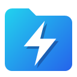
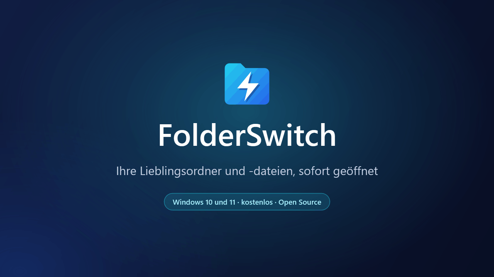
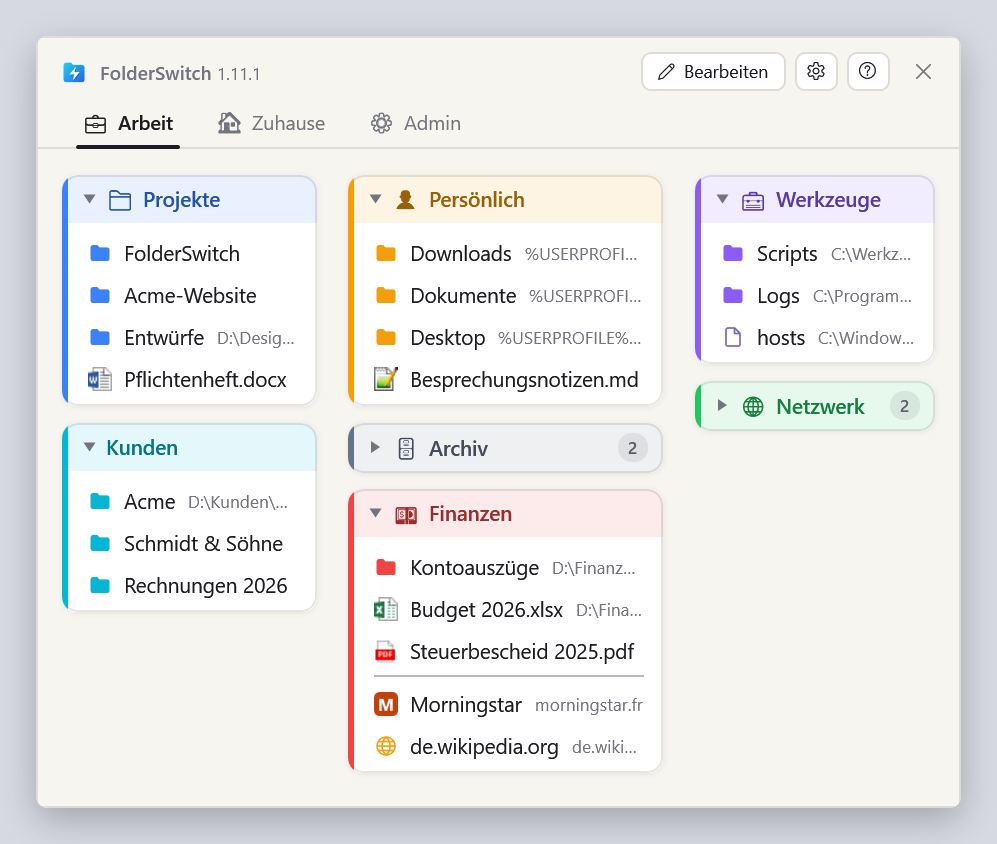
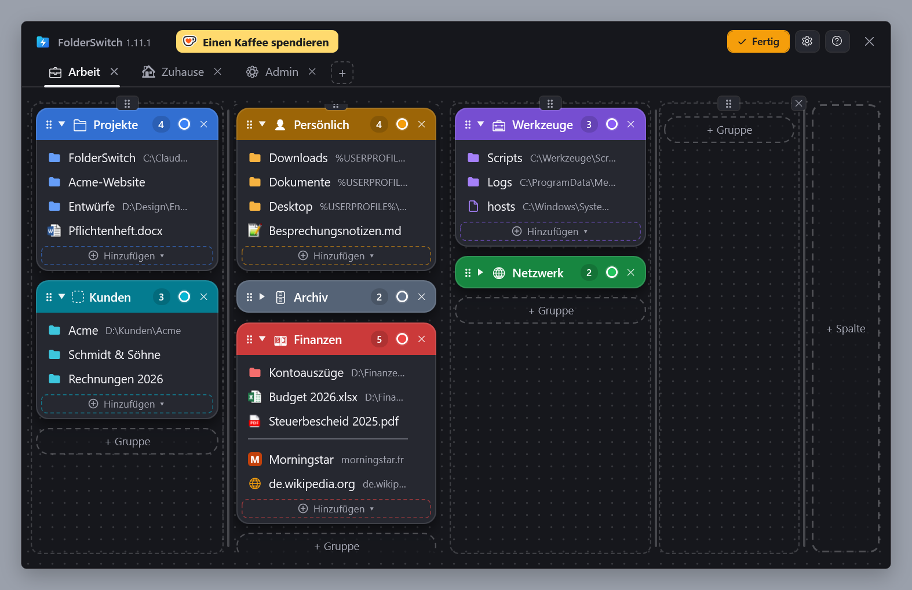
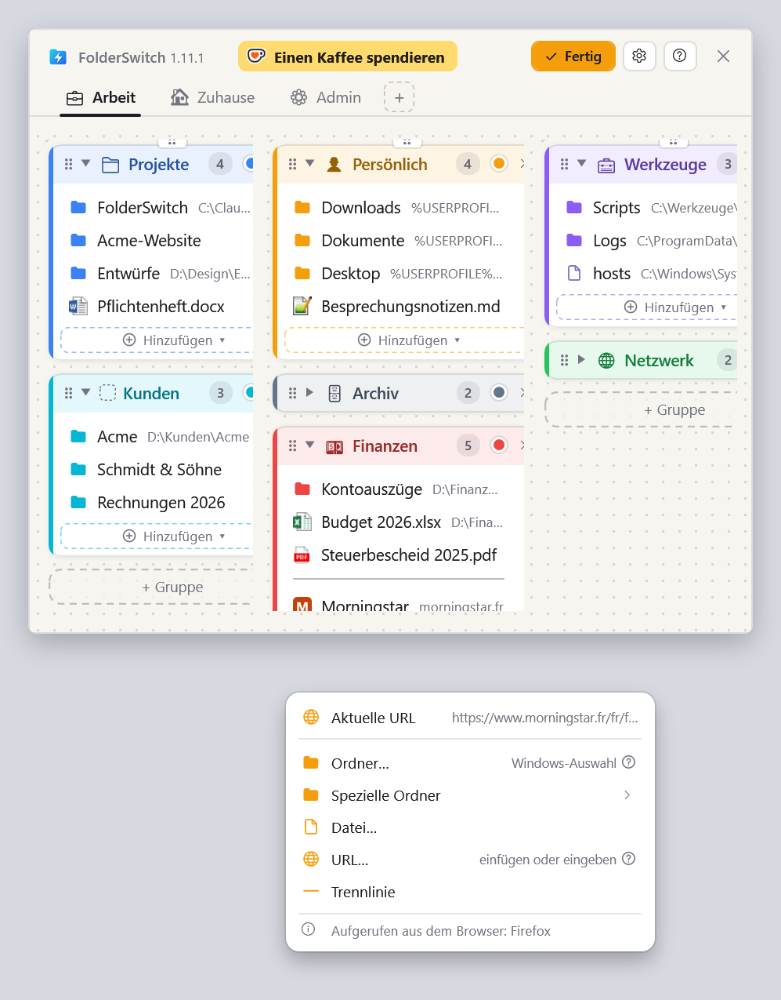
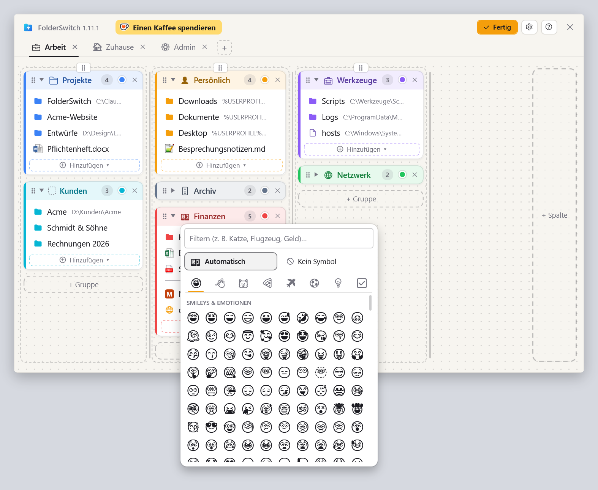
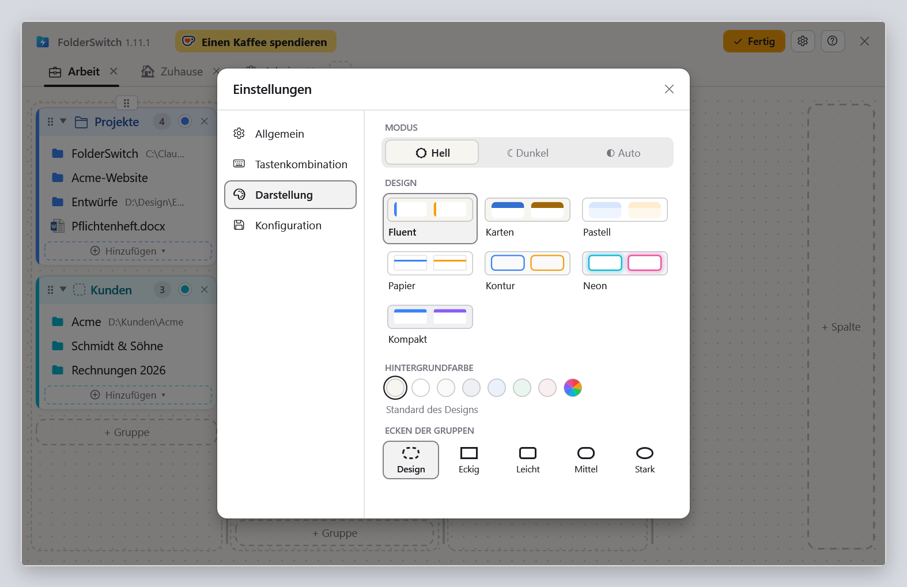

  <a href="README.md">English</a> ·
  <a href="README.fr.md">Français</a> ·
  <b>Deutsch</b> ·
  <a href="README.es.md">Español</a> ·
  <a href="README.it.md">Italiano</a> ·
  <a href="README.nl.md">Nederlands</a> ·
  <a href="README.pl.md">Polski</a> ·
  <a href="README.pt-BR.md">Português (Brasil)</a> ·
  <a href="README.pt-PT.md">Português (Portugal)</a>

<h1 align="center">FolderSwitch</h1>

<b>Ihre Lieblingsordner und -dateien, sofort geöffnet.</b>

  
  
  

  <a href="https://github.com/kbuleon/FolderSwitch/releases/latest/download/FolderSwitch-win-Setup.exe"><b>⬇ FolderSwitch für Windows herunterladen</b></a>
  &nbsp;·&nbsp;
  <a href="https://github.com/kbuleon/FolderSwitch/releases">Alle Versionen und ihre Hinweise</a>

## Was ist FolderSwitch?

FolderSwitch ist ein kleines Windows-Programm, das Ihre Lieblingsordner, -dateien und -webseiten nur einen Tastendruck
entfernt hält. Drücken Sie **Strg + Win**, und Ihre Übersicht erscheint: Registerkarten, Spalten und farbige Gruppen, so
angeordnet, wie es Ihnen gefällt.

Ein Klick auf einen Ordner schickt das Datei-Explorer-Fenster oder den Dialog „Öffnen“ / „Speichern unter“, aus dem Sie
FolderSwitch aufgerufen haben, direkt in diesen Ordner. Von überall sonst aufgerufen, öffnet sich ein Ordner in einem
neuen Explorer-Fenster, eine Datei in ihrer Anwendung und eine Webseite in Ihrem Browser.

Es ist kostenlos und quelloffen und sammelt nichts über Sie.

## Screenshots

Ihre Übersicht, so wie die Tastenkombination sie zeigt:

Der Modus „Bearbeiten“, in dem Registerkarten, Spalten, Gruppen und Einträge hinzugefügt, umbenannt, umgefärbt und per Drag
and drop verschoben werden (hier mit dem Design „Karten“, dunkel):

Das Menü „Hinzufügen ▾“ einer Gruppe, aufgerufen aus Firefox: Die Seite, die der Browser gerade zeigt, steht an erster
Stelle. Aus dem Datei-Explorer aufgerufen, ist es der aktuelle Ordner:

Die Symbolauswahl: ein Emoji, das aus dem Namen der Gruppe vorgeschlagen wird, oder das, das Sie selbst wählen:

Die Einstellungen, mit sieben Designs in Hell und Dunkel:

## Funktionen

- **Eine Tastenkombination, überall.** Standardmäßig Strg + Win oder jede Kombination Ihrer Wahl. Das Fenster öffnet
  sich auf dem Bildschirm, auf dem Ihre Maus steht, und dieselbe Tastenkombination blendet es wieder aus.
- **Es weiß, von wo aus Sie es aufrufen.** Der Datei-Explorer (unter Windows 11 sein aktueller Tab) und die Dialoge
  „Öffnen“, „Speichern unter“ und zur Ordnerauswahl springen direkt zu dem Ordner, den Sie anklicken. Strg + Klick
  öffnet ihn stattdessen in einem neuen Explorer-Tab (unter Windows 10 in einem neuen Fenster).
- **Eine Übersicht, die Sie per Drag and drop anordnen.** Registerkarten, Spalten, farbige Gruppen, die sich einklappen
  lassen, und darin Ordner, Dateien, Webseiten, spezielle Windows-Ordner (Desktop, Dokumente, Dieser PC …) und
  Trennlinien. Jede Änderung wird sofort gespeichert.
- **Fügen Sie Dinge dort hinzu, wo Sie gerade sind.** Im Datei-Explorer oder in einem Dateidialog fügt „Aktueller
  Ordner“ den Ordner, in dem Sie sich befinden, mit einem Klick hinzu. In Firefox, Chrome oder Edge fügt „Aktuelle URL“
  die Seite hinzu, die Sie gerade lesen.
- **Symbole, die etwas sagen.** Registerkarten und Gruppen erhalten aus ihrem Namen ein Emoji („Finanzen“ bekommt eine
  Banknote, „Fotos“ eine Kamera) oder das, das Sie auswählen. Dateien zeigen ihr Windows-Symbol und Webseiten ihr
  eigenes.
- **Sieben Designs**, jedes in Hell und Dunkel oder passend zu Windows.
- **Neun Sprachen**: Englisch, Französisch, Deutsch, Spanisch, Italienisch, Niederländisch, Polnisch sowie Portugiesisch
  aus Brasilien und aus Portugal.
- **Ihre Konfiguration ist sicher**: automatisch gesichert und mit einem Klick exportiert oder importiert.
- **Hält sich selbst aktuell**: FolderSwitch prüft einmal täglich, ob es eine neue Version gibt, und bietet an, sie zu
  installieren. Das lässt sich in den Einstellungen abschalten.

## Installation

1. Laden Sie [FolderSwitch-win-Setup.exe](https://github.com/kbuleon/FolderSwitch/releases/latest/download/FolderSwitch-win-Setup.exe) herunter.
2. Führen Sie die Datei aus. FolderSwitch wird nur für Ihr Benutzerkonto installiert, ohne Administratorrechte, und
   startet.
3. Ein kurzer Assistent fragt nach Ihrer Sprache, Ihrer Tastenkombination und Ihrem Design und danach, ob FolderSwitch
   mit Windows starten soll.

FolderSwitch läuft unter Windows 10 und 11 (64 Bit). Das Installationsprogramm ist nicht signiert, daher warnt Windows
möglicherweise vor einem unbekannten Herausgeber: Sie können es trotzdem ausführen.

Zum Deinstallieren verwenden Sie die Einstellungen „Apps“ von Windows. Ihre Konfiguration bleibt erhalten, falls Sie
zurückkommen.

## Datenschutz

FolderSwitch sammelt nichts und sendet nichts über Sie: keine Telemetrie, keine Analysen, keine Kennung. Es verbindet
sich nur für zwei Dinge mit dem Internet: um auf GitHub nach einer neuen Version zu suchen (sofern Sie das nicht
abschalten) und um das Symbol einer Webseite abzurufen, die Sie zu Ihrer Übersicht hinzufügen. Nichts aus Ihrer
Übersicht wird jemals gesendet. Die Einzelheiten stehen in [DEVELOPMENT.md](DEVELOPMENT.md#privacy) (auf Englisch, wie
die anderen weiter unten genannten technischen Dokumente).

## Gut zu wissen

- Die Tastenkombination bewirkt nichts, solange ein als Administrator ausgeführtes Fenster im Vordergrund ist: Windows
  erlaubt das nicht.
- Der Datei-Explorer ist der einzige Dateimanager, den FolderSwitch steuert.
- Die vollständige Liste der bekannten Einschränkungen steht in [DEVELOPMENT.md](DEVELOPMENT.md#known-limits).

## FolderSwitch unterstützen

FolderSwitch ist ein privates Projekt, das in der Freizeit seines Autors entsteht. Wenn es Ihnen Zeit spart, können Sie ihm
einen Kaffee spendieren:

Fehlerberichte und Vorschläge sind in den [Issues](https://github.com/kbuleon/FolderSwitch/issues) willkommen; siehe
[CONTRIBUTING.md](CONTRIBUTING.md). Sicherheitslücken werden vertraulich gemeldet: siehe [SECURITY.md](SECURITY.md).

## Für Entwickler

Wie man FolderSwitch aus dem Quellcode baut, paketiert, veröffentlicht und testet, steht in
[DEVELOPMENT.md](DEVELOPMENT.md). Der Entwurf steht in [ARCHITECTURE.md](ARCHITECTURE.md), die Karte des Codes in
[CODEMAP.md](CODEMAP.md) und die Änderungshistorie in [CHANGELOG.md](CHANGELOG.md).

## Lizenz

FolderSwitch ist Copyright (C) 2026 Karl BULEON.

Es ist freie Software, verbreitet unter der GNU General Public License in Version 3 oder (nach Ihrer Wahl) jeder
späteren Version (SPDX: `GPL-3.0-or-later`), ohne jegliche Gewährleistung. Den vollständigen Text finden Sie in
[LICENSE](LICENSE). Hinzu kommen drei zusätzliche Bedingungen nach Abschnitt 7 der GPLv3:

1. Ein darauf basierendes Werk muss den Hinweis „Based on FolderSwitch by Karl BULEON“ beibehalten.
2. Eine veränderte Version darf nicht „FolderSwitch“ heißen und nicht dessen Symbol verwenden.
3. Es werden keine Markenrechte am Namen oder am Symbol eingeräumt.

Komponenten von Drittanbietern stehen unter ihren eigenen, kompatiblen Lizenzen; sie sind in
[THIRD-PARTY-NOTICES.txt](THIRD-PARTY-NOTICES.txt) aufgeführt.

Maßgeblich ist allein der englische Text: siehe [README.md](README.md#license).
