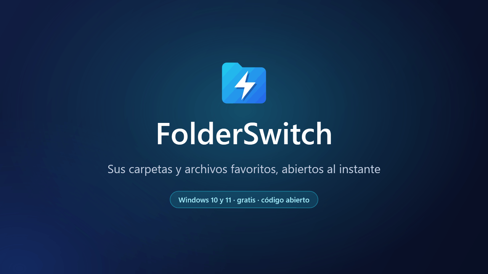
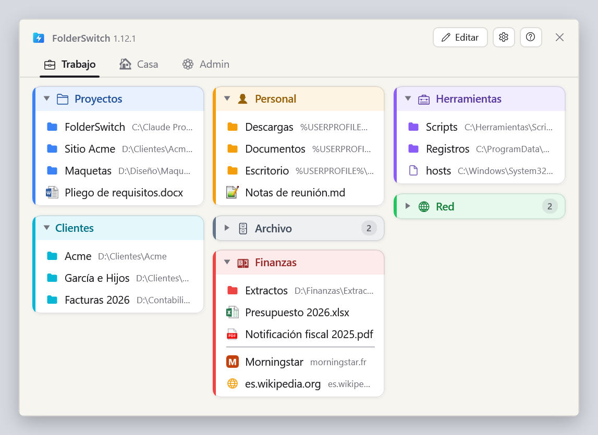
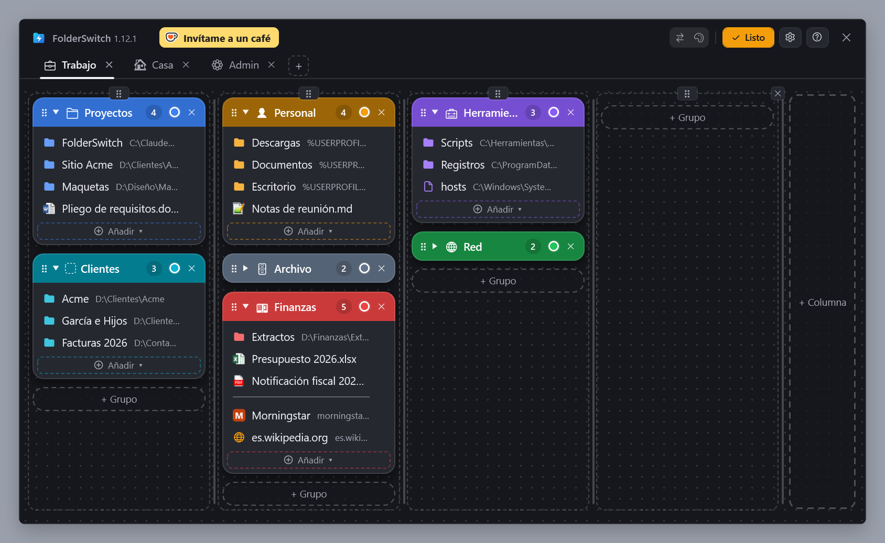
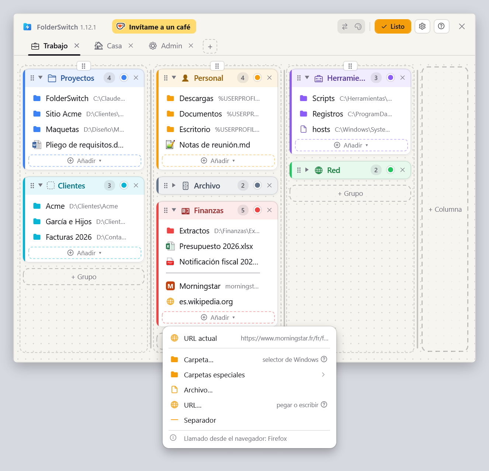
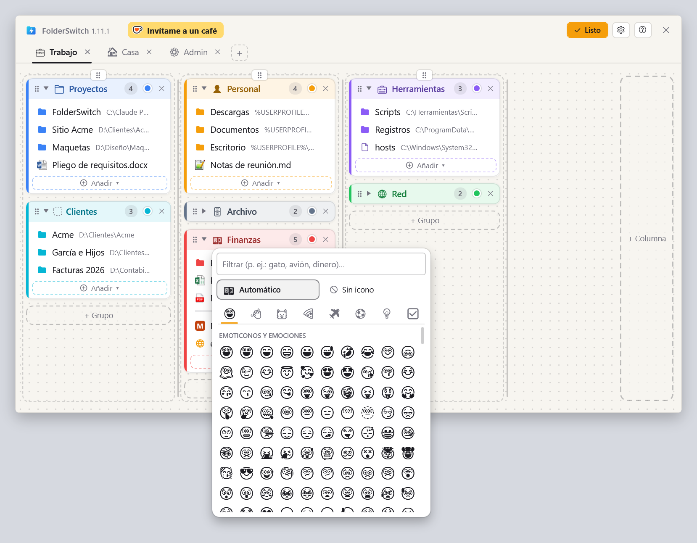
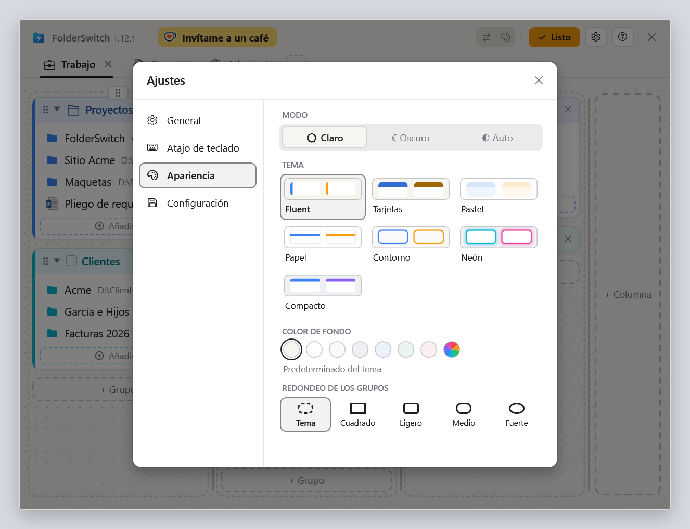

  <a href="README.md">English</a> ·
  <a href="README.fr.md">Français</a> ·
  <a href="README.de.md">Deutsch</a> ·
  <b>Español</b> ·
  <a href="README.it.md">Italiano</a> ·
  <a href="README.nl.md">Nederlands</a> ·
  <a href="README.pl.md">Polski</a> ·
  <a href="README.pt-BR.md">Português (Brasil)</a> ·
  <a href="README.pt-PT.md">Português (Portugal)</a>

<h1 align="center">FolderSwitch</h1>

<b>Sus carpetas y archivos favoritos, abiertos al instante.</b>

  
  
  

  <a href="https://github.com/kbuleon/FolderSwitch/releases/latest/download/FolderSwitch-win-Setup.exe"><b>⬇ Descargar FolderSwitch para Windows</b></a>
  &nbsp;·&nbsp;
  <a href="https://github.com/kbuleon/FolderSwitch/releases">Todas las versiones y sus notas</a>

## ¿Qué es FolderSwitch?

FolderSwitch es una pequeña utilidad de Windows que mantiene tus carpetas, archivos y sitios web favoritos a un atajo de
distancia. Pulsa **Ctrl + Win** y aparece tu tablero: pestañas, columnas y grupos de colores, organizados como más te
guste.

Un clic en una carpeta lleva directamente a ella la ventana del Explorador de archivos, o el cuadro de diálogo
Abrir / Guardar como, desde donde llamaste a FolderSwitch. Si lo llamas desde cualquier otro sitio, una carpeta se abre
en una ventana nueva del Explorador, un archivo en su aplicación y un sitio web en tu navegador.

Es gratuito y de código abierto, y no recopila nada sobre ti.

## Capturas de pantalla

Tu tablero, tal como lo muestra el atajo:

El modo Editar, donde se añaden, renombran, recolorean y mueven con arrastrar y soltar las pestañas, columnas, grupos y
elementos (aquí con el tema Tarjetas, oscuro):

El menú «Añadir ▾» de un grupo, llamado desde Firefox: la página que muestra el navegador va primero. Si se llama desde
el Explorador de archivos, es la carpeta actual:

El selector de iconos: un emoji sugerido a partir del nombre del grupo, o el que tú elijas:

Los ajustes, con siete temas en claro y oscuro:

## Características

- **Un solo atajo, en todas partes.** Ctrl + Win de forma predeterminada, o la combinación que prefieras. La ventana se
  abre en la pantalla donde está el ratón, y el mismo atajo la oculta.
- **Sabe desde dónde lo llamas.** El Explorador de archivos (su pestaña actual en Windows 11) y los cuadros de diálogo
  Abrir, Guardar como y de selección de carpeta van directamente a la carpeta en la que haces clic. Ctrl + clic la abre
  en una pestaña nueva del Explorador (una ventana nueva en Windows 10).
- **Un tablero que organizas con arrastrar y soltar.** Pestañas, columnas, grupos de colores que se pueden plegar y,
  dentro, carpetas, archivos, sitios web, carpetas especiales de Windows (Escritorio, Documentos, Este equipo…) y
  separadores. Las columnas conservan el ancho que les das: en el modo Editar, un clic les da a todas el mismo ancho y
  otro, un color a cada una. Cada cambio se guarda al instante.
- **Añade cosas allí donde estés.** Desde el Explorador de archivos o un cuadro de diálogo de archivos, «Carpeta
  actual» añade la carpeta en la que estás con un solo clic, y el selector de archivos se abre en ella; desde el
  Explorador, «Archivo seleccionado» añade el archivo seleccionado. Desde Firefox, Chrome o Edge, «URL actual» añade
  la página que estás leyendo.
- **Iconos que hablan.** Las pestañas y los grupos reciben un emoji a partir de su nombre («Finanzas» recibe un billete,
  «Fotos» una cámara), o el que tú elijas. Los archivos muestran su icono de Windows, y los sitios web el suyo.
- **Siete temas**, cada uno en claro y oscuro, o siguiendo a Windows.
- **Nueve idiomas**: inglés, francés, alemán, español, italiano, neerlandés, polaco y portugués de Brasil y de Portugal.
- **Tu configuración está a salvo**: se copia automáticamente y se exporta o importa con un clic.
- **Se actualiza solo**: FolderSwitch comprueba una vez al día si hay una versión nueva y se ofrece a instalarla. Se
  puede desactivar en los ajustes.

## Instalación

1. Descarga [FolderSwitch-win-Setup.exe](https://github.com/kbuleon/FolderSwitch/releases/latest/download/FolderSwitch-win-Setup.exe).
2. Ejecútalo. FolderSwitch se instala solo para tu usuario, sin permisos de administrador, y se inicia.
3. Un breve asistente te pregunta tu idioma, tu atajo y tu tema, y si FolderSwitch debe iniciarse con Windows.

FolderSwitch funciona en Windows 10 y 11 (64 bits). El instalador no está firmado, así que Windows puede avisar de que su
editor es desconocido: puedes elegir ejecutarlo de todos modos.

Para desinstalarlo, usa la configuración de «Aplicaciones» de Windows. Tu configuración se conserva, por si vuelves.

## Privacidad

FolderSwitch no recopila nada ni envía nada sobre ti: sin telemetría, sin análisis, sin identificador. Se conecta a
internet solo para dos cosas: comprobar en GitHub si hay una versión nueva (a menos que lo desactives) y obtener el icono
de un sitio web que añades a tu tablero. Nada de tu tablero se envía jamás. Los detalles están en
[DEVELOPMENT.md](DEVELOPMENT.md#privacy) (en inglés, como los demás documentos técnicos que se citan más abajo).

## Conviene saber

- El atajo no hace nada mientras haya delante una ventana ejecutándose como administrador: Windows no lo permite.
- El Explorador de archivos es el único administrador de archivos que FolderSwitch controla.
- La lista completa de limitaciones conocidas está en [DEVELOPMENT.md](DEVELOPMENT.md#known-limits).

## Apoya FolderSwitch

FolderSwitch es un proyecto personal, hecho en el tiempo libre de su autor. Si te ahorra tiempo, puedes invitarle a un café:

Los informes de errores y las sugerencias son bienvenidos en los [issues](https://github.com/kbuleon/FolderSwitch/issues);
consulta [CONTRIBUTING.md](CONTRIBUTING.md). Las vulnerabilidades de seguridad se comunican de forma privada: consulta
[SECURITY.md](SECURITY.md).

## Para desarrolladores

Cómo compilar FolderSwitch desde el código fuente, empaquetarlo, publicarlo y probarlo está en
[DEVELOPMENT.md](DEVELOPMENT.md). El diseño está en [ARCHITECTURE.md](ARCHITECTURE.md), el mapa del código en
[CODEMAP.md](CODEMAP.md) y el historial de cambios en [CHANGELOG.md](CHANGELOG.md).

## Licencia

FolderSwitch es Copyright (C) 2026 Karl BULEON.

Es software libre, distribuido bajo la Licencia Pública General de GNU (GPL) versión 3 o, a tu elección, cualquier
versión posterior (SPDX: `GPL-3.0-or-later`), sin ninguna garantía. El texto completo está en [LICENSE](LICENSE). Se le
añaden tres condiciones adicionales, conforme a la sección 7 de la GPLv3:

1. una obra basada en FolderSwitch debe conservar la mención «Based on FolderSwitch by Karl BULEON»;
2. una versión modificada no debe llamarse «FolderSwitch» ni usar su icono;
3. no se concede ningún derecho de marca sobre el nombre ni sobre el icono.

Los componentes de terceros están bajo sus propias licencias, compatibles con la GPLv3; se enumeran en
[THIRD-PARTY-NOTICES.txt](THIRD-PARTY-NOTICES.txt).

Solo el texto en inglés es el que tiene validez: consulta [README.md](README.md#license).
