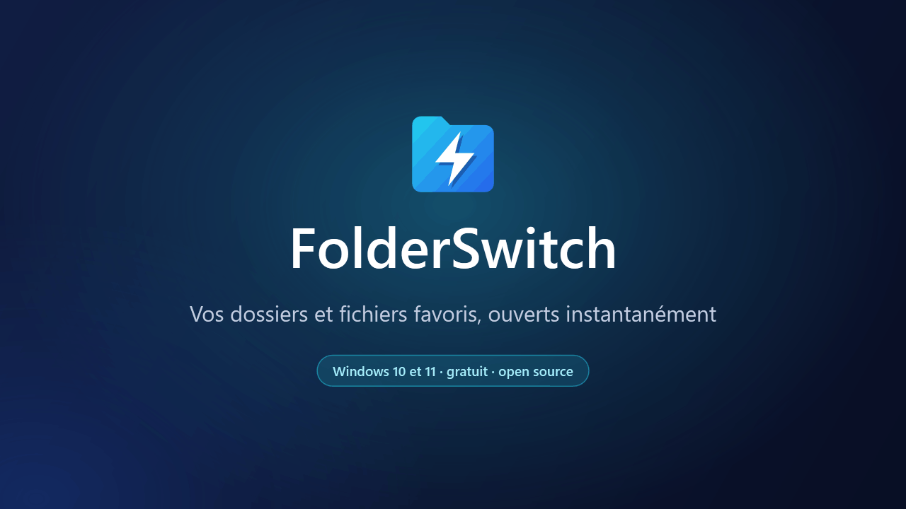
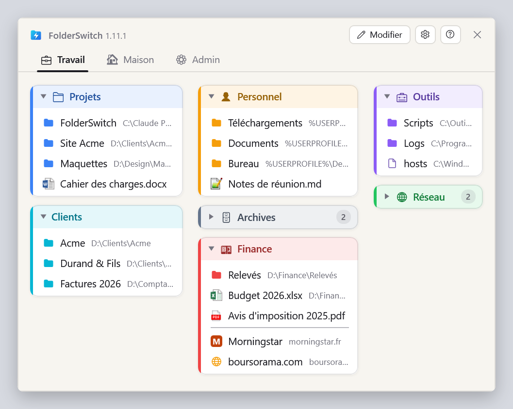
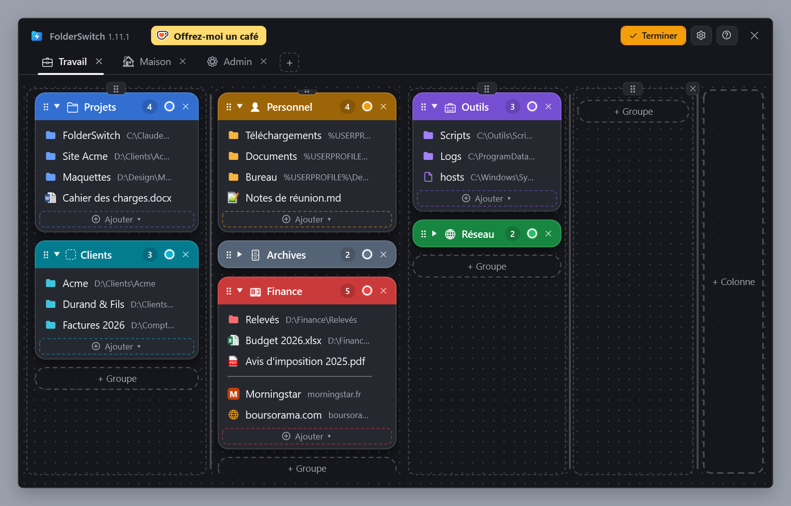
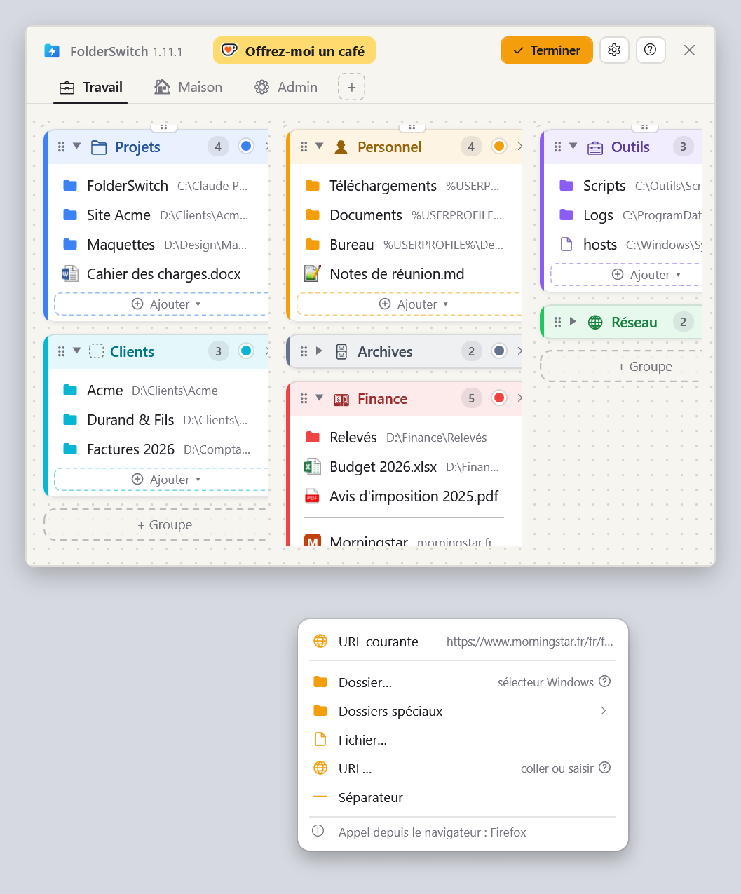
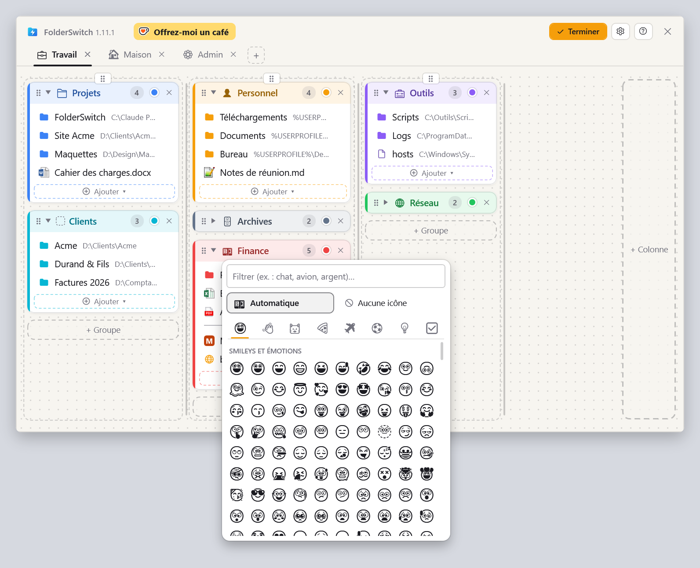
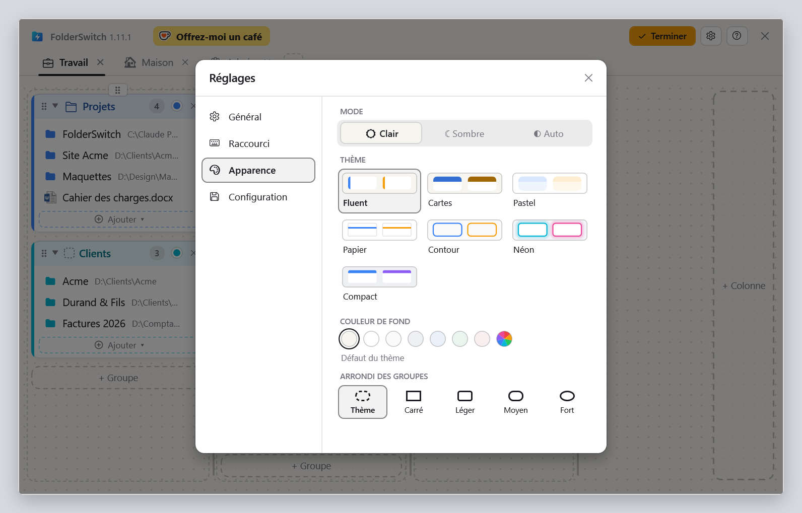

  <a href="README.md">English</a> ·
  <b>Français</b> ·
  <a href="README.de.md">Deutsch</a> ·
  <a href="README.es.md">Español</a> ·
  <a href="README.it.md">Italiano</a> ·
  <a href="README.nl.md">Nederlands</a> ·
  <a href="README.pl.md">Polski</a> ·
  <a href="README.pt-BR.md">Português (Brasil)</a> ·
  <a href="README.pt-PT.md">Português (Portugal)</a>

<h1 align="center">FolderSwitch</h1>

<b>Vos dossiers et fichiers favoris, ouverts instantanément.</b>

  
  
  

  <a href="https://github.com/kbuleon/FolderSwitch/releases/latest/download/FolderSwitch-win-Setup.exe"><b>⬇ Télécharger FolderSwitch pour Windows</b></a>
  &nbsp;·&nbsp;
  <a href="https://github.com/kbuleon/FolderSwitch/releases">Toutes les versions et leurs notes</a>

## Qu'est-ce que FolderSwitch ?

FolderSwitch est un petit utilitaire Windows qui garde vos dossiers, fichiers et sites web favoris à un raccourci de
distance. Appuyez sur **Ctrl + Win** et votre tableau apparaît : onglets, colonnes et groupes colorés, organisés comme
vous l'aimez.

Un clic sur un dossier envoie directement vers ce dossier la fenêtre de l'Explorateur de fichiers, ou la boîte de
dialogue Ouvrir / Enregistrer sous, depuis laquelle vous avez appelé FolderSwitch. Appelé d'ailleurs, il ouvre un
dossier dans une nouvelle fenêtre de l'Explorateur, un fichier dans son application et un site dans votre navigateur.

Il est gratuit et open source, et ne collecte rien sur vous.

## Captures d'écran

Votre tableau, tel que le raccourci l'affiche :

Le mode Modifier, où l'on ajoute, renomme, recolore et déplace par glisser-déposer onglets, colonnes, groupes et éléments
(ici avec le thème Cartes, sombre) :

Le menu « Ajouter ▾ » d'un groupe, appelé depuis Firefox : la page affichée par le navigateur passe en premier. Appelé
depuis l'Explorateur de fichiers, c'est le dossier courant :

Le sélecteur d'icône : un emoji suggéré d'après le nom du groupe, ou celui que vous choisissez :

Les paramètres, avec sept thèmes en clair et en sombre :

## Fonctionnalités

- **Un seul raccourci, partout.** Ctrl + Win par défaut, ou toute combinaison de votre choix. La fenêtre s'ouvre sur
  l'écran où se trouve votre souris, et le même raccourci la referme.
- **Il sait d'où vous l'appelez.** L'Explorateur de fichiers (son onglet courant sous Windows 11) et les boîtes de
  dialogue Ouvrir, Enregistrer sous et de sélection de dossier vont directement au dossier sur lequel vous cliquez.
  Ctrl + clic l'ouvre plutôt dans un nouvel onglet de l'Explorateur (une nouvelle fenêtre sous Windows 10).
- **Un tableau que vous organisez par glisser-déposer.** Des onglets, des colonnes, des groupes colorés et repliables, et
  dedans des dossiers, des fichiers, des sites web, des dossiers spéciaux de Windows (Bureau, Documents, Ce PC…) et des
  séparateurs. Chaque modification est enregistrée immédiatement.
- **Ajoutez les choses là où vous êtes.** Depuis l'Explorateur de fichiers ou une boîte de dialogue de fichier,
  « Dossier courant » ajoute le dossier dans lequel vous vous trouvez, en un clic. Depuis Firefox, Chrome ou Edge,
  « URL courante » ajoute la page que vous lisez.
- **Des icônes parlantes.** Les onglets et les groupes reçoivent un emoji d'après leur nom (« Finance » obtient un
  billet de banque, « Photos » un appareil photo), ou celui que vous choisissez. Les fichiers affichent leur icône
  Windows, et les sites la leur.
- **Sept thèmes**, chacun en clair et en sombre, ou en suivant Windows.
- **Neuf langues** : anglais, français, allemand, espagnol, italien, néerlandais, polonais, et portugais du Brésil et du
  Portugal.
- **Votre configuration est en sécurité** : sauvegardée automatiquement, exportée ou importée en un clic.
- **À jour tout seul** : FolderSwitch vérifie une fois par jour s'il existe une nouvelle version et propose de
  l'installer. Cela se désactive dans les paramètres.

## Installation

1. Téléchargez [FolderSwitch-win-Setup.exe](https://github.com/kbuleon/FolderSwitch/releases/latest/download/FolderSwitch-win-Setup.exe).
2. Lancez-le. FolderSwitch s'installe pour votre seul compte, sans droits d'administrateur, puis démarre.
3. Un court assistant vous demande votre langue, votre raccourci et votre thème, et si FolderSwitch doit démarrer avec
   Windows.

FolderSwitch fonctionne sous Windows 10 et 11 (64 bits). L'installeur n'est pas signé : Windows peut donc avertir que
son éditeur est inconnu, et vous pouvez choisir de l'exécuter quand même.

Pour le désinstaller, utilisez les paramètres « Applications » de Windows. Votre configuration est conservée, au cas où
vous reviendriez.

## Confidentialité

FolderSwitch ne collecte rien et n'envoie rien sur vous : pas de télémétrie, pas d'analyse d'usage, pas d'identifiant. Il
se connecte à Internet pour deux choses seulement : chercher sur GitHub une nouvelle version (sauf si vous le
désactivez), et récupérer l'icône d'un site web que vous ajoutez à votre tableau. Rien de votre tableau n'est jamais
envoyé. Les détails sont dans [DEVELOPMENT.md](DEVELOPMENT.md#privacy) (en anglais, comme les autres documents
techniques cités plus bas).

## Bon à savoir

- Le raccourci ne fait rien tant qu'une fenêtre exécutée en administrateur est au premier plan : Windows ne le permet
  pas.
- L'Explorateur de fichiers est le seul gestionnaire de fichiers que FolderSwitch pilote.
- La liste complète des limites connues est dans [DEVELOPMENT.md](DEVELOPMENT.md#known-limits).

## Soutenir FolderSwitch

FolderSwitch est un projet personnel, réalisé sur le temps libre de son auteur. S'il vous fait gagner du temps, vous
pouvez lui offrir un café :

Les rapports de bogues et les suggestions sont les bienvenus dans les [issues](https://github.com/kbuleon/FolderSwitch/issues) ;
voir [CONTRIBUTING.md](CONTRIBUTING.md). Les failles de sécurité se signalent en privé : voir [SECURITY.md](SECURITY.md).

## Pour les développeurs

La façon de compiler FolderSwitch depuis les sources, de l'empaqueter, de le publier et de le tester est décrite dans
[DEVELOPMENT.md](DEVELOPMENT.md). La conception est dans [ARCHITECTURE.md](ARCHITECTURE.md), la carte du code dans
[CODEMAP.md](CODEMAP.md) et l'historique des changements dans [CHANGELOG.md](CHANGELOG.md).

## Licence

FolderSwitch est Copyright (C) 2026 Karl BULEON.

C'est un logiciel libre, distribué sous la licence publique générale GNU (GPL) version 3 ou, à votre convenance, toute
version ultérieure (SPDX : `GPL-3.0-or-later`), sans aucune garantie. Le texte complet est dans [LICENSE](LICENSE).
Trois conditions supplémentaires s'y ajoutent, au titre de la section 7 de la GPLv3 :

1. une version dérivée doit conserver la mention « Based on FolderSwitch by Karl BULEON » ;
2. une version modifiée ne doit pas s'appeler « FolderSwitch » ni utiliser son icône ;
3. aucun droit de marque n'est accordé sur le nom ou l'icône.

Les composants tiers sont placés sous leurs propres licences, compatibles avec la GPLv3 ; elles sont listées dans
[THIRD-PARTY-NOTICES.txt](THIRD-PARTY-NOTICES.txt).

Seul le texte anglais fait foi : voir [README.md](README.md#license).
