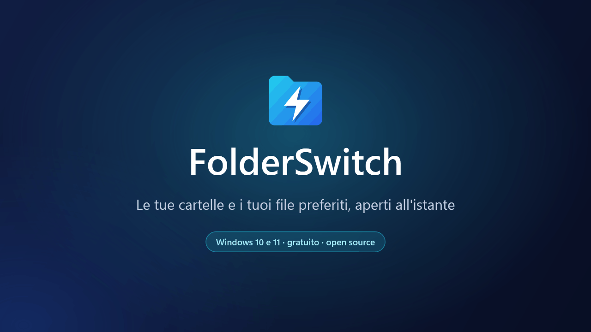
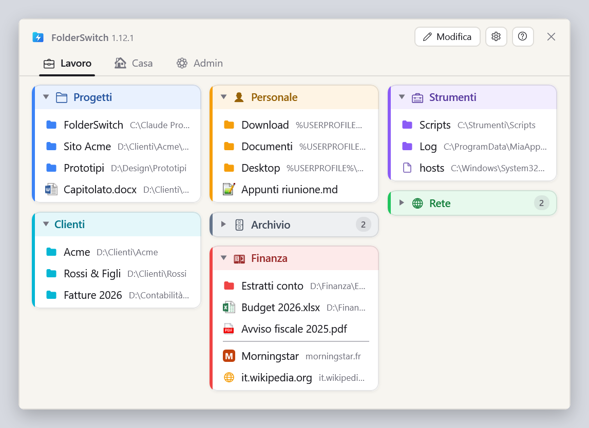
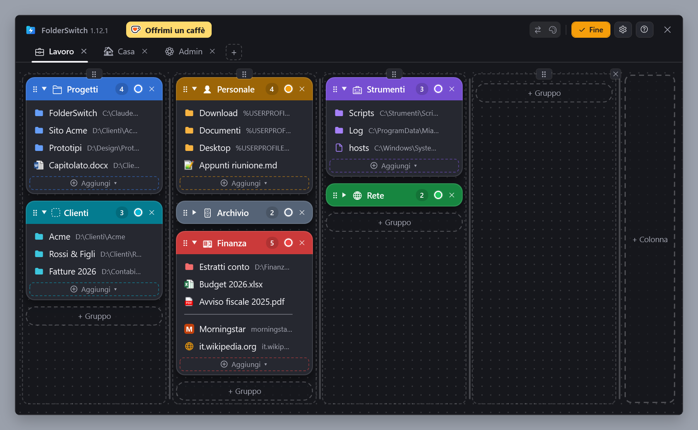
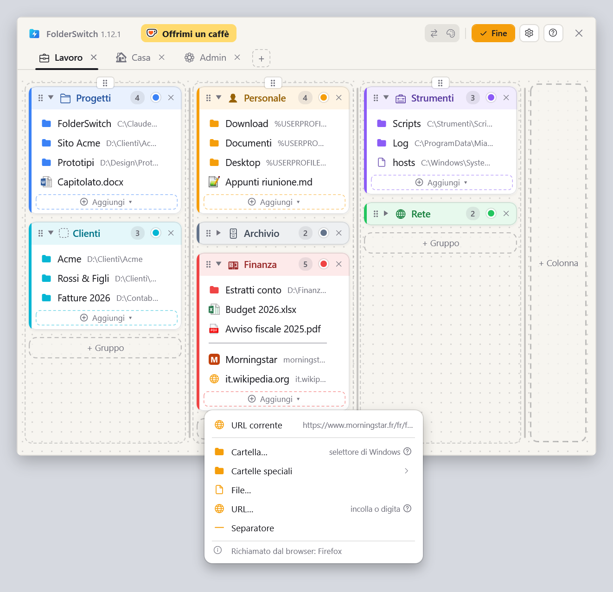
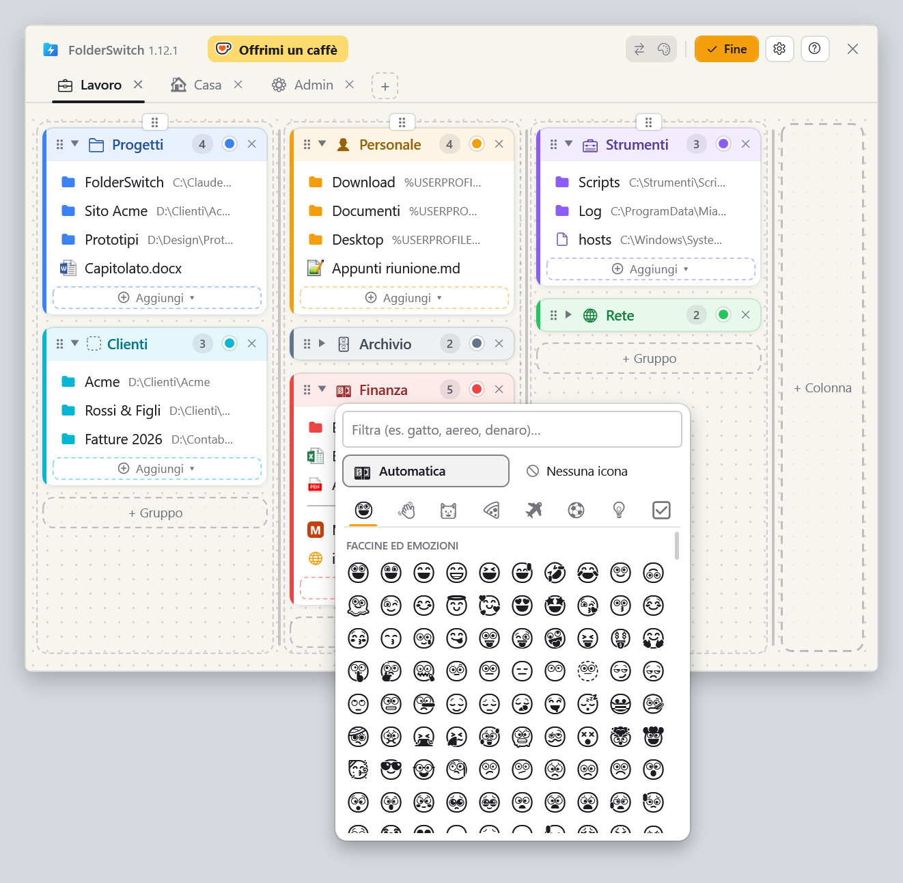
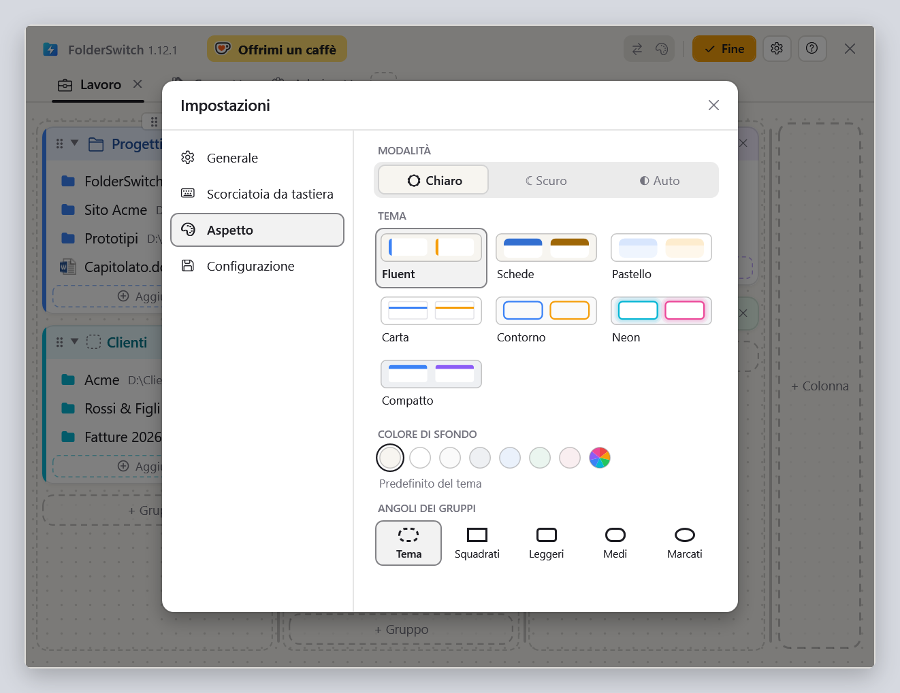

  <a href="README.md">English</a> ·
  <a href="README.fr.md">Français</a> ·
  <a href="README.de.md">Deutsch</a> ·
  <a href="README.es.md">Español</a> ·
  <b>Italiano</b> ·
  <a href="README.nl.md">Nederlands</a> ·
  <a href="README.pl.md">Polski</a> ·
  <a href="README.pt-BR.md">Português (Brasil)</a> ·
  <a href="README.pt-PT.md">Português (Portugal)</a>

<h1 align="center">FolderSwitch</h1>

<b>Le tue cartelle e i tuoi file preferiti, aperti all'istante.</b>

  
  
  

  <a href="https://github.com/kbuleon/FolderSwitch/releases/latest/download/FolderSwitch-win-Setup.exe"><b>⬇ Scarica FolderSwitch per Windows</b></a>
  &nbsp;·&nbsp;
  <a href="https://github.com/kbuleon/FolderSwitch/releases">Tutte le versioni e le loro note</a>

## Che cos'è FolderSwitch?

FolderSwitch è una piccola utilità per Windows che tiene le tue cartelle, i tuoi file e i tuoi siti web preferiti a una
scorciatoia di distanza. Premi **Ctrl + Win** e compare la tua bacheca: schede, colonne e gruppi colorati, disposti come
preferisci.

Un clic su una cartella porta direttamente lì la finestra di Esplora file, o la finestra di dialogo Apri / Salva con
nome, da cui hai richiamato FolderSwitch. Richiamata da qualsiasi altro posto, una cartella si apre in una nuova
finestra di Esplora file, un file nella sua applicazione e un sito nel tuo browser.

È gratuito e open source, e non raccoglie nulla su di te.

## Schermate

La tua bacheca, come la mostra la scorciatoia:

La modalità Modifica, in cui schede, colonne, gruppi ed elementi si aggiungono, rinominano, ricolorano e spostano con il
trascinamento (qui con il tema Schede, scuro):

Il menu «Aggiungi ▾» di un gruppo, richiamato da Firefox: la pagina mostrata dal browser viene per prima. Richiamato da
Esplora file, è la cartella corrente:

Il selettore di icone: un'emoji suggerita dal nome del gruppo, oppure quella che scegli tu:

Le impostazioni, con sette temi in chiaro e scuro:

## Funzionalità

- **Una sola scorciatoia, ovunque.** Ctrl + Win per impostazione predefinita, o qualsiasi combinazione tu scelga. La
  finestra si apre sullo schermo in cui si trova il mouse, e la stessa scorciatoia la nasconde.
- **Sa da dove lo richiami.** Esplora file (la sua scheda corrente in Windows 11) e le finestre di dialogo Apri, Salva
  con nome e di selezione cartella vanno direttamente alla cartella su cui fai clic. Ctrl + clic la apre invece in una
  nuova scheda di Esplora file (una nuova finestra in Windows 10).
- **Una bacheca che disponi con il trascinamento.** Schede, colonne, gruppi colorati che si comprimono e, al loro
  interno, cartelle, file, siti web, cartelle speciali di Windows (Desktop, Documenti, Questo PC…) e separatori. Le
  colonne mantengono la larghezza che dai loro: in modalità Modifica, un clic le porta tutte alla stessa larghezza, un
  altro dà a ciascuna il suo colore. Ogni modifica viene salvata subito.
- **Aggiungi le cose dove ti trovi.** Da Esplora file o da una finestra di dialogo dei file, «Cartella corrente»
  aggiunge la cartella in cui sei, con un clic. Da Firefox, Chrome o Edge, «URL corrente» aggiunge la pagina che stai
  leggendo.
- **Icone che parlano.** Le schede e i gruppi ricevono un'emoji dal loro nome («Finanze» riceve una banconota, «Foto»
  una fotocamera), oppure quella che scegli tu. I file mostrano la loro icona di Windows, e i siti la propria.
- **Sette temi**, ciascuno in chiaro e scuro, o in linea con Windows.
- **Nove lingue**: inglese, francese, tedesco, spagnolo, italiano, olandese, polacco e portoghese del Brasile e del
  Portogallo.
- **La tua configurazione è al sicuro**: salvata automaticamente, esportata o importata con un clic.
- **Si aggiorna da solo**: FolderSwitch controlla una volta al giorno se c'è una nuova versione e propone di
  installarla. Si può disattivare nelle impostazioni.

## Installazione

1. Scarica [FolderSwitch-win-Setup.exe](https://github.com/kbuleon/FolderSwitch/releases/latest/download/FolderSwitch-win-Setup.exe).
2. Eseguilo. FolderSwitch si installa solo per il tuo utente, senza diritti di amministratore, e si avvia.
3. Una breve procedura guidata ti chiede la lingua, la scorciatoia e il tema, e se FolderSwitch deve avviarsi con
   Windows.

FolderSwitch funziona su Windows 10 e 11 (64 bit). Il programma di installazione non è firmato, quindi Windows potrebbe
avvisare che l'autore è sconosciuto: puoi scegliere di eseguirlo comunque.

Per disinstallarlo, usa le impostazioni «App» di Windows. La tua configurazione viene conservata, nel caso tornassi.

## Privacy

FolderSwitch non raccoglie nulla e non invia nulla su di te: nessuna telemetria, nessuna analisi, nessun identificatore.
Si connette a internet solo per due cose: cercare su GitHub una nuova versione (a meno che tu non lo disattivi) e
recuperare l'icona di un sito web che aggiungi alla tua bacheca. Nulla della tua bacheca viene mai inviato. I dettagli
sono in [DEVELOPMENT.md](DEVELOPMENT.md#privacy) (in inglese, come gli altri documenti tecnici citati più avanti).

## Da sapere

- La scorciatoia non fa nulla finché davanti c'è una finestra eseguita come amministratore: Windows non lo consente.
- Esplora file è l'unico gestore di file che FolderSwitch controlla.
- L'elenco completo dei limiti noti è in [DEVELOPMENT.md](DEVELOPMENT.md#known-limits).

## Sostieni FolderSwitch

FolderSwitch è un progetto personale, realizzato nel tempo libero. Se ti fa risparmiare tempo, puoi offrire un caffè al
suo autore:

Segnalazioni di bug e suggerimenti sono benvenuti nelle [issues](https://github.com/kbuleon/FolderSwitch/issues); vedi
[CONTRIBUTING.md](CONTRIBUTING.md). Le vulnerabilità di sicurezza si segnalano in privato: vedi
[SECURITY.md](SECURITY.md).

## Per gli sviluppatori

Come compilare FolderSwitch dai sorgenti, impacchettarlo, pubblicarlo e testarlo è spiegato in
[DEVELOPMENT.md](DEVELOPMENT.md). La progettazione è in [ARCHITECTURE.md](ARCHITECTURE.md), la mappa del codice in
[CODEMAP.md](CODEMAP.md) e la cronologia delle modifiche in [CHANGELOG.md](CHANGELOG.md).

## Licenza

FolderSwitch è Copyright (C) 2026 Karl BULEON.

È software libero, distribuito secondo i termini della GNU General Public License versione 3 o, a tua scelta, di una
versione successiva (SPDX: `GPL-3.0-or-later`), senza alcuna garanzia. Il testo completo è in [LICENSE](LICENSE). Si
aggiungono tre condizioni supplementari, ai sensi della sezione 7 della GPLv3:

1. un'opera basata su FolderSwitch deve mantenere la dicitura «Based on FolderSwitch by Karl BULEON»;
2. una versione modificata non deve chiamarsi «FolderSwitch» né usarne l'icona;
3. non viene concesso alcun diritto di marchio sul nome o sull'icona.

I componenti di terze parti sono soggetti alle proprie licenze, compatibili con la GPLv3; sono elencati in
[THIRD-PARTY-NOTICES.txt](THIRD-PARTY-NOTICES.txt).

Fa fede solo il testo inglese: vedi [README.md](README.md#license).
