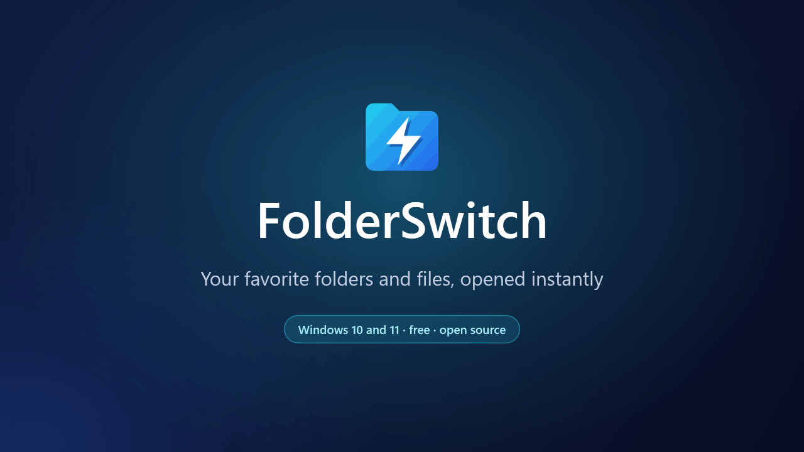
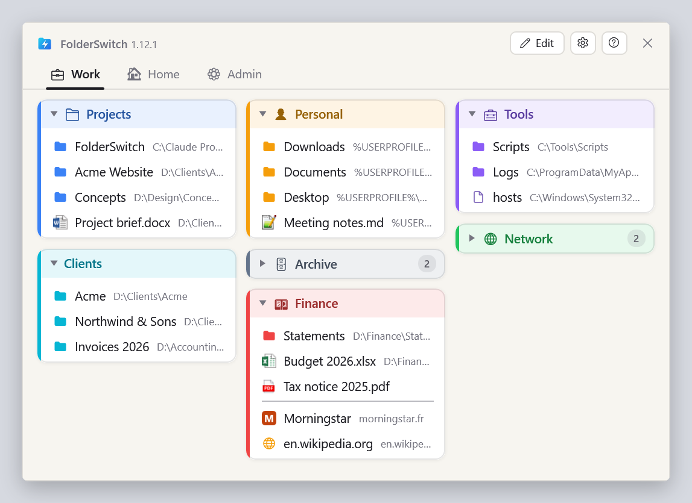
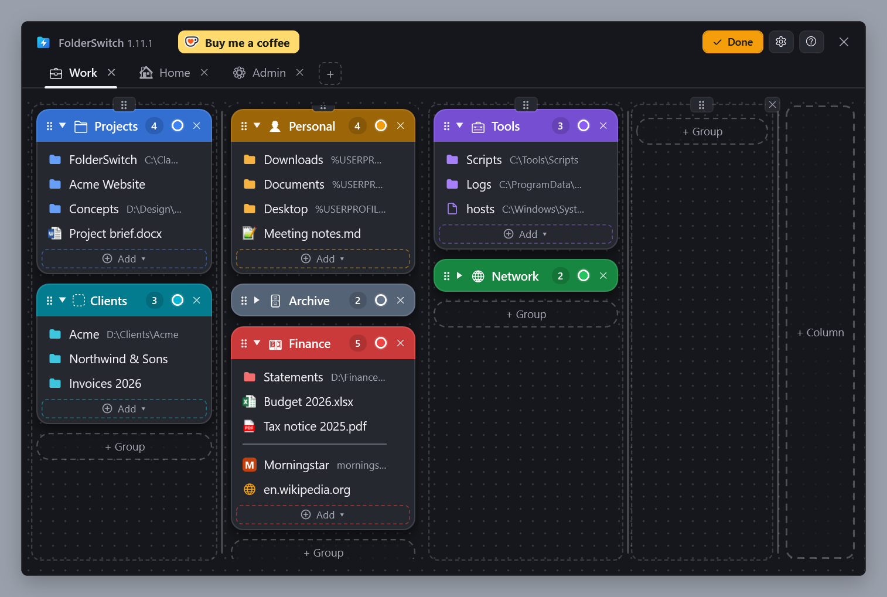
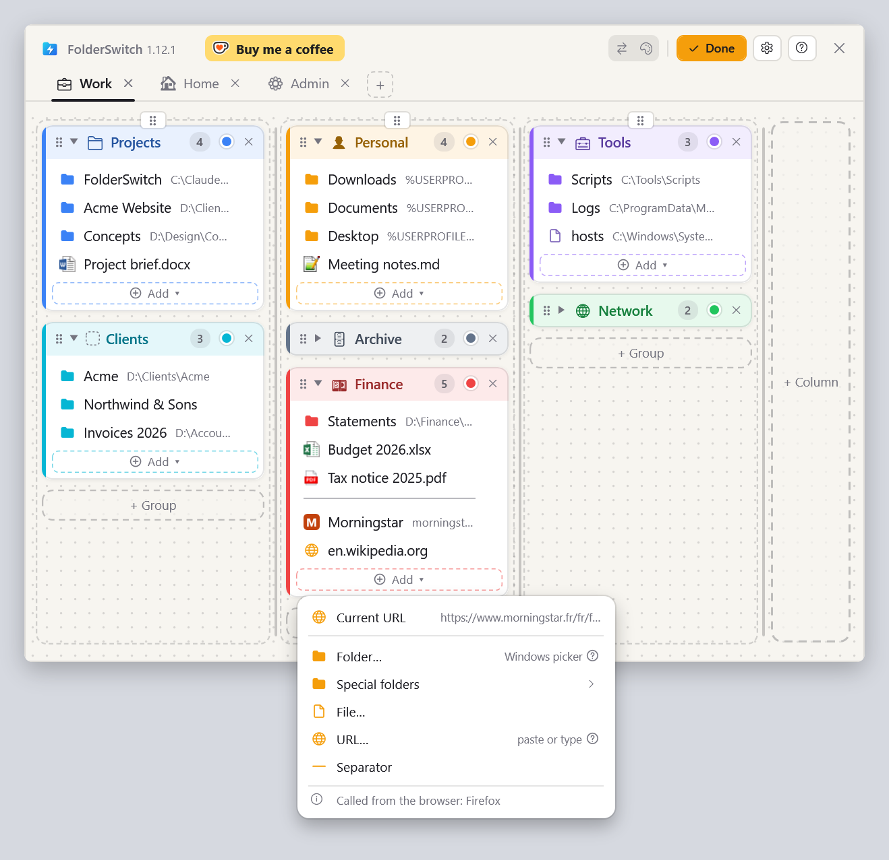
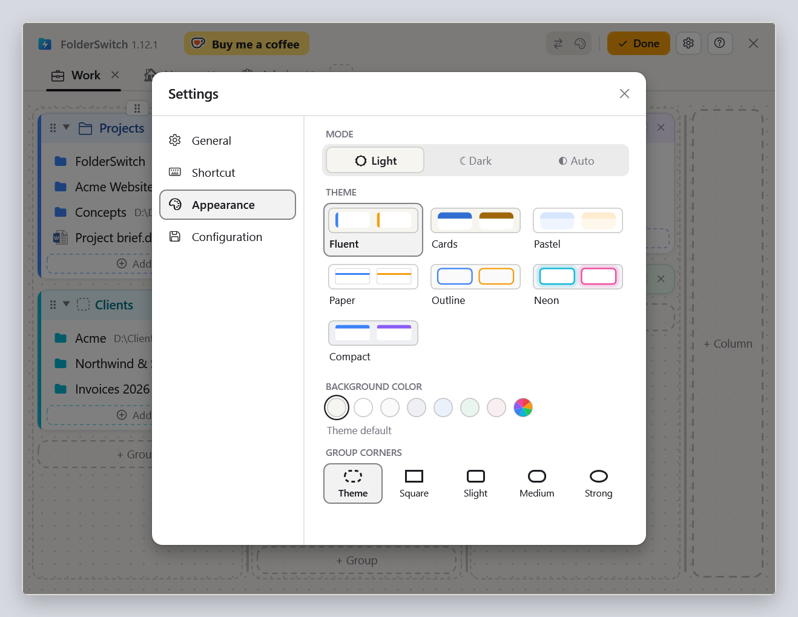

  <b>English</b> ·
  <a href="README.fr.md">Français</a> ·
  <a href="README.de.md">Deutsch</a> ·
  <a href="README.es.md">Español</a> ·
  <a href="README.it.md">Italiano</a> ·
  <a href="README.nl.md">Nederlands</a> ·
  <a href="README.pl.md">Polski</a> ·
  <a href="README.pt-BR.md">Português (Brasil)</a> ·
  <a href="README.pt-PT.md">Português (Portugal)</a>

<h1 align="center">FolderSwitch</h1>

<b>Your favorite folders and files, opened instantly.</b>

  
  
  

  <a href="https://github.com/kbuleon/FolderSwitch/releases/latest/download/FolderSwitch-win-Setup.exe"><b>⬇ Download FolderSwitch for Windows</b></a>
  &nbsp;·&nbsp;
  <a href="https://github.com/kbuleon/FolderSwitch/releases">All versions and their notes</a>

## What is FolderSwitch?

FolderSwitch is a small Windows utility that keeps your favorite folders, files and web sites one shortcut away. Press
**Ctrl + Win** and your board appears: tabs, columns and colored groups, laid out the way you like.

One click on a folder takes the File Explorer window, or the Open / Save As dialog, you called FolderSwitch from
straight to that folder. Called from anywhere else, a folder opens in a new Explorer window, a file in its application
and a site in your browser.

It is free and open source, and it collects nothing about you.

## Screenshots

Your board, as the shortcut shows it:

Edit mode, where tabs, columns, groups and items are added, renamed, recolored and moved by drag and drop (here with
the Cards theme, dark):

The « Add ▾ » menu of a group, called from Firefox: the page the browser shows comes first. Called from File Explorer,
the current folder does:

The icon picker: an emoji suggested from the group's name, or the one you choose:

The settings, with seven themes in light and dark:

## Features

- **One shortcut, everywhere.** Ctrl + Win by default, or any combination you choose. The window opens on the screen
  where your mouse is, and the same shortcut hides it.
- **It knows where you called it from.** File Explorer (its current tab on Windows 11) and the Open, Save As and
  folder-picker dialogs go straight to the folder you click. Ctrl + click opens it in a new Explorer tab instead (a new window on Windows 10).
- **A board you arrange by drag and drop.** Tabs, columns, groups with a color that fold away, and in them folders,
  files, web sites, Windows special folders (Desktop, Documents, This PC…) and separators. Columns keep the width you
  give them: in Edit mode, one click sets them all to the same width, another gives each one its own color. Every change
  is saved at once.
- **Add things where you are.** From File Explorer or a file dialog, « Current folder » adds the folder you are in, in
  one click, and the file picker opens there; from File Explorer, « Selected file » adds the file you have selected.
  From Firefox, Chrome or Edge, « Current URL » adds the page you are reading.
- **Icons that speak.** Tabs and groups get an emoji from their name (« Finance » gets a banknote, « Photos » a
  camera), or the one you pick. Files show their Windows icon, and sites their own icon.
- **Seven themes**, each in light and dark, or following Windows.
- **Nine languages**: English, French, German, Spanish, Italian, Dutch, Polish, and Portuguese of Brazil and of
  Portugal.
- **Your configuration is safe**: backed up automatically, and exported or imported in one click.
- **Up to date by itself**: FolderSwitch checks for a new version once a day and offers to install it. This can be
  turned off in the settings.

## Install

1. Download [FolderSwitch-win-Setup.exe](https://github.com/kbuleon/FolderSwitch/releases/latest/download/FolderSwitch-win-Setup.exe).
2. Run it. FolderSwitch installs for your user only, without administrator rights, and starts.
3. A short wizard asks for your language, your shortcut and your theme, and whether FolderSwitch starts with Windows.

FolderSwitch runs on Windows 10 and 11 (64-bit). The installer is not signed, so Windows may warn that its publisher
is unknown: you can choose to run it anyway.

To uninstall it, use Windows' « Apps » settings. Your configuration is kept, in case you come back.

## Privacy

FolderSwitch collects nothing and sends nothing about you: no telemetry, no analytics, no identifier. It connects to the
internet for two things only: checking GitHub for a new version (unless you turn that off), and fetching the icon of a
web site you add to your board. Nothing from your board is ever sent. The details are in
[DEVELOPMENT.md](DEVELOPMENT.md#privacy).

## Good to know

- The shortcut does nothing while a window running as administrator is in front: Windows does not allow it.
- File Explorer is the only file manager FolderSwitch drives.
- The complete list of known limits is in [DEVELOPMENT.md](DEVELOPMENT.md#known-limits).

## Support FolderSwitch

FolderSwitch is a personal project, made in its author's free time. If it saves you time, you can buy its author a coffee:

Bug reports and suggestions are welcome in the [issues](https://github.com/kbuleon/FolderSwitch/issues); see
[CONTRIBUTING.md](CONTRIBUTING.md). Security vulnerabilities are reported privately: see [SECURITY.md](SECURITY.md).

## For developers

How to build FolderSwitch from source, package it, publish it and test it is in [DEVELOPMENT.md](DEVELOPMENT.md). The
design is in [ARCHITECTURE.md](ARCHITECTURE.md), the map of the code in [CODEMAP.md](CODEMAP.md) and the history of
changes in [CHANGELOG.md](CHANGELOG.md).

## License

FolderSwitch is Copyright (C) 2026 Karl BULEON.

FolderSwitch is free software: you can redistribute it and/or modify it under the terms of the GNU General Public
License as published by the Free Software Foundation, either version 3 of the License, or (at your option) any later
version (SPDX: `GPL-3.0-or-later`), with the additional terms below. It is distributed in the hope that it will be
useful, but WITHOUT ANY WARRANTY; without even the implied warranty of MERCHANTABILITY or FITNESS FOR A PARTICULAR
PURPOSE. See [LICENSE](LICENSE) for the full text of the license.

### Additional terms under section 7 of the GPLv3

These terms apply to all of FolderSwitch, as permitted by section 7 of the GPLv3:

1. **Attribution (section 7(b)).** A work based on FolderSwitch must preserve the author attribution of FolderSwitch in
   the Appropriate Legal Notices it displays, in the form « Based on FolderSwitch by Karl BULEON ».
2. **Origin and name (section 7(c)).** The origin of FolderSwitch must not be misrepresented: a modified version must
   not be conveyed under the name « FolderSwitch » nor with the FolderSwitch icon, and must be marked in reasonable ways
   as different from the original version. Referring to FolderSwitch to state where a work comes from, as in term 1, is
   allowed.
3. **Trademarks (section 7(e)).** This license grants no right under trademark law to use the name « FolderSwitch » or
   its icon.

The icon's files (`assets/icon/`) are licensed under the GPL-3.0-or-later like the rest of the repository (see
`REUSE.toml`), and it is compiled into the executable; only its use to identify a modified version is restricted, by
term 2.

### Third-party components

FolderSwitch is distributed with components under their own licenses, all compatible with the GPLv3: H.NotifyIcon,
Velopack (with the `Setup.exe` and `Update.exe` programs), CommunityToolkit.Mvvm, the code generated by CsWin32, and
the .NET and Windows Desktop runtimes, under the MIT license; the Rust crates of `Setup.exe` and `Update.exe` are under
permissive licenses and the MPL-2.0. The emoji data of the icons comes from Unicode files (the Unicode Emoji list and the CLDR
annotations) and is under the Unicode License v3, also compatible with the GPLv3. Their notices are in
[THIRD-PARTY-NOTICES.txt](THIRD-PARTY-NOTICES.txt), installed next to `FolderSwitch.exe` with the license
(`LICENSE.txt`); the About window links to both.

The cup on Ko-fi's button in Edit mode (`assets/ko-fi/kofi-cup.png`), compiled into the executable, is cropped from
Ko-fi Labs' « Buy me a coffee » button, used as Ko-fi's brand assets allow to link to a Ko-fi page. It is not under the
GPL, and « Ko-fi » is Ko-fi Labs' trademark; a modified version may leave the button out.
