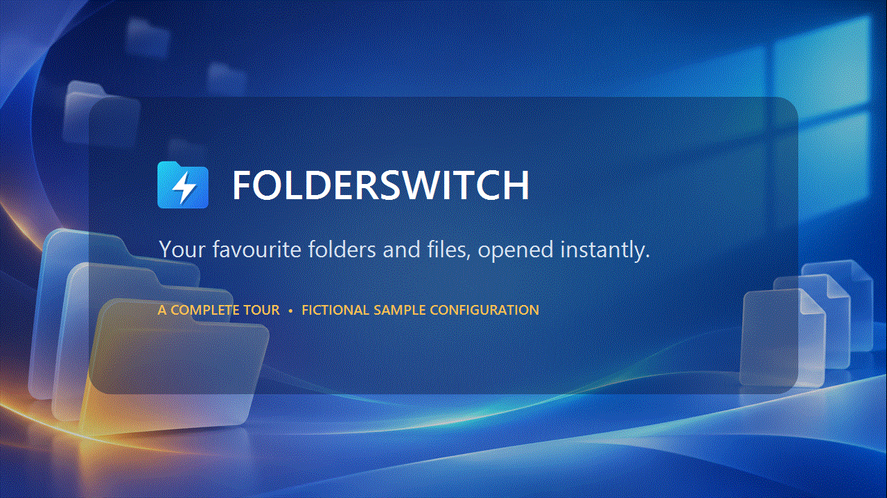
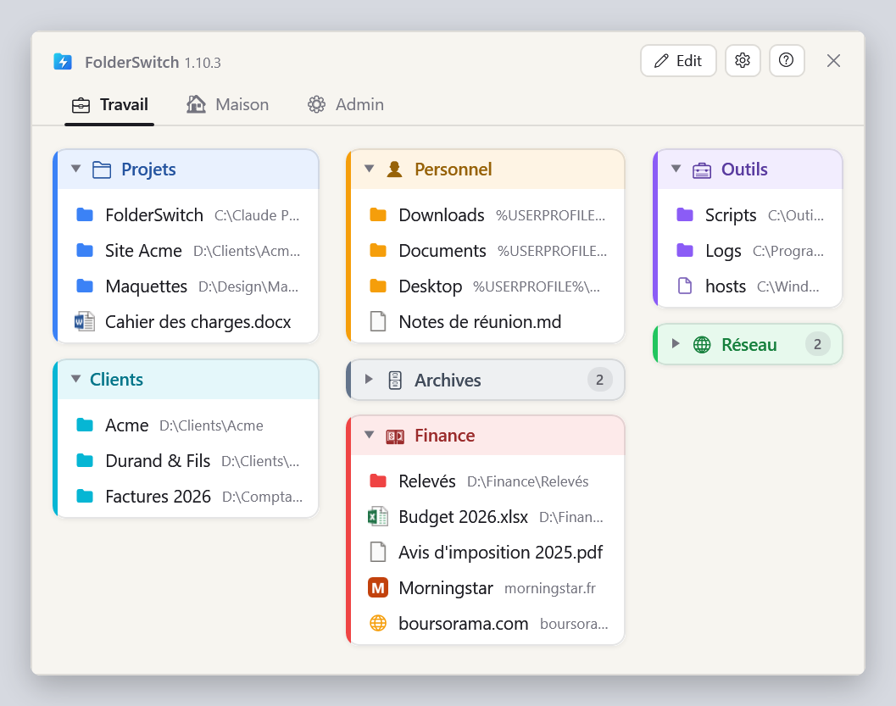
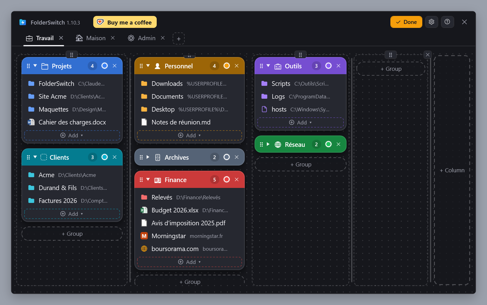
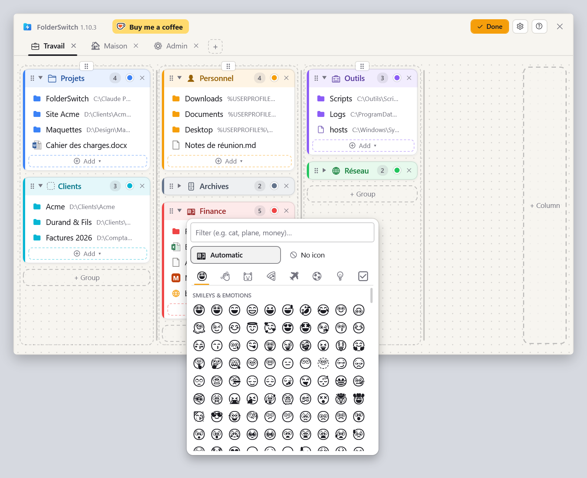
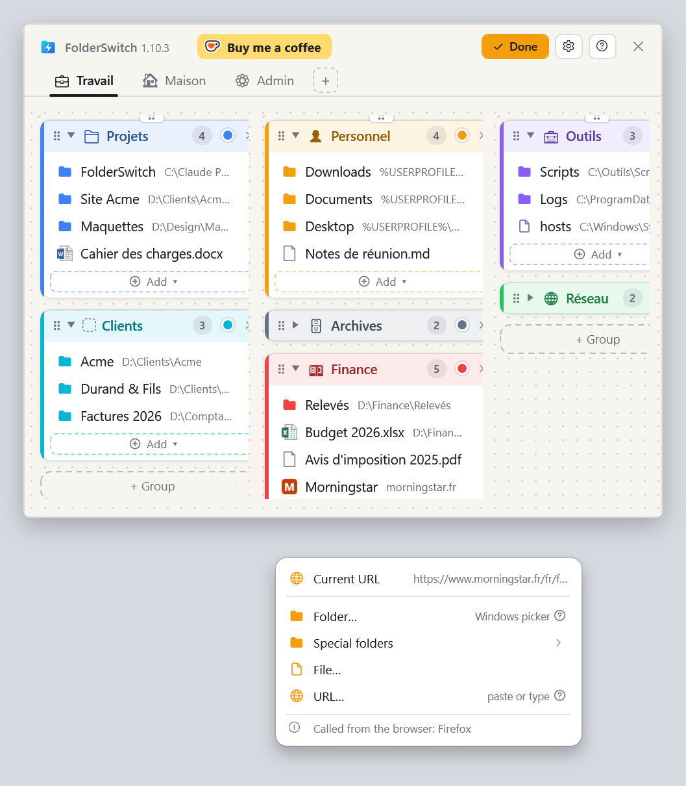
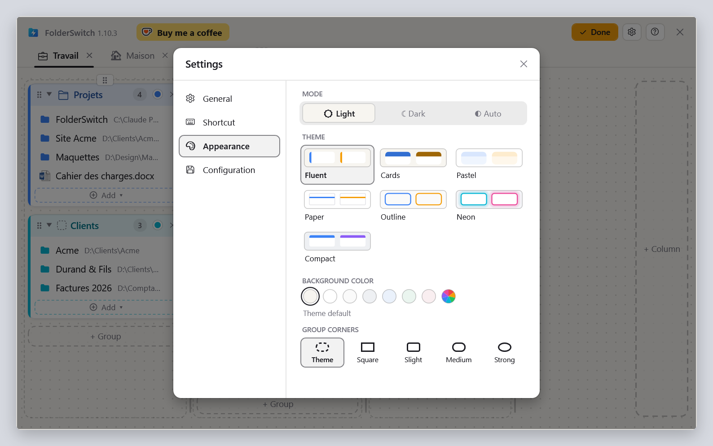

# Folder Switch

**Your favorite folders and files, opened instantly.**



[](LICENSE)


<a href="https://ko-fi.com/karlbuleon"></a>

FolderSwitch is a small resident Windows utility that gives instant access to remembered folders and files. A global
shortcut (Ctrl + Win by default) shows a window that was built once and is only hidden between calls: tabs hold
columns, columns hold collapsible coloured groups, groups hold folders, files and web sites. One click takes the File Explorer
window, or the Open / Save As / folder-picker dialog, you called it from to that folder. From any other window the
folder opens in a new Explorer window, a file opens with its associated application and a site in the default browser.

C# on .NET 10 with WPF, for Windows 10 and 11 (the installer is x64). Installed per user, without administrator rights.

**Download** the installer of the latest version:
[FolderSwitch-win-Setup.exe](https://github.com/kbuleon/FolderSwitch/releases/latest/download/FolderSwitch-win-Setup.exe).
Every version, with its notes, is on the [releases page](https://github.com/kbuleon/FolderSwitch/releases).

## Screenshots

The board, as the shortcut shows it (Fluent theme, light):



Edit mode, where tabs, columns, groups and items are added, renamed, recoloured and moved by drag and drop (Cards
theme, dark):



The icon picker, opened from the icon of the Finance group in Edit mode: a filter, « Automatic » (the icon the group's name
gives), « No icon », the categories, and the emojis the machine's font can draw:



The « Add ▾ » menu of a group, called from Firefox: the page shown by the browser comes first, then the folder picker,
the special folders, the file picker and the address prompt. Called from Explorer, « Current folder » comes first:



The Appearance page of the settings: the mode, the theme, the background colour and the group corners:



These images are drawn by the `--snapshot` diagnostic mode (see « Diagnostic modes » below).

## Main features

- **Global shortcut**, Ctrl + Win pressed alone by default. It acts when the keys are released, so the Windows
  shortcuts that start with Ctrl + Win keep working. Any other combination can be chosen. Pressed again it hides the
  window; in Edit mode, a window left behind another one comes back to the front instead, keeping Edit mode
  and taking the window you came from as the new calling window. The shortcut opens the window centered on the mouse
  cursor, always fully on screen; the notification icon opens it centered on the screen. It moves by its title bar.
- **Context aware**: the calling Explorer window (its active tab on Windows 11) or file dialog (modern and legacy Open,
  Save As, folder pickers) is moved to the folder. Ctrl + click opens a new Explorer tab on Windows 11, a new window
  on Windows 10. A right-click on an item opens its menu: « Open in File Explorer » (a new window; a file's folder for
  a file), and « Open in new tab » when Ctrl + click would open one; for a site, « Copy address ». The title bar shows
  the version that runs. From a file dialog only folders can be used: files and sites are greyed out, with a tooltip.
- **A board you organise by drag and drop** in Edit mode (« Edit » in the title bar): tabs, columns (moved by their
  ⠿ grip) of fixed or automatic width, groups with a colour that collapse, folders, files, web sites and Windows special folders (Desktop, Documents, This PC…). A group's
  « Add ▾ » menu starts with what the window you called FolderSwitch from shows: « Current folder » from Explorer or a
  file dialog, added in one click, « Current URL » from Firefox, Chrome or Edge, whose address opens in the « URL… » prompt to be
  trimmed (of a session id, say) before it is added. It goes on with « Folder… », « Special folders »,
  « File… » and « URL… » (an address typed or pasted; the clipboard's is offered). A column, group or item held over another tab for a
  moment shows that tab, where it can be dropped. A right-click on a tab, a group's header or an item offers « Rename »
  (F2) (and « Icon… » for a tab or a group). Every change is saved at once. The window keeps the width of its widest tab: the tabs stay in place when you
  switch. Edit mode also shows Ko-fi's « Buy me a coffee » button, in the language shown, after the name in the title bar, which opens the
  author's Ko-fi page in the browser; it gives way when the title bar lacks room.
- **Emoji icons for tabs and groups**, left of the name, drawn in one colour, the text's, with the Windows font
  `Segoe UI Emoji`. The icon comes from the name as it is typed, when a tab or a group is created or renamed (« Finance »
  gets a banknote, « Photos » a camera, a name that means nothing to FolderSwitch gets none): first from FolderSwitch's own
  table of common folder and site words, in the nine languages, then from the Unicode keywords of the language in use,
  then of English. In Edit mode, a click on the icon (or on the empty slot) or « Icon… » in the right-click menu opens a
  picker: type the start of a word to filter, choose a category or « Automatic » (the icon the name gives) or « No icon »; Enter
  takes the first result, Escape closes. An icon chosen by hand is never changed by a rename. Tabs and groups that already
  exist get no icon until they are renamed or given one.
- **Icons that say what an item is**: a file shows the icon Windows gives its type, found without touching the file; a
  site shows its favicon, fetched once in the background when the site is added (and tried once more per session when
  the cache has none), and a globe until then or when it has none.
- **Seven themes**, each in a light and a dark variant (or following the Windows mode), with a choice of background
  and group corners.
- **Nine languages**: English, French, Spanish, German, Italian, Portuguese (Brazil and Portugal), Dutch, Polish. A
  language is one JSON file.
- A first-run wizard (a message then says which shortcut opens FolderSwitch), a notification-area icon, start
  with Windows, export and import of the configuration.
- An installer and updates (Velopack), read from the releases of this repository on GitHub. An installed copy looks for
  a new version by itself, a minute after it starts and then every day; « Check for updates automatically » in the
  settings, ticked by default, turns that off, and the « Check for updates » button still works. Once an installation, a
  repair or an update ends, a message box says so, with the version and the shortcut that opens FolderSwitch.

## Documentation

- [ARCHITECTURE.md](ARCHITECTURE.md): how the software is built. The projects and their dependencies, the process
  lifecycle, threads and time budgets, the integration with Windows, persistence, localization, theming, the error
  policy, packaging and the testing strategy.
- [CODEMAP.md](CODEMAP.md): the map of the code, one line per significant file or type, folder by folder.
- [CHANGELOG.md](CHANGELOG.md): the history of changes, version by version.
- [LICENSE](LICENSE), [THIRD-PARTY-NOTICES.txt](THIRD-PARTY-NOTICES.txt), [CONTRIBUTING.md](CONTRIBUTING.md) and
  [SECURITY.md](SECURITY.md): see « License » and « Contributing » below.

## Build and run from source

Prerequisites: Windows and the .NET 10 SDK (pinned by `global.json`). Warnings are errors.

Every `.cs`, `.xaml` and `.ps1` file starts with the license header:

```csharp
// SPDX-License-Identifier: GPL-3.0-or-later
// Copyright (C) 2026 Karl BULEON
// Additional terms under GPLv3 section 7: see the License section of README.md.
```

A C# file without it fails the build (rule IDE0073, from `.editorconfig`; the IDE's quick fix, Ctrl+., inserts it). XAML
files carry it in a `<!-- -->` comment and PowerShell files in `#` lines, by hand. Files that cannot carry a comment are
declared in `REUSE.toml`.

```powershell
dotnet build FolderSwitch.slnx -c Release
dotnet run --project src/FolderSwitch.App -c Release
```

The emoji data of the icons (`src/FolderSwitch.App/Emoji/`, copied next to the executable) is made from the Unicode files by
the maintainer's tool `tools/FolderSwitch.EmojiData`, which is not part of the build and whose output is committed; its own
`README.md` says how to run it.

A second copy never starts: it asks the running one to show itself, so quit an installed copy before running one from
source. A copy that Velopack did not install never checks for updates. A copy run from source uses the real
configuration, `%APPDATA%\FolderSwitch`, like an installed one, and « Start with Windows » (in the settings or the
first-run wizard) rewrites the same `Run` value, then pointing at the `bin\…\FolderSwitch.exe` of the source tree.

## Package and publish

Nothing to install beyond the SDK: the packaging tool, Velopack's `vpk`, is a local dotnet tool
(`.config/dotnet-tools.json`) that the script restores. When upgrading, keep its version equal to the `Velopack` package
of `Directory.Packages.props`. `vpk` runs on the .NET 10 runtime that comes with
the SDK, so no roll-forward setting is needed.

`artifacts/publish` holds `LICENSE.txt` (the GPLv3) and `THIRD-PARTY-NOTICES.txt` next to `FolderSwitch.exe`, and the
installer installs them. When a package is added or updated, or the SDK brings another runtime, update
`THIRD-PARTY-NOTICES.txt` (name, version, address, copyright and license text of each component); compare it with
`dotnet list src/FolderSwitch.App package --include-transitive` and the runtime packs of `artifacts/publish/FolderSwitch.deps.json`.
Check the license of a new package first: it must be compatible with the GPLv3 (a GPLv2-only one is not).

```powershell
powershell -ExecutionPolicy Bypass -File build/pack.ps1
```

The script (Windows PowerShell 5.1 or PowerShell 7) publishes the application self-contained, ReadyToRun, win-x64 to
`artifacts/publish`, then packs it with `vpk` into `artifacts/releases`. The version released is the `<Version>` property of
`Directory.Build.props`; `-Version` (`x.y.z` or `x.y.z-prerelease`) releases another one, such as a prerelease. It is
also the version of the application (the settings show its `x.y.z` part). `-ReleaseNotes <file>` (a Markdown file that
must exist) puts the notes of the version in the package. The executable is `FolderSwitch.exe`.
`-ExecutionPolicy Bypass` is for a Windows client whose policy refuses unsigned scripts.

| In `artifacts/releases`                | What it is                                               |
| -------------------------------------- | -------------------------------------------------------- |
| `FolderSwitch-win-Setup.exe`           | the installer: per user, no administrator rights         |
| `FolderSwitch-<version>-full.nupkg`    | the full package, for updates                            |
| `FolderSwitch-<version>-delta.nupkg`   | the delta from the previous version found in the folder  |
| `releases.win.json`, `RELEASES`        | the feed that lists the packages                         |
| `assets.win.json`, `FolderSwitch-win-Portable.zip` | not needed for updates                       |

Run alone, the script keeps what `artifacts/releases` holds and builds the delta package from the previous release found
there; `build/release.ps1` (below) rebuilds that folder from GitHub at each preparation. `artifacts/` is not versioned.

**Publishing.** The updates are the releases of `https://github.com/kbuleon/FolderSwitch` (`UpdateFeed.Url` in
`src/FolderSwitch.App/UpdateFeed.cs`, the address of the repository: any other address disables the check and the « Check
for updates » button of the settings). `build/release.ps1` makes one, from a PowerShell prompt at the root of the repository:

```powershell
powershell -ExecutionPolicy Bypass -File build/release.ps1 -Step Prepare   # build and test locally, upload nothing
powershell -ExecutionPolicy Bypass -File build/release.ps1 -Step Publish   # tag and upload what Prepare built
powershell -ExecutionPolicy Bypass -File build/release.ps1                 # All: Prepare, then Publish
```

It needs the [GitHub CLI](https://cli.github.com/) (`gh`), installed and signed in once (`gh auth login`). The release is the
`<Version>` of `Directory.Build.props` (`x.y.z` only, never a prerelease), named `FolderSwitch <version>`, on the annotated
tag `v<version>`; its notes are the version's section of `CHANGELOG.md` (titled `## <version> — `), its title in bold.
*Prepare* runs the Core, Presentation and App tests, downloads the latest published release into an emptied
`artifacts/releases` (the base of the delta package), packs with `pack.ps1 -ReleaseNotes`, and records the version and the
commit in `artifacts/release-prepared.json`: try the installer it shows before publishing. *Publish* creates and pushes the
tag on the prepared commit, uploads `artifacts/releases` as a draft release, then sets the notes and publishes it. Both
refuse, saying what to do, unless `gh` is signed in, the branch is `main` with no uncommitted change and no untracked file
(ignored ones do not count) and the same commit as `origin/main`, and the changelog has the section; *Prepare* also refuses a
tag or a release of that version already there, and a non-empty `artifacts/releases` it did not make (it holds a marker
file, `.made-by-release-ps1`: set your own folder aside, e.g. as `artifacts/releases-before-github`), and *Publish* a missing or stale preparation, a published release and a tag on another commit. An
interrupted *Publish* is run again: a draft that holds every file is only made visible, an empty one is filled, and one
that holds only some is refused (delete the draft on GitHub, keep the tag, run it again). The token comes from
`gh auth token` when it is needed and goes to `vpk` only, in an environment variable: never shown, never written to a file.
The script never deletes a tag or a release and never changes a published release: fix a published version with a new one.

The first version that reads GitHub cannot be found by an older installed copy (its update address was empty): it is
installed by hand, with `FolderSwitch-win-Setup.exe`. From then on installed copies find each release themselves.

An installed copy asks GitHub for the releases of the repository, then for the feed of each of them, about a minute after it
starts and then every 24 hours (unless « Check for updates automatically » is unticked, which stops the timer at once and
never interrupts a check or a download in progress). It announces a version with a notification and an « Install update »
entry in the notification menu: once per session, so again after the next start of FolderSwitch while the update is not
installed, and during a session again only for a newer version. It installs the update when the user accepts (the entry
reads « Downloading update… » and the « Check for updates » button is disabled meanwhile). A copy that Velopack did not
install (a development run) never checks. Without a token, the GitHub API answers 60 requests an hour per IP address, far
more than one check a day needs; no token is built into the application. The update accounts for one of the two kinds of
network access of FolderSwitch (the other is the favicons of the sites, see « Privacy »).

**Source code.** The GPL requires each published binary to come with a way to get its source (section 6). The commit of
each published version carries the tag `v<version>`, which `build/release.ps1` creates and pushes, and the release page is
in the repository itself, next to that tag.

**Signing.** `-SignParams` hands the parameters of `signtool.exe` to `vpk`, which runs its own copy of it to sign the
application's files, the updater and the installer (the code signing certificate must be in the user's store, or named in
the parameters). Unsigned, SmartScreen warns about an unknown publisher.

```powershell
powershell -ExecutionPolicy Bypass -File build/pack.ps1 -SignParams '/a /fd sha256 /tr http://timestamp.digicert.com /td sha256'
```

**Checks to make by hand on a release** (no test runs the installer):

1. Quit FolderSwitch, then run `FolderSwitch-win-Setup.exe`: it installs to `%LocalAppData%\FolderSwitch` (the folder
   that Velopack owns) with no elevation prompt and starts FolderSwitch; `current\` holds `LICENSE.txt` and
   `THIRD-PARTY-NOTICES.txt`, which the About window's links open. The wizard's « Start with Windows » writes the
   `FolderSwitch` value of `HKCU\Software\Microsoft\Windows\CurrentVersion\Run`, with the path
   `%LocalAppData%\FolderSwitch\current\FolderSwitch.exe`; after signing out and in, FolderSwitch is running.
2. Uninstall it from « Apps »: the `Run` value is gone, and `%APPDATA%\FolderSwitch` (the configuration and the debug
   log, `logs\folderswitch.log`) is kept.
3. Update: with the previous version installed (from its release), press « Check for updates » in the settings: the offer
   for the new release appears, and « Install » restarts FolderSwitch on it (the settings show the version).
4. Untick « Check for updates automatically » in the settings: the debug log says « Updates: automatic check off », and no
   check follows (tick it again: « automatic check on »).

## Tests

Four xUnit projects (Core, Presentation, App, Windows integration), plus the `DialogHost` helper; the testing strategy
of [ARCHITECTURE.md](ARCHITECTURE.md) says what each one covers. Every class of the Windows integration tests is tagged
`Category=Desktop`, except three that touch no window (the browser reading rule, its wait per window, the file type
icons).

The **Desktop** category drives real windows: it opens Explorer windows, file dialogs (through `DialogHost`), a message
box, a text editor and, for each of Firefox, Chrome and Edge that is installed, a browser with a throwaway profile on
pages served by the test itself (a browser that is not installed skips its tests), moves the foreground window, and
installs the real keyboard hook. No keystroke is sent, but do not run it while someone is using the machine. Filter it out, or run it alone:

```powershell
dotnet test FolderSwitch.slnx --filter "Category!=Desktop"   # Core, Presentation, App and the windowless Windows tests: safe at any time
dotnet test FolderSwitch.slnx --filter "Category=Desktop"    # Windows integration tests: on an idle desktop
```

Nothing automated covers the installer and the update flow: see « Checks to make by hand on a release » above.

## Diagnostic modes

```powershell
FolderSwitch.exe --self-test
FolderSwitch.exe --snapshot <directory> [--snapshot-language <code>]
```

- `--self-test` composes everything with the real services, builds and renders the main window off-screen, then exits
  without showing anything. It uses a throwaway configuration folder and never touches the user's configuration or
  log (the folder is deleted when the test passes, kept when it fails). Exit code 0: passed; 1: could not start (or
  another self-test is running); 2: not ready within 5 s; 3: an exception reached the UI thread. From the installed
  program: `(Start-Process .\FolderSwitch.exe -ArgumentList '--self-test' -Wait -PassThru).ExitCode`; from source:
  `dotnet run --project src/FolderSwitch.App -c Release -- --self-test`.
- `--snapshot <directory>` draws the main window's content and the first-run wizard into PNG files, off-screen (nothing
  appears on screen): every theme in both variants at 96 and 144 DPI, Edit mode, the menus, each page of the settings,
  the About window and the message boxes, in the language of `--snapshot-language` (French by default). It needs no running instance, touches neither the
  configuration nor the keyboard, and writes its log, `folderswitch.log`, in the output folder. Exit code 0 when every
  file was written, 1 otherwise.

## Where data lives

| What | Where |
| ---- | ----- |
| Configuration | `%APPDATA%\FolderSwitch\config.json`: indented JSON with a schema version (2; a version 1 file is read as it is), written at every change (a temporary file, then an atomic replace). |
| Backups | `%APPDATA%\FolderSwitch\backups\config-<yyyyMMdd-HHmmss>.json`: one at each start and one before an import replaces the configuration; the 10 most recent are kept. |
| Invalid configuration | `%APPDATA%\FolderSwitch\config.invalid-<timestamp>.json`: a damaged `config.json` is kept aside, then replaced by the latest valid backup (or by a new configuration), and the user is told. |
| Favicons | `%APPDATA%\FolderSwitch\favicons\`: one image per host (`morningstar.fr.png`, the host in lower-case punycode), outside the configuration and its export; deleting the folder is harmless, the icons are fetched again. |
| Emoji data | `Emoji\` next to `FolderSwitch.exe`: `catalog.json`, `synonyms.json` and `keywords\<language>.json`. Shipped with the program, read when it starts, never downloaded; not in `%APPDATA%`. |
| Debug log | `%APPDATA%\FolderSwitch\logs\folderswitch.log`, rolling to `folderswitch.1.log` at 512 KiB. Local only. |
| Start with Windows | The `FolderSwitch` value of `HKCU\Software\Microsoft\Windows\CurrentVersion\Run`. |
| Installed program | `%LocalAppData%\FolderSwitch`, owned by Velopack. Uninstalling removes it and the `Run` value, and keeps `%APPDATA%\FolderSwitch`. |

The configuration can be exported to a file and imported again from the Configuration page of the settings (⚙ in the title bar).

## Privacy

FolderSwitch collects nothing and sends nothing about you: no telemetry, no analytics, no identifier. Its debug log stays
on the machine. It makes two kinds of network request, and no other:

- The update check: the list of the releases of this repository from the GitHub API, then the feed of each release, a
  minute after FolderSwitch starts and then every 24 hours, unless « Check for updates automatically » is unticked (and
  when the user presses « Check for updates » or accepts an update, which also downloads the package). GitHub sees the IP
  address and the `User-Agent` header that Velopack sends, under GitHub's own privacy statement. FolderSwitch adds no
  token and no identifier, and nothing from the board or the configuration is in a request.
- The favicon of a web site, when a site is added to a board, and once per session for a site that has none in the
  cache. It is a plain `GET` of the site's own page, then of the icon the page declares or `/favicon.ico`, to the site
  itself, up to 5 redirects, with no cookie and the single header `User-Agent: FolderSwitch/<version>`; it gives up after
  5 s in all, and reads 256 KiB at most from any response. Nothing from the board or the configuration is in a request.
  Reading the address of the page a browser shows (for « Current URL ») stays on the machine.

The emoji data of the icons is shipped with the program: nothing is downloaded for it. So is the cup of Ko-fi's button
in Edit mode: only a click on it opens the Ko-fi page, in the browser.

With automatic update checks turned off (or in a copy Velopack did not install) and without a site on the board,
FolderSwitch never connects on its own.

## Known limits

Imposed by Windows:

- **The shortcut has no effect while a window running as administrator has the focus.** Windows does not give the
  keyboard to a program that is not elevated then. Running FolderSwitch as administrator is not supported.
- **On Windows 11, Ctrl + click opening a new Explorer tab is not guaranteed.** It relies on an Explorer command that
  Microsoft does not document and may stop working after a Windows update. FolderSwitch then opens a new window.

In the current version:

- « Current URL » works with Firefox, Chrome and Edge only, and relies on what they expose to Windows accessibility
  (UI Automation): a browser update may break it, and the address can still be typed (« URL… »). A browser run as
  administrator cannot be read. The first reading of a browser session can be slow, so the line may appear after a moment,
  or not at all; the browser is not otherwise touched, but reading it may turn on its accessibility mode until it closes.
  A site opens in the default browser, not in the browser the address came from.
  From a Chrome or Edge window that is hidden or fully covered, only the address bar can be read, and it hides the scheme:
  an `http` page is then stored as `https` (remove it and add it again with « URL… »).
- Only the `http` and `https` schemes are accepted for a site. A favicon that is neither an ICO nor a bitmap (PNG, GIF,
  JPEG, BMP), such as an SVG, shows the globe.
- Going back to an earlier version of FolderSwitch loses the changes made since the update: it does not read a version 2
  configuration, sets it aside and starts again from the latest backup it can read. A 1.7.0 reads a configuration that has
  icons, ignores them and drops them when it saves; nothing else is lost.
- From a file dialog only folders can be used: a file or a site is greyed out, and a file no longer moves the dialog to
  its folder. Edit mode is not affected.
- Only genuine file dialogs are driven, and only to folders such a dialog can show (This PC, libraries and network
  locations qualify, the Recycle Bin and the Control Panel do not). The move is limited to 1.5 s and fails with a
  message rather than waiting.
- The calling window's current folder is read within 50 ms. If Explorer or the dialog does not answer in time,
  FolderSwitch still knows the kind of window but « Current folder » is unavailable for that call. It is unavailable
  too for search results, which are a query rather than a place.
- The OneDrive special folder resolves only when the OneDrive client has set its environment variable.
- Emoji icons are drawn in one colour, and some are less readable that way than others. The list leaves out flags, skin tone
  variants and composed emojis (families, professions), which WPF cannot assemble, and the few emojis that do not read well in
  one colour.
- The emojis offered, and shown, are those the machine's `Segoe UI Emoji` can draw: Windows 10's font has fewer than
  Windows 11's, so an icon chosen on 11 is hidden on 10 (it stays in the configuration and comes back where the font has it).
  The drawing on Windows 10 has not been tried on a real machine.
- An icon is suggested only from the words of the table and the Unicode keywords: a proper name or a rare word gets none, and the
  suggestion is made once, when the name is validated (it does not follow a later change of language).
- File Explorer is the only supported file manager; items are folders, files and web sites; languages written left to right only.

## Contributing

Code contributions are not accepted; bug reports and suggestions are welcome. See [CONTRIBUTING.md](CONTRIBUTING.md).
Security vulnerabilities are reported privately: see [SECURITY.md](SECURITY.md).

## License

FolderSwitch is Copyright (C) 2026 Karl BULEON.

FolderSwitch is free software: you can redistribute it and/or modify it under the terms of the GNU General Public
License as published by the Free Software Foundation, either version 3 of the License, or (at your option) any later
version (SPDX: `GPL-3.0-or-later`), with the additional terms below. It is distributed in the hope that it will be
useful, but WITHOUT ANY WARRANTY; without even the implied warranty of MERCHANTABILITY or FITNESS FOR A PARTICULAR
PURPOSE. See [LICENSE](LICENSE) for the full text of the license.

### Additional terms under section 7 of the GPLv3

These terms apply to all of FolderSwitch, as permitted by section 7 of the GPLv3:

1. **Attribution (section 7(b)).** A work based on FolderSwitch must preserve the author attribution of FolderSwitch in
   the Appropriate Legal Notices it displays, in the form « Based on FolderSwitch by Karl BULEON ».
2. **Origin and name (section 7(c)).** The origin of FolderSwitch must not be misrepresented: a modified version must
   not be conveyed under the name « FolderSwitch » nor with the FolderSwitch icon, and must be marked in reasonable ways
   as different from the original version. Referring to FolderSwitch to state where a work comes from, as in term 1, is
   allowed.
3. **Trademarks (section 7(e)).** This license grants no right under trademark law to use the name « FolderSwitch » or
   its icon.

The icon's files (`assets/icon/`) are licensed under the GPL-3.0-or-later like the rest of the repository (see
`REUSE.toml`), and it is compiled into the executable; only its use to identify a modified version is restricted, by
term 2.

### Third-party components

FolderSwitch is distributed with components under their own licenses, all compatible with the GPLv3: H.NotifyIcon,
Velopack (with the `Setup.exe` and `Update.exe` programs), CommunityToolkit.Mvvm, the code generated by CsWin32, and
the .NET and Windows Desktop runtimes, under the MIT license; the Rust crates of `Setup.exe` and `Update.exe` are under
permissive licenses and the MPL-2.0. The emoji data of the icons comes from Unicode files (the Unicode Emoji list and the CLDR
annotations) and is under the Unicode License v3, also compatible with the GPLv3. Their notices are in
[THIRD-PARTY-NOTICES.txt](THIRD-PARTY-NOTICES.txt), installed next to `FolderSwitch.exe` with the license
(`LICENSE.txt`); the About window links to both.

The cup on Ko-fi's button in Edit mode (`assets/ko-fi/kofi-cup.png`), compiled into the executable, is cropped from
Ko-fi Labs' « Buy me a coffee » button, used as Ko-fi's brand assets allow to link to a Ko-fi page. It is not under the
GPL, and « Ko-fi » is Ko-fi Labs' trademark; a modified version may leave the button out.
