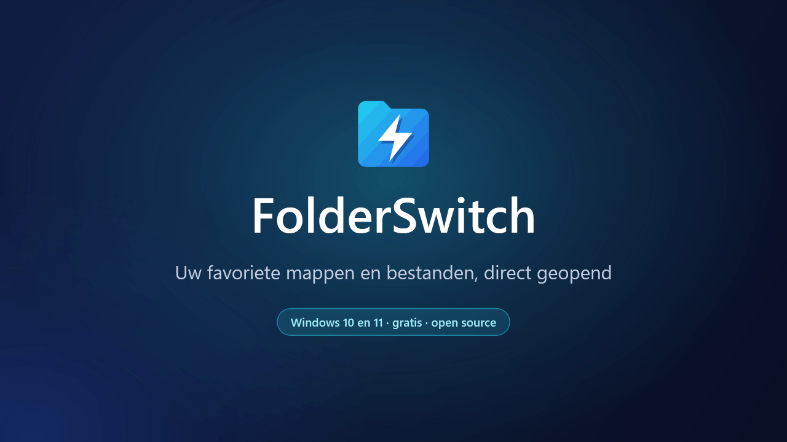
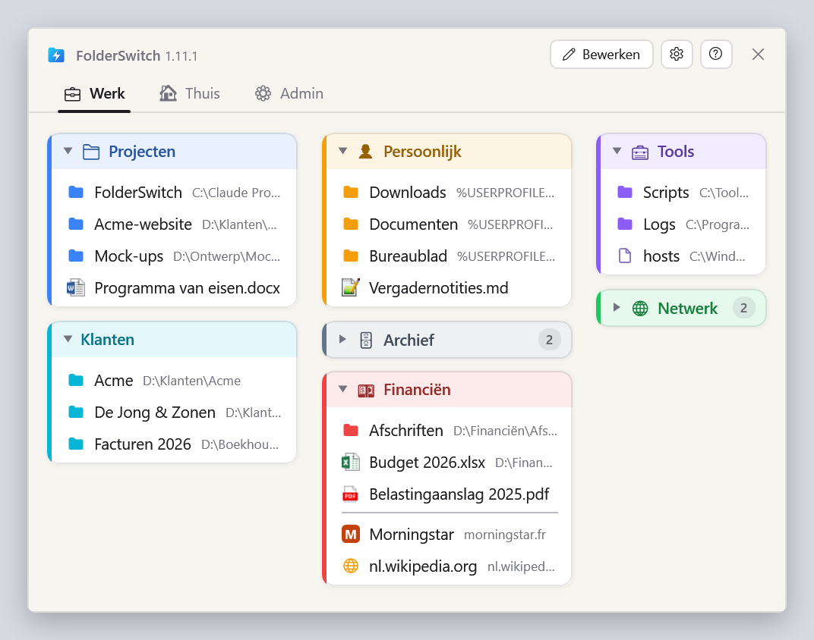
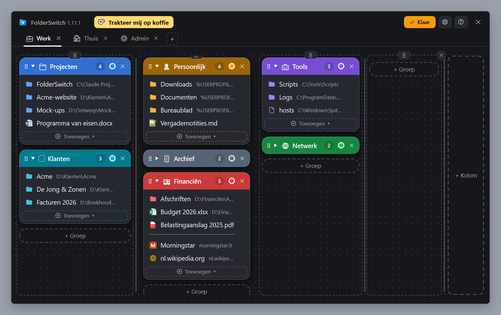
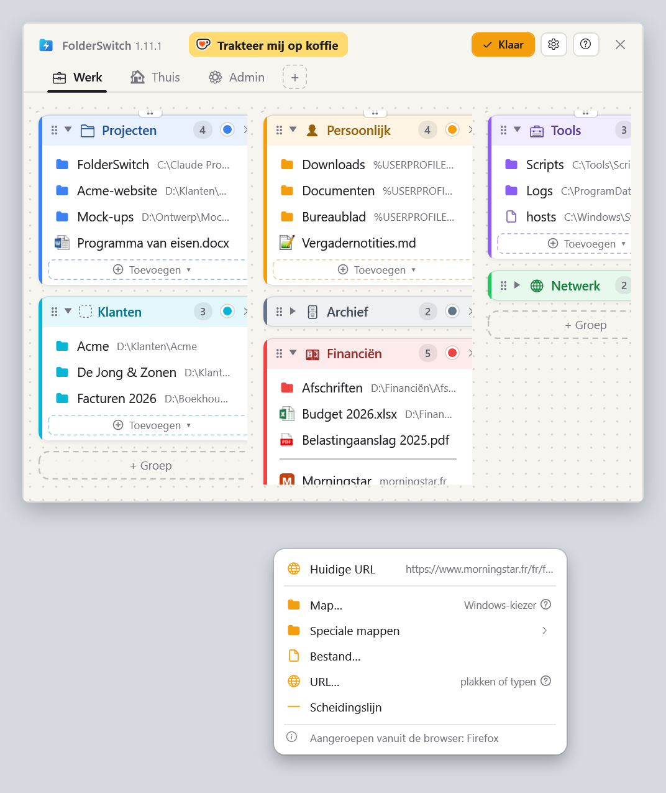
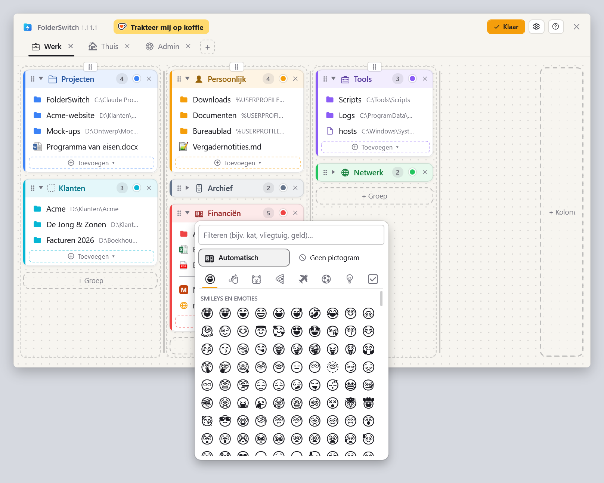
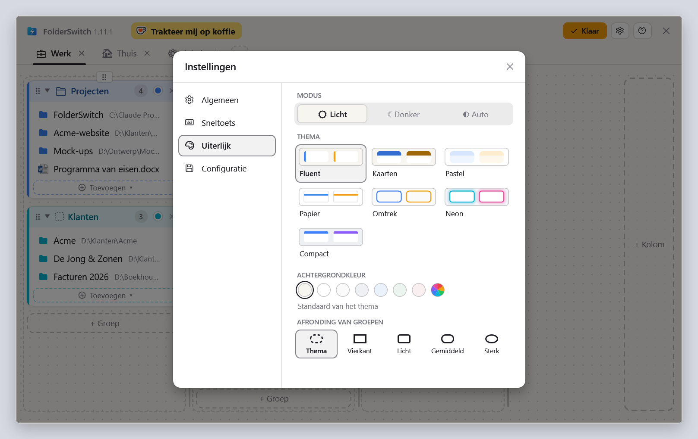

  <a href="README.md">English</a> ·
  <a href="README.fr.md">Français</a> ·
  <a href="README.de.md">Deutsch</a> ·
  <a href="README.es.md">Español</a> ·
  <a href="README.it.md">Italiano</a> ·
  <b>Nederlands</b> ·
  <a href="README.pl.md">Polski</a> ·
  <a href="README.pt-BR.md">Português (Brasil)</a> ·
  <a href="README.pt-PT.md">Português (Portugal)</a>

<h1 align="center">FolderSwitch</h1>

<b>Uw favoriete mappen en bestanden, direct geopend.</b>

  
  
  

  <a href="https://github.com/kbuleon/FolderSwitch/releases/latest/download/FolderSwitch-win-Setup.exe"><b>⬇ FolderSwitch voor Windows downloaden</b></a>
  &nbsp;·&nbsp;
  <a href="https://github.com/kbuleon/FolderSwitch/releases">Alle versies en hun release-opmerkingen</a>

## Wat is FolderSwitch?

FolderSwitch is een klein Windows-hulpprogramma dat uw favoriete mappen, bestanden en websites één sneltoets ver weg
houdt. Druk op **Ctrl + Win** en uw bord verschijnt: tabbladen, kolommen en gekleurde groepen, ingedeeld zoals u het
wilt.

Eén klik op een map brengt het Verkenner-venster, of het dialoogvenster Openen / Opslaan als, waarvandaan u FolderSwitch
hebt opgeroepen, rechtstreeks naar die map. Vanaf een andere plek opgeroepen opent een map zich in een nieuw
Verkenner-venster, een bestand in zijn eigen toepassing en een website in uw browser.

Het is gratis en open source, en verzamelt niets over u.

## Schermafbeeldingen

Uw bord, zoals de sneltoets het toont:

De modus Bewerken, waarin tabbladen, kolommen, groepen en items worden toegevoegd, hernoemd, anders gekleurd en met
slepen en neerzetten verplaatst (hier met het thema Kaarten, donker):

Het menu ‘Toevoegen ▾’ van een groep, opgeroepen vanuit Firefox: de pagina die de browser toont staat bovenaan. Vanuit
Verkenner opgeroepen is dat de huidige map:

De pictogramkiezer: een emoji die wordt voorgesteld op basis van de naam van de groep, of die u zelf kiest:

De instellingen, met zeven thema's in licht en donker:

## Functies

- **Eén sneltoets, overal.** Standaard Ctrl + Win, of elke combinatie die u kiest. Het venster opent op het scherm waar
  uw muis staat, en dezelfde sneltoets verbergt het weer.
- **Het weet waarvandaan u het oproept.** Verkenner (op Windows 11 het huidige tabblad) en de dialoogvensters Openen,
  Opslaan als en mapkeuze gaan rechtstreeks naar de map waarop u klikt. Ctrl + klik opent die in plaats daarvan in een
  nieuw tabblad van Verkenner (op Windows 10 in een nieuw venster).
- **Een bord dat u indeelt met slepen en neerzetten.** Tabbladen, kolommen, gekleurde groepen die u kunt inklappen, en
  daarin mappen, bestanden, websites, speciale Windows-mappen (Bureaublad, Documenten, Deze pc…) en scheidingslijnen.
  Elke wijziging wordt meteen opgeslagen.
- **Voeg dingen toe waar u bent.** Vanuit Verkenner of een bestandsdialoogvenster voegt ‘Huidige map’ met één klik de
  map toe waarin u zich bevindt. Vanuit Firefox, Chrome of Edge voegt ‘Huidige URL’ de pagina toe die u leest.
- **Pictogrammen die spreken.** Tabbladen en groepen krijgen een emoji op basis van hun naam (‘Financiën’ krijgt een
  bankbiljet, ‘Foto's’ een camera), of die u zelf kiest. Bestanden tonen hun Windows-pictogram en websites hun eigen.
- **Zeven thema's**, elk in licht en donker, of in de stijl van Windows.
- **Negen talen**: Engels, Frans, Duits, Spaans, Italiaans, Nederlands, Pools en Portugees van Brazilië en van
  Portugal.
- **Uw configuratie is veilig**: automatisch een back-up gemaakt, en met één klik geëxporteerd of geïmporteerd.
- **Houdt zichzelf up-to-date**: FolderSwitch controleert één keer per dag of er een nieuwe versie is en biedt aan die
  te installeren. Dit kunt u in de instellingen uitschakelen.

## Installeren

1. Download [FolderSwitch-win-Setup.exe](https://github.com/kbuleon/FolderSwitch/releases/latest/download/FolderSwitch-win-Setup.exe).
2. Voer het uit. FolderSwitch wordt alleen voor uw gebruiker geïnstalleerd, zonder beheerdersrechten, en start.
3. Een korte wizard vraagt naar uw taal, uw sneltoets en uw thema, en of FolderSwitch met Windows moet starten.

FolderSwitch draait op Windows 10 en 11 (64-bits). Het installatieprogramma is niet ondertekend, dus Windows kan
waarschuwen dat de uitgever onbekend is: u kunt kiezen om het toch uit te voeren.

Om het te verwijderen, gebruikt u de instellingen ‘Apps’ van Windows. Uw configuratie blijft bewaard, voor het geval u
terugkomt.

## Privacy

FolderSwitch verzamelt niets en verstuurt niets over u: geen telemetrie, geen analyses, geen identificatie. Het maakt
alleen voor twee dingen verbinding met internet: op GitHub controleren of er een nieuwe versie is (tenzij u dat
uitschakelt) en het pictogram ophalen van een website die u aan uw bord toevoegt. Er wordt nooit iets van uw bord
verzonden. De details staan in [DEVELOPMENT.md](DEVELOPMENT.md#privacy) (in het Engels, net als de andere technische
documenten die hieronder worden genoemd).

## Goed om te weten

- De sneltoets doet niets zolang een venster dat als beheerder draait op de voorgrond staat: Windows staat dat niet toe.
- Verkenner is de enige bestandsbeheerder die FolderSwitch aanstuurt.
- De volledige lijst met bekende beperkingen staat in [DEVELOPMENT.md](DEVELOPMENT.md#known-limits).

## FolderSwitch steunen

FolderSwitch is een persoonlijk project, gemaakt in de vrije tijd van de maker. Als het u tijd bespaart, kunt u hem een kopje
koffie aanbieden:

Foutmeldingen en suggesties zijn welkom in de [issues](https://github.com/kbuleon/FolderSwitch/issues); zie
[CONTRIBUTING.md](CONTRIBUTING.md). Beveiligingslekken worden privé gemeld: zie [SECURITY.md](SECURITY.md).

## Voor ontwikkelaars

Hoe u FolderSwitch uit de broncode bouwt, verpakt, publiceert en test, staat in [DEVELOPMENT.md](DEVELOPMENT.md). Het
ontwerp staat in [ARCHITECTURE.md](ARCHITECTURE.md), de kaart van de code in [CODEMAP.md](CODEMAP.md) en de geschiedenis
van de wijzigingen in [CHANGELOG.md](CHANGELOG.md).

## Licentie

FolderSwitch is Copyright (C) 2026 Karl BULEON.

Het is vrije software, verspreid onder de GNU General Public License versie 3 of, naar uw keuze, een latere versie
(SPDX: `GPL-3.0-or-later`), zonder enige garantie. De volledige tekst staat in [LICENSE](LICENSE). Daar komen drie extra
voorwaarden bij, op grond van sectie 7 van de GPLv3:

1. een werk dat op FolderSwitch is gebaseerd, moet de vermelding ‘Based on FolderSwitch by Karl BULEON’ behouden;
2. een gewijzigde versie mag niet ‘FolderSwitch’ heten en het pictogram ervan niet gebruiken;
3. er wordt geen merkrecht verleend op de naam of het pictogram.

Onderdelen van derden vallen onder hun eigen, compatibele licenties; ze staan vermeld in
[THIRD-PARTY-NOTICES.txt](THIRD-PARTY-NOTICES.txt).

Alleen de Engelse tekst is bindend: zie [README.md](README.md#license).
