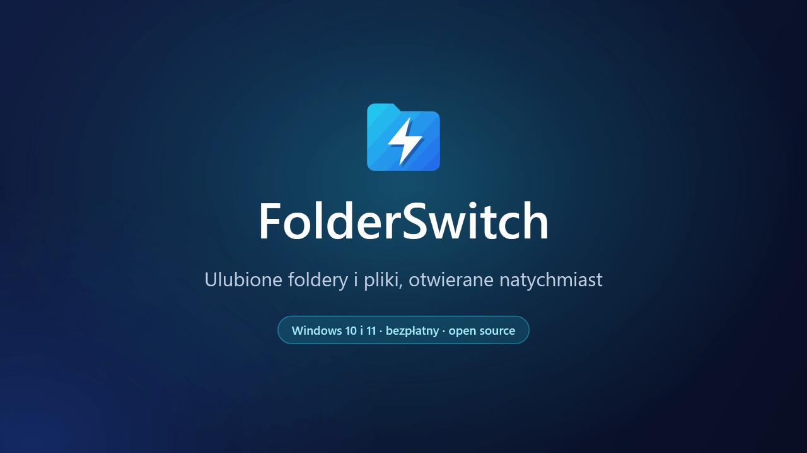
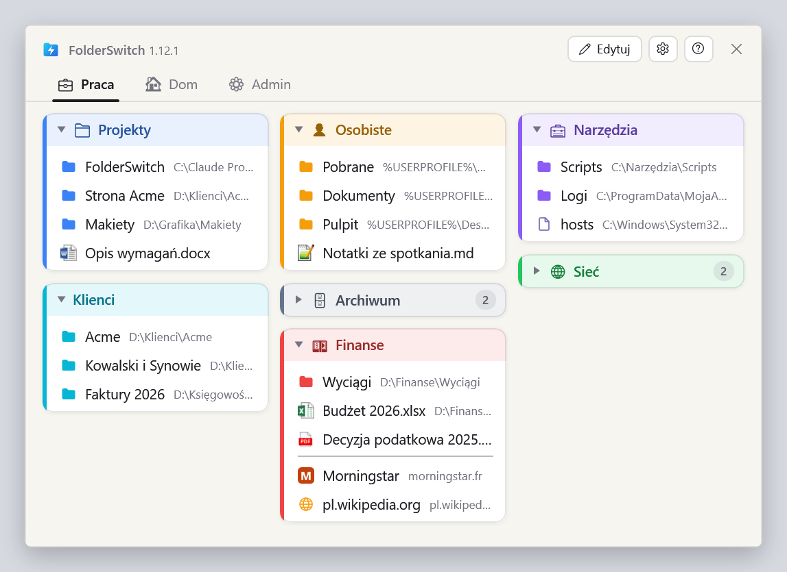
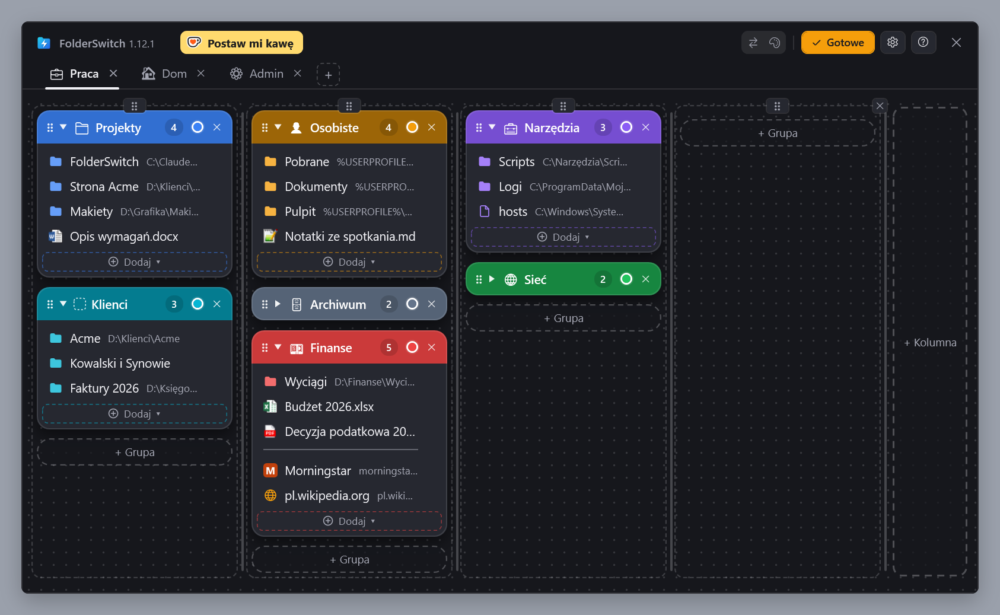
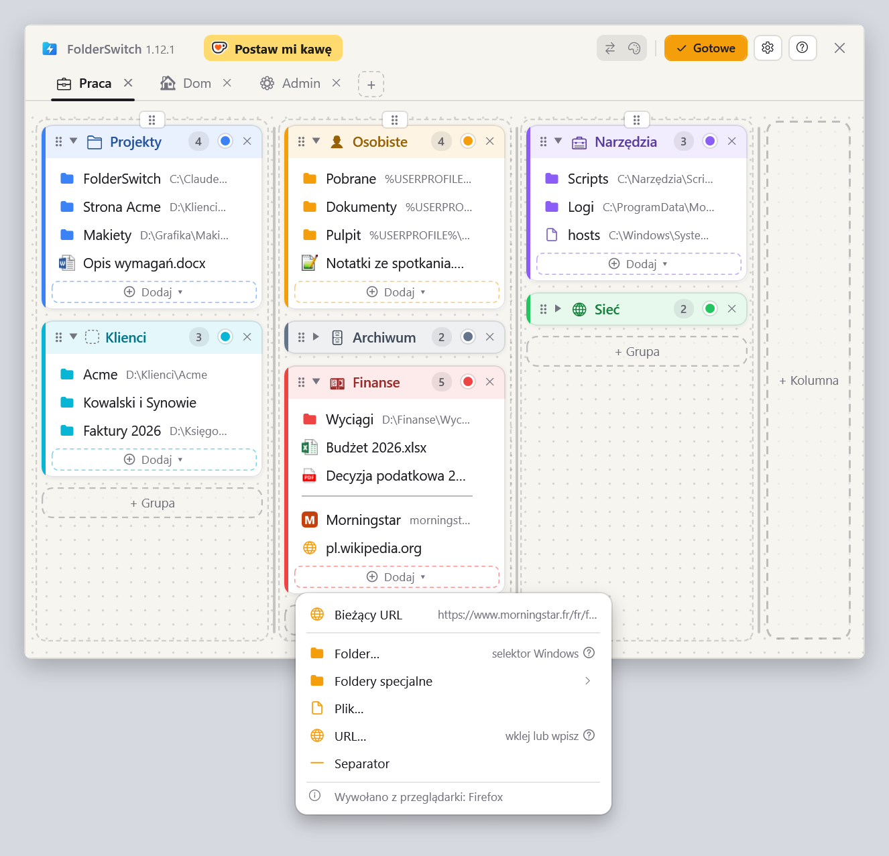
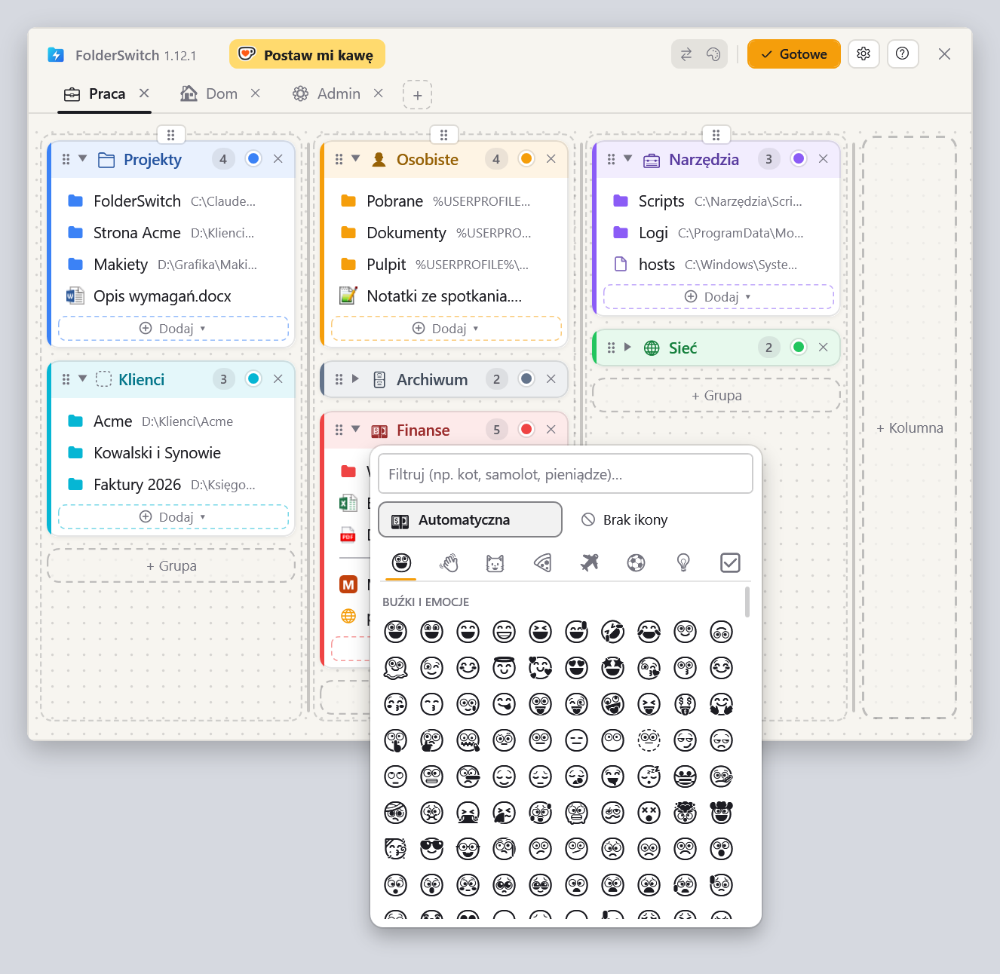
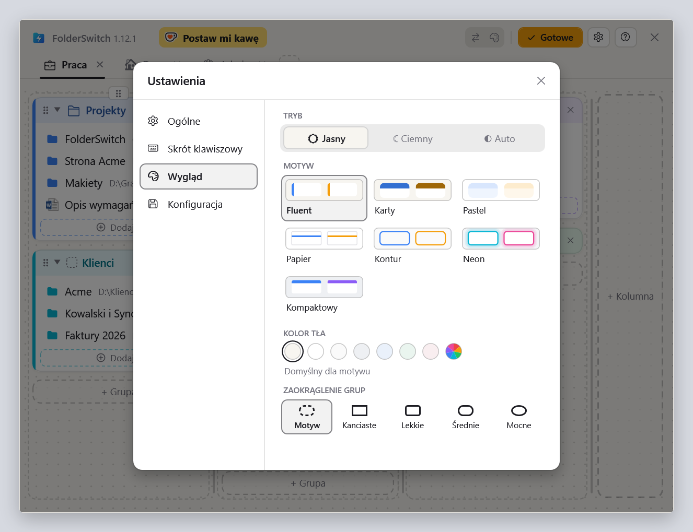

  <a href="README.md">English</a> ·
  <a href="README.fr.md">Français</a> ·
  <a href="README.de.md">Deutsch</a> ·
  <a href="README.es.md">Español</a> ·
  <a href="README.it.md">Italiano</a> ·
  <a href="README.nl.md">Nederlands</a> ·
  <b>Polski</b> ·
  <a href="README.pt-BR.md">Português (Brasil)</a> ·
  <a href="README.pt-PT.md">Português (Portugal)</a>

<h1 align="center">FolderSwitch</h1>

<b>Ulubione foldery i pliki, otwierane natychmiast.</b>

  
  
  

  <a href="https://github.com/kbuleon/FolderSwitch/releases/latest/download/FolderSwitch-win-Setup.exe"><b>⬇ Pobierz FolderSwitch dla Windows</b></a>
  &nbsp;·&nbsp;
  <a href="https://github.com/kbuleon/FolderSwitch/releases">Wszystkie wersje i ich opisy</a>

## Czym jest FolderSwitch?

FolderSwitch to małe narzędzie dla Windows, które trzyma Twoje ulubione foldery, pliki i strony internetowe o jeden
skrót stąd. Naciśnij **Ctrl + Win**, a pojawi się Twoja tablica: karty, kolumny i kolorowe grupy, ułożone tak, jak
lubisz.

Jedno kliknięcie folderu przenosi okno Eksploratora plików lub okno dialogowe Otwórz / Zapisz jako, z którego
FolderSwitch został wywołany, prosto do tego folderu. Wywołany z dowolnego innego miejsca, folder otwiera się w nowym
oknie Eksploratora, plik w swojej aplikacji, a strona internetowa w przeglądarce.

Jest darmowy, ma otwarte źródła i nie zbiera żadnych danych o Tobie.

## Zrzuty ekranu

Twoja tablica, taka, jaką pokazuje skrót:

Tryb Edytuj, w którym karty, kolumny, grupy i elementy dodaje się, zmienia im nazwy i kolory oraz przenosi je metodą
przeciągnij i upuść (tu z motywem Karty, ciemnym):

Menu „Dodaj ▾” grupy, wywołane z Firefoksa: na pierwszym miejscu jest strona, którą pokazuje przeglądarka. Wywołane
z Eksploratora plików, na pierwszym miejscu jest bieżący folder:

Selektor ikon: emoji zaproponowane na podstawie nazwy grupy albo to, które wybierzesz:

Ustawienia, z siedmioma motywami w wersji jasnej i ciemnej:

## Funkcje

- **Jeden skrót, wszędzie.** Domyślnie Ctrl + Win lub dowolna wybrana kombinacja. Okno otwiera się na ekranie, na którym
  jest mysz, a ten sam skrót je ukrywa.
- **Wie, skąd go wywołujesz.** Eksplorator plików (w Windows 11 jego bieżąca karta) oraz okna dialogowe Otwórz,
  Zapisz jako i wyboru folderu przechodzą prosto do klikniętego folderu. Ctrl + klik otwiera go zamiast tego w nowej
  karcie Eksploratora (w Windows 10 w nowym oknie).
- **Tablica, którą układasz przeciąganiem.** Karty, kolumny, kolorowe grupy, które można zwijać, a w nich foldery,
  pliki, strony internetowe, foldery specjalne systemu Windows (Pulpit, Dokumenty, Ten komputer…) i separatory. Kolumny
  zachowują szerokość, którą im nadasz: w trybie Edytuj jedno kliknięcie wyrównuje ich szerokość, a drugie nadaje każdej
  własny kolor. Każda zmiana jest zapisywana od razu.
- **Dodawaj rzeczy tam, gdzie jesteś.** W Eksploratorze plików lub oknie dialogowym plików „Bieżący folder” dodaje
  folder, w którym się znajdujesz, jednym kliknięciem. W Firefoksie, Chrome lub Edge „Bieżący URL” dodaje stronę, którą
  czytasz.
- **Ikony, które mówią same za siebie.** Karty i grupy dostają emoji na podstawie nazwy („Finanse” dostają banknot,
  „Zdjęcia” aparat) albo to, które wybierzesz. Pliki pokazują swoją ikonę z Windows, a strony własną.
- **Siedem motywów**, każdy w wersji jasnej i ciemnej lub zgodnie z Windows.
- **Dziewięć języków**: angielski, francuski, niemiecki, hiszpański, włoski, niderlandzki, polski oraz portugalski
  brazylijski i europejski.
- **Twoja konfiguracja jest bezpieczna**: automatycznie archiwizowana, eksportowana i importowana jednym kliknięciem.
- **Aktualizuje się sam**: FolderSwitch raz dziennie sprawdza, czy jest nowa wersja, i proponuje jej instalację. Można to
  wyłączyć w ustawieniach.

## Instalacja

1. Pobierz [FolderSwitch-win-Setup.exe](https://github.com/kbuleon/FolderSwitch/releases/latest/download/FolderSwitch-win-Setup.exe).
2. Uruchom go. FolderSwitch instaluje się tylko dla Twojego użytkownika, bez uprawnień administratora, i startuje.
3. Krótki kreator zapyta o język, skrót i motyw oraz o to, czy FolderSwitch ma uruchamiać się razem z Windows.

FolderSwitch działa w systemach Windows 10 i 11 (64-bitowych). Instalator nie jest podpisany, więc Windows może
ostrzec, że wydawca jest nieznany: możesz zdecydować, że i tak chcesz go uruchomić.

Aby go odinstalować, skorzystaj z ustawień „Aplikacje” w Windows. Twoja konfiguracja zostanie zachowana, na wypadek
gdyby przyszło Ci wrócić.

## Prywatność

FolderSwitch niczego nie zbiera i niczego o Tobie nie wysyła: bez telemetrii, bez analityki, bez identyfikatora. Łączy
się z internetem tylko w dwóch celach: aby sprawdzić w GitHubie, czy jest nowa wersja (chyba że to wyłączysz), i aby
pobrać ikonę strony internetowej dodanej do tablicy. Nic z Twojej tablicy nigdy nie jest wysyłane. Szczegóły są w
[DEVELOPMENT.md](DEVELOPMENT.md#privacy) (po angielsku, tak jak pozostałe dokumenty techniczne wymienione niżej).

## Warto wiedzieć

- Skrót nic nie robi, gdy na pierwszym planie jest okno uruchomione jako administrator: Windows na to nie pozwala.
- Eksplorator plików to jedyny menedżer plików, którym FolderSwitch steruje.
- Pełna lista znanych ograniczeń jest w [DEVELOPMENT.md](DEVELOPMENT.md#known-limits).

## Wesprzyj FolderSwitch

FolderSwitch to projekt osobisty, tworzony w wolnym czasie. Jeśli oszczędza Ci czas, możesz postawić jego autorowi kawę:

Zgłoszenia błędów i sugestie są mile widziane w [issues](https://github.com/kbuleon/FolderSwitch/issues); zobacz
[CONTRIBUTING.md](CONTRIBUTING.md). Luki w zabezpieczeniach zgłasza się prywatnie: zobacz [SECURITY.md](SECURITY.md).

## Dla programistów

Jak zbudować FolderSwitch ze źródeł, spakować go, opublikować i przetestować, opisano w [DEVELOPMENT.md](DEVELOPMENT.md).
Projekt jest w [ARCHITECTURE.md](ARCHITECTURE.md), mapa kodu w [CODEMAP.md](CODEMAP.md), a historia zmian
w [CHANGELOG.md](CHANGELOG.md).

## Licencja

FolderSwitch jest objęty prawami autorskimi Copyright (C) 2026 Karl BULEON.

To wolne oprogramowanie, rozpowszechniane na warunkach Powszechnej Licencji Publicznej GNU (GPL) w wersji 3 lub, według
Twojego wyboru, dowolnej późniejszej (SPDX: `GPL-3.0-or-later`), bez jakiejkolwiek gwarancji. Pełny tekst znajduje się
w [LICENSE](LICENSE). Dochodzą do tego trzy dodatkowe warunki na mocy sekcji 7 GPLv3:

1. utwór oparty na FolderSwitch musi zachować informację „Based on FolderSwitch by Karl BULEON”;
2. zmodyfikowana wersja nie może nazywać się „FolderSwitch” ani używać jego ikony;
3. nie przyznaje się żadnych praw ze znaku towarowego do nazwy ani ikony.

Składniki firm trzecich podlegają własnym, zgodnym licencjom; są wymienione w
[THIRD-PARTY-NOTICES.txt](THIRD-PARTY-NOTICES.txt).

Wiążący jest wyłącznie tekst angielski: zobacz [README.md](README.md#license).
