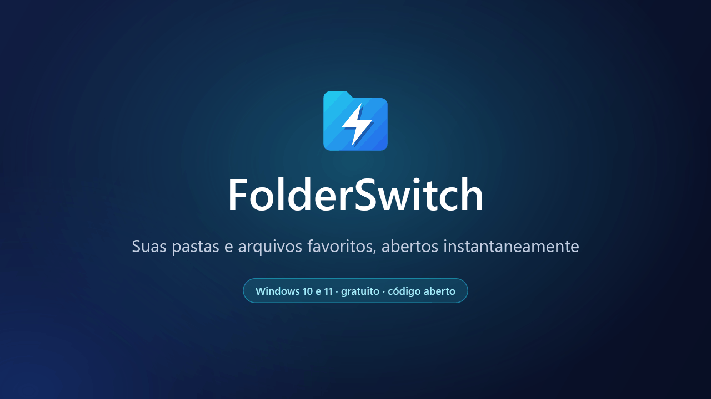
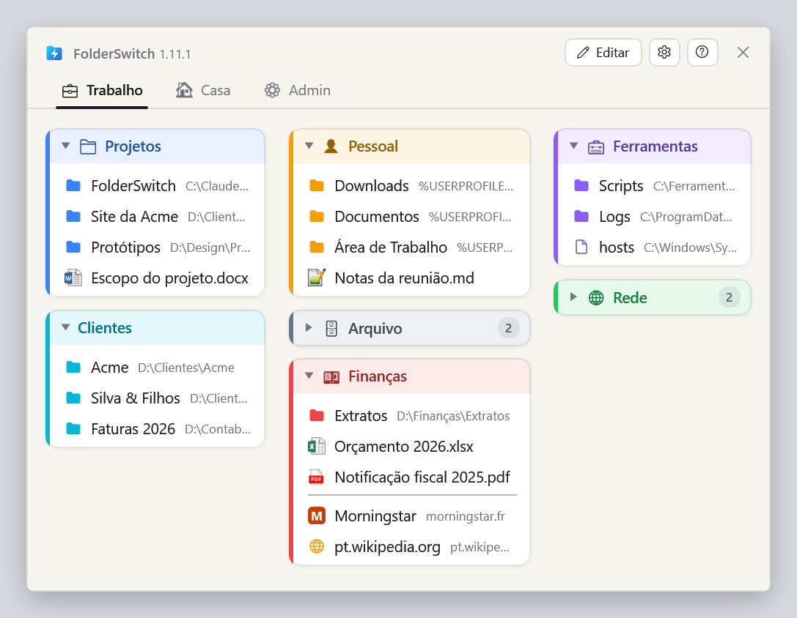
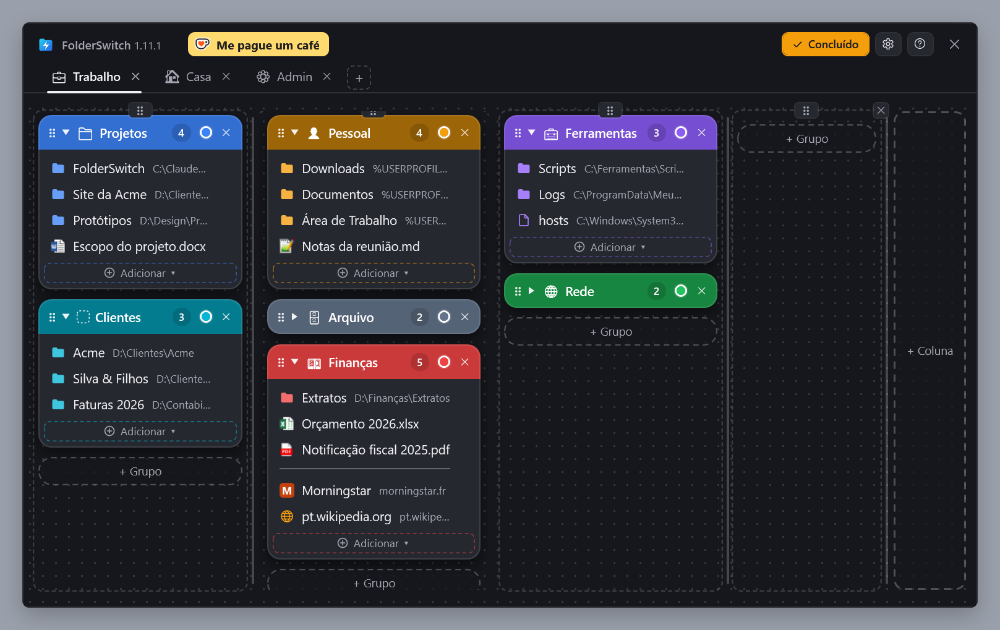
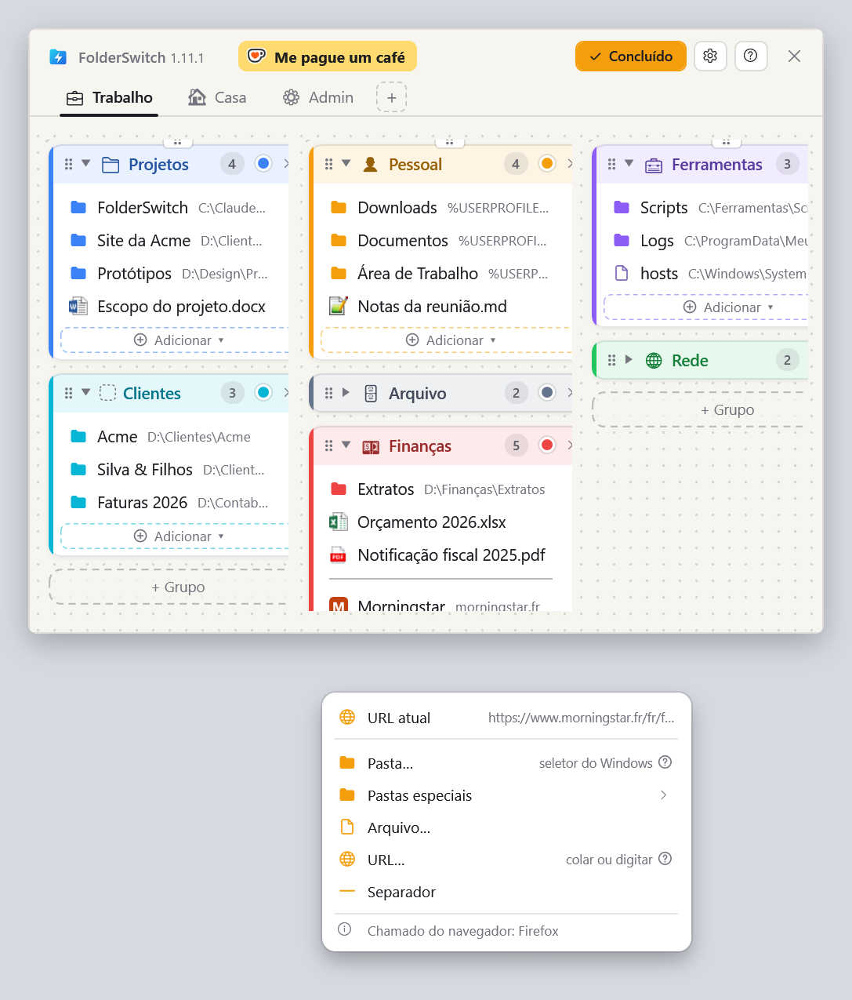
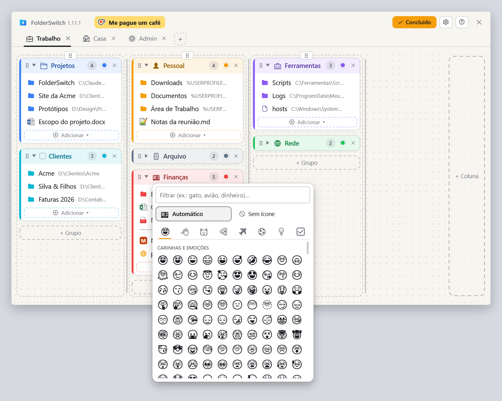
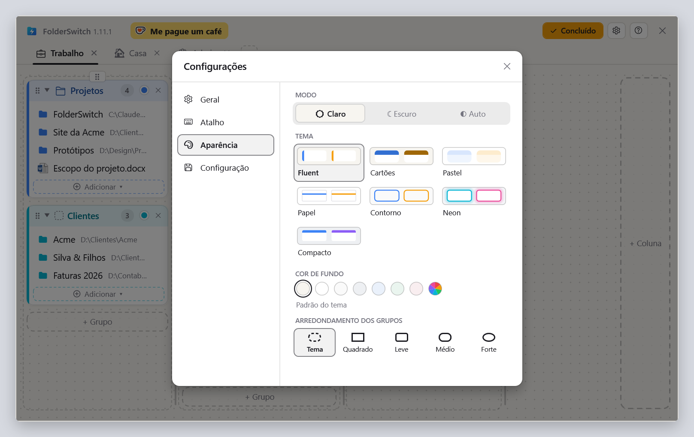

  <a href="README.md">English</a> ·
  <a href="README.fr.md">Français</a> ·
  <a href="README.de.md">Deutsch</a> ·
  <a href="README.es.md">Español</a> ·
  <a href="README.it.md">Italiano</a> ·
  <a href="README.nl.md">Nederlands</a> ·
  <a href="README.pl.md">Polski</a> ·
  <b>Português (Brasil)</b> ·
  <a href="README.pt-PT.md">Português (Portugal)</a>

<h1 align="center">FolderSwitch</h1>

<b>Suas pastas e arquivos favoritos, abertos instantaneamente.</b>

  
  
  

  <a href="https://github.com/kbuleon/FolderSwitch/releases/latest/download/FolderSwitch-win-Setup.exe"><b>⬇ Baixar o FolderSwitch para Windows</b></a>
  &nbsp;·&nbsp;
  <a href="https://github.com/kbuleon/FolderSwitch/releases">Todas as versões e suas notas</a>

## O que é o FolderSwitch?

O FolderSwitch é um pequeno utilitário para Windows que deixa suas pastas, arquivos e sites favoritos a um atalho de
distância. Pressione **Ctrl + Win** e seu quadro aparece: guias, colunas e grupos coloridos, organizados do jeito que
você preferir.

Um clique em uma pasta leva direto para ela a janela do Explorador de Arquivos, ou a caixa de diálogo Abrir / Salvar
como, de onde você chamou o FolderSwitch. Chamado de qualquer outro lugar, uma pasta abre em uma nova janela do
Explorador, um arquivo no seu aplicativo e um site no seu navegador.

Ele é gratuito, de código aberto e não coleta nada sobre você.

## Capturas de tela

Seu quadro, como o atalho o mostra:

O modo Editar, em que guias, colunas, grupos e itens são adicionados, renomeados, recoloridos e movidos com arrastar e
soltar (aqui com o tema Cartões, escuro):

O menu “Adicionar ▾” de um grupo, chamado a partir do Firefox: a página que o navegador está mostrando vem primeiro.
Chamado a partir do Explorador de Arquivos, é a pasta atual:

O seletor de ícones: um emoji sugerido a partir do nome do grupo, ou o que você escolher:

As configurações, com sete temas em claro e escuro:

## Recursos

- **Um só atalho, em qualquer lugar.** Ctrl + Win por padrão, ou qualquer combinação que você escolher. A janela abre na
  tela em que está o mouse, e o mesmo atalho a esconde.
- **Ele sabe de onde você o chamou.** O Explorador de Arquivos (a guia atual, no Windows 11) e as caixas de diálogo
  Abrir, Salvar como e de seleção de pasta vão direto para a pasta em que você clica. Ctrl + clique a abre em uma nova
  guia do Explorador (uma nova janela no Windows 10).
- **Um quadro que você organiza com arrastar e soltar.** Guias, colunas, grupos coloridos que podem ser recolhidos e,
  dentro deles, pastas, arquivos, sites, pastas especiais do Windows (Área de Trabalho, Documentos, Este Computador…) e
  separadores. Cada alteração é salva na hora.
- **Adicione coisas onde você está.** No Explorador de Arquivos ou em uma caixa de diálogo de arquivos, “Pasta atual”
  adiciona a pasta em que você está, com um clique. No Firefox, no Chrome ou no Edge, “URL atual” adiciona a página que
  você está lendo.
- **Ícones que falam.** Guias e grupos ganham um emoji a partir do nome (“Finanças” ganha uma nota de dinheiro, “Fotos”
  uma câmera), ou o que você escolher. Os arquivos mostram o ícone deles no Windows, e os sites, o seu próprio.
- **Sete temas**, cada um em claro e escuro, ou acompanhando o Windows.
- **Nove idiomas**: inglês, francês, alemão, espanhol, italiano, holandês, polonês e português do Brasil e de Portugal.
- **Sua configuração está segura**: com backup automático, exportada ou importada com um clique.
- **Se atualiza sozinho**: o FolderSwitch verifica uma vez por dia se há uma nova versão e oferece para instalá-la. Isso
  pode ser desativado nas configurações.

## Instalação

1. Baixe o [FolderSwitch-win-Setup.exe](https://github.com/kbuleon/FolderSwitch/releases/latest/download/FolderSwitch-win-Setup.exe).
2. Execute-o. O FolderSwitch é instalado apenas para o seu usuário, sem direitos de administrador, e inicia.
3. Um breve assistente pergunta seu idioma, seu atalho e seu tema, e se o FolderSwitch deve iniciar com o Windows.

O FolderSwitch funciona no Windows 10 e 11 (64 bits). O instalador não é assinado, então o Windows pode avisar que o
editor é desconhecido: você pode optar por executá-lo mesmo assim.

Para desinstalá-lo, use as configurações de “Aplicativos” do Windows. Sua configuração é mantida, caso você volte.

## Privacidade

O FolderSwitch não coleta nada e não envia nada sobre você: sem telemetria, sem análises, sem identificador. Ele se
conecta à internet apenas para duas coisas: verificar no GitHub se há uma nova versão (a menos que você desative) e
buscar o ícone de um site que você adiciona ao seu quadro. Nada do seu quadro é enviado, nunca. Os detalhes estão em
[DEVELOPMENT.md](DEVELOPMENT.md#privacy) (em inglês, como os outros documentos técnicos citados mais abaixo).

## Bom saber

- O atalho não faz nada enquanto uma janela executada como administrador estiver na frente: o Windows não permite.
- O Explorador de Arquivos é o único gerenciador de arquivos que o FolderSwitch controla.
- A lista completa dos limites conhecidos está em [DEVELOPMENT.md](DEVELOPMENT.md#known-limits).

## Apoie o FolderSwitch

O FolderSwitch é um projeto pessoal, feito no tempo livre do autor. Se ele economiza seu tempo, você pode pagar um café
para ele:

Relatos de bugs e sugestões são bem-vindos nas [issues](https://github.com/kbuleon/FolderSwitch/issues); veja
[CONTRIBUTING.md](CONTRIBUTING.md). Vulnerabilidades de segurança são relatadas em particular: veja
[SECURITY.md](SECURITY.md).

## Para desenvolvedores

Como compilar o FolderSwitch a partir do código-fonte, empacotá-lo, publicá-lo e testá-lo está em
[DEVELOPMENT.md](DEVELOPMENT.md). O projeto está em [ARCHITECTURE.md](ARCHITECTURE.md), o mapa do código em
[CODEMAP.md](CODEMAP.md) e o histórico de mudanças em [CHANGELOG.md](CHANGELOG.md).

## Licença

O FolderSwitch é Copyright (C) 2026 Karl BULEON.

É software livre, distribuído sob a Licença Pública Geral GNU (GPL) versão 3 ou, a seu critério, qualquer versão
posterior (SPDX: `GPL-3.0-or-later`), sem nenhuma garantia. O texto completo está em [LICENSE](LICENSE). Somam-se três
termos adicionais, com base na seção 7 da GPLv3:

1. um trabalho baseado no FolderSwitch deve manter a menção “Based on FolderSwitch by Karl BULEON”;
2. uma versão modificada não pode se chamar “FolderSwitch” nem usar o ícone dele;
3. nenhum direito de marca é concedido sobre o nome ou o ícone.

Os componentes de terceiros estão sob suas próprias licenças, compatíveis com a GPLv3; elas estão listadas em
[THIRD-PARTY-NOTICES.txt](THIRD-PARTY-NOTICES.txt).

Somente o texto em inglês é válido: veja [README.md](README.md#license).
