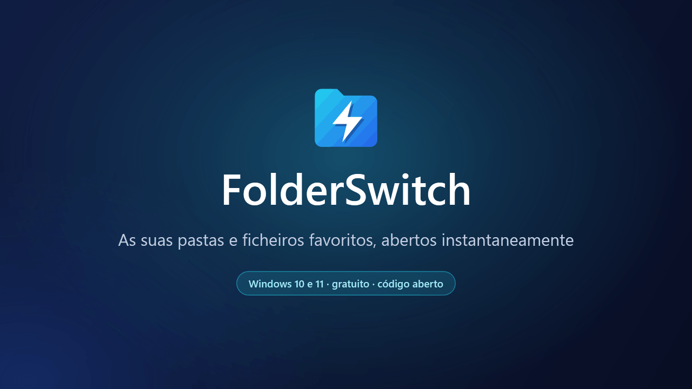
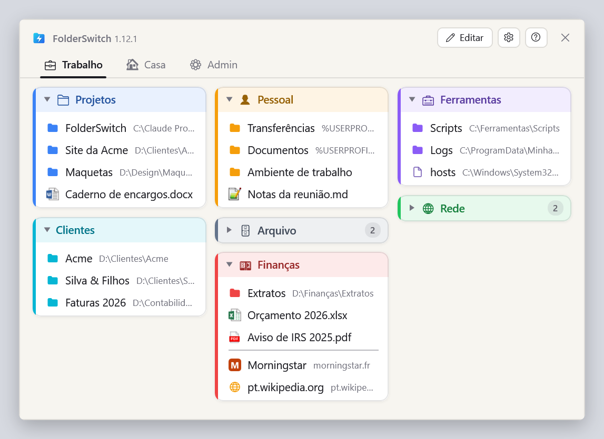
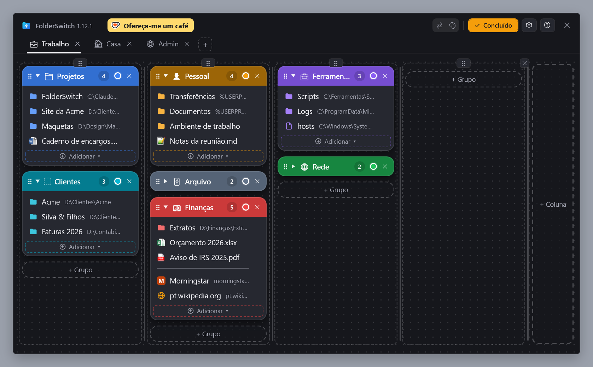
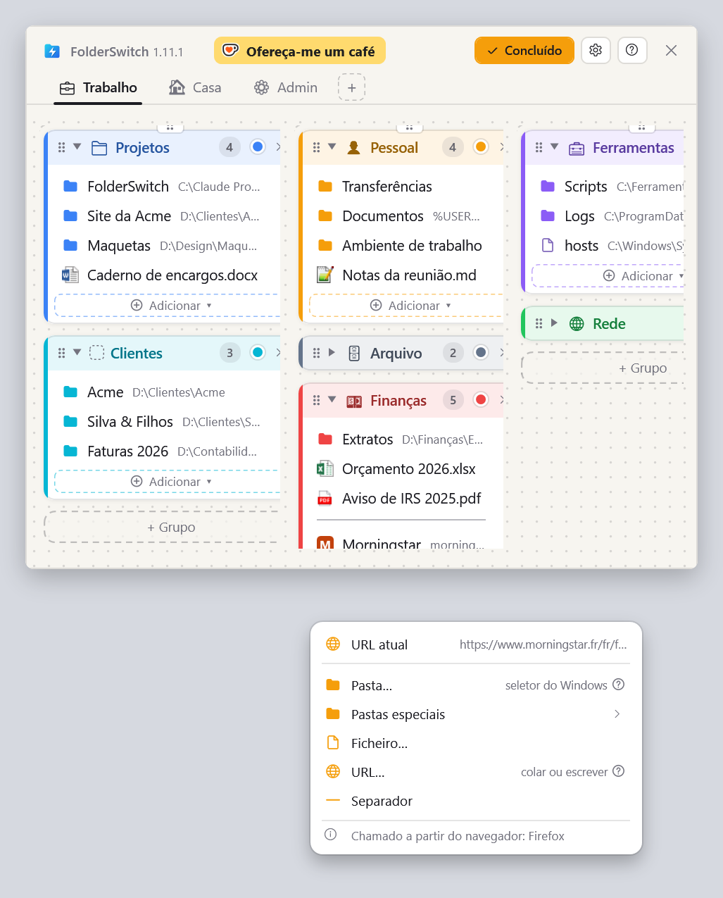
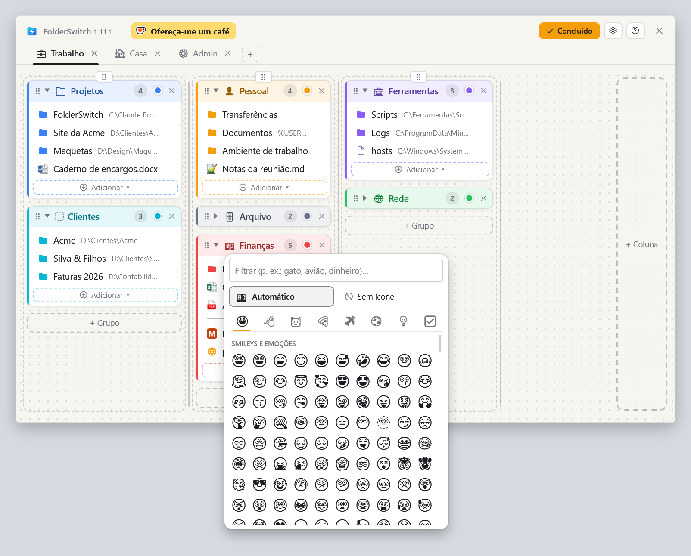
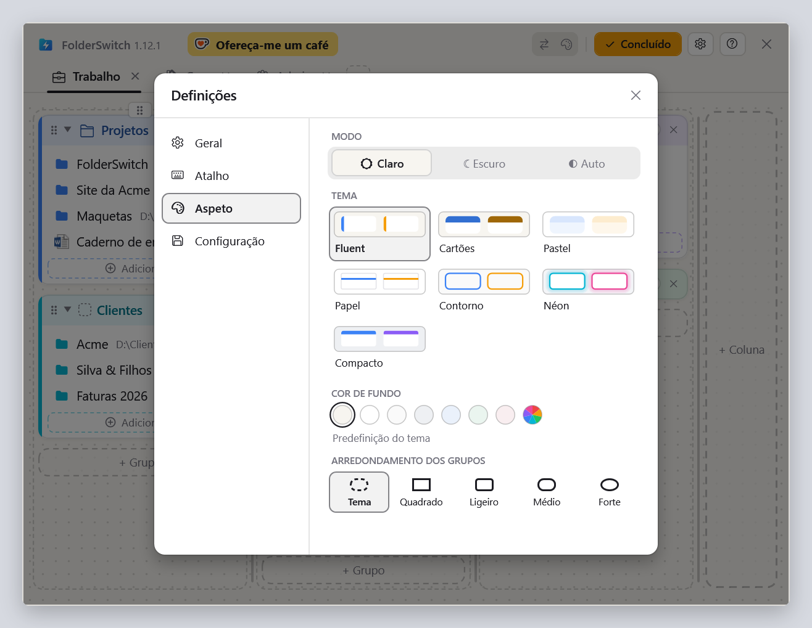

  <a href="README.md">English</a> ·
  <a href="README.fr.md">Français</a> ·
  <a href="README.de.md">Deutsch</a> ·
  <a href="README.es.md">Español</a> ·
  <a href="README.it.md">Italiano</a> ·
  <a href="README.nl.md">Nederlands</a> ·
  <a href="README.pl.md">Polski</a> ·
  <a href="README.pt-BR.md">Português (Brasil)</a> ·
  <b>Português (Portugal)</b>

<h1 align="center">FolderSwitch</h1>

<b>As suas pastas e ficheiros favoritos, abertos instantaneamente.</b>

  
  
  

  <a href="https://github.com/kbuleon/FolderSwitch/releases/latest/download/FolderSwitch-win-Setup.exe"><b>⬇ Transferir o FolderSwitch para Windows</b></a>
  &nbsp;·&nbsp;
  <a href="https://github.com/kbuleon/FolderSwitch/releases">Todas as versões e respetivas notas</a>

## O que é o FolderSwitch?

O FolderSwitch é um pequeno utilitário para Windows que mantém as suas pastas, ficheiros e sites favoritos a um atalho
de distância. Prima **Ctrl + Win** e o seu painel aparece: separadores, colunas e grupos coloridos, organizados como
mais lhe agradar.

Um clique numa pasta leva diretamente até ela a janela do Explorador de Ficheiros, ou a caixa de diálogo
Abrir / Guardar como, a partir da qual chamou o FolderSwitch. Chamado de qualquer outro sítio, uma pasta abre numa nova
janela do Explorador, um ficheiro na respetiva aplicação e um site no seu navegador.

É gratuito, de código aberto e não recolhe nada sobre si.

## Capturas de ecrã

O seu painel, tal como o atalho o mostra:

O modo Editar, em que separadores, colunas, grupos e itens são adicionados, renomeados, recoloridos e movidos com
arrastar e largar (aqui com o tema Cartões, escuro):

O menu “Adicionar ▾” de um grupo, chamado a partir do Firefox: a página que o navegador está a mostrar vem primeiro.
Chamado a partir do Explorador de Ficheiros, é a pasta atual:

O seletor de ícones: um emoji sugerido a partir do nome do grupo, ou o que escolher:

As definições, com sete temas em claro e escuro:

## Funcionalidades

- **Um só atalho, em qualquer lado.** Ctrl + Win por predefinição, ou qualquer combinação que escolher. A janela abre no
  ecrã onde está o rato, e o mesmo atalho esconde-a.
- **Sabe a partir de onde o chama.** O Explorador de Ficheiros (o separador atual, no Windows 11) e as caixas de diálogo
  Abrir, Guardar como e de seleção de pasta vão diretamente para a pasta em que clica. Ctrl + clique abre-a antes num
  novo separador do Explorador (numa nova janela no Windows 10).
- **Um painel que organiza com arrastar e largar.** Separadores, colunas, grupos coloridos que se podem recolher e,
  dentro deles, pastas, ficheiros, sites, pastas especiais do Windows (Ambiente de trabalho, Documentos, Este PC…) e
  linhas de separação. As colunas mantêm a largura que lhes der: no modo Editar, um clique dá-lhes a todas a mesma
  largura, outro dá a cada uma a sua cor. Cada alteração é guardada de imediato.
- **Adicione coisas onde estiver.** No Explorador de Ficheiros ou numa caixa de diálogo de ficheiros, “Pasta atual”
  adiciona a pasta em que se encontra, com um clique, e o seletor de ficheiros abre nela; no Explorador de Ficheiros,
  “Ficheiro selecionado” adiciona o ficheiro selecionado. No Firefox, no Chrome ou no Edge, “URL atual” adiciona a
  página que está a ler.
- **Ícones que falam por si.** Os separadores e os grupos recebem um emoji a partir do nome (“Finanças” recebe uma nota
  de banco, “Fotos” uma câmara), ou o que escolher. Os ficheiros mostram o respetivo ícone do Windows, e os sites o seu.
- **Sete temas**, cada um em claro e escuro, ou a acompanhar o Windows.
- **Nove idiomas**: inglês, francês, alemão, espanhol, italiano, neerlandês, polaco e português do Brasil e de Portugal.
- **A sua configuração está segura**: com cópia de segurança automática, exportada ou importada com um clique.
- **Atualiza-se sozinho**: o FolderSwitch verifica uma vez por dia se há uma nova versão e propõe instalá-la. Isto pode
  ser desativado nas definições.

## Instalação

1. Transfira o [FolderSwitch-win-Setup.exe](https://github.com/kbuleon/FolderSwitch/releases/latest/download/FolderSwitch-win-Setup.exe).
2. Execute-o. O FolderSwitch é instalado apenas para o seu utilizador, sem direitos de administrador, e arranca.
3. Um breve assistente pergunta o seu idioma, o seu atalho e o seu tema, e se o FolderSwitch deve arrancar com o
   Windows.

O FolderSwitch funciona no Windows 10 e 11 (64 bits). O instalador não está assinado, pelo que o Windows pode avisar que
o editor é desconhecido: pode optar por executá-lo na mesma.

Para o desinstalar, use as definições de “Aplicações” do Windows. A sua configuração é mantida, caso volte.

## Privacidade

O FolderSwitch não recolhe nada e não envia nada sobre si: sem telemetria, sem análises, sem identificador. Liga-se à
internet apenas para duas coisas: verificar no GitHub se há uma nova versão (a menos que o desative) e obter o ícone de
um site que adicione ao seu painel. Nada do seu painel é alguma vez enviado. Os detalhes estão em
[DEVELOPMENT.md](DEVELOPMENT.md#privacy) (em inglês, tal como os outros documentos técnicos referidos mais abaixo).

## Bom saber

- O atalho não faz nada enquanto uma janela executada como administrador estiver à frente: o Windows não o permite.
- O Explorador de Ficheiros é o único gestor de ficheiros que o FolderSwitch controla.
- A lista completa dos limites conhecidos está em [DEVELOPMENT.md](DEVELOPMENT.md#known-limits).

## Apoie o FolderSwitch

O FolderSwitch é um projeto pessoal, feito no tempo livre do autor. Se lhe poupa tempo, pode oferecer-lhe um café:

Relatos de erros e sugestões são bem-vindos nas [issues](https://github.com/kbuleon/FolderSwitch/issues); consulte
[CONTRIBUTING.md](CONTRIBUTING.md). As vulnerabilidades de segurança são comunicadas em privado: consulte
[SECURITY.md](SECURITY.md).

## Para programadores

Como compilar o FolderSwitch a partir do código-fonte, empacotá-lo, publicá-lo e testá-lo está em
[DEVELOPMENT.md](DEVELOPMENT.md). A conceção está em [ARCHITECTURE.md](ARCHITECTURE.md), o mapa do código em
[CODEMAP.md](CODEMAP.md) e o histórico de alterações em [CHANGELOG.md](CHANGELOG.md).

## Licença

O FolderSwitch é Copyright (C) 2026 Karl BULEON.

É software livre, distribuído ao abrigo da Licença Pública Geral GNU (GPL) versão 3 ou, à sua escolha, qualquer versão
posterior (SPDX: `GPL-3.0-or-later`), sem qualquer garantia. O texto completo está em [LICENSE](LICENSE). Acrescem três
termos adicionais, ao abrigo da secção 7 da GPLv3:

1. um trabalho baseado no FolderSwitch deve manter a menção “Based on FolderSwitch by Karl BULEON”;
2. uma versão modificada não pode chamar-se “FolderSwitch” nem usar o respetivo ícone;
3. não é concedido nenhum direito de marca sobre o nome ou o ícone.

Os componentes de terceiros estão sujeitos às suas próprias licenças, compatíveis com a GPLv3; encontram-se listadas em
[THIRD-PARTY-NOTICES.txt](THIRD-PARTY-NOTICES.txt).

Apenas o texto em inglês é válido: consulte [README.md](README.md#license).
